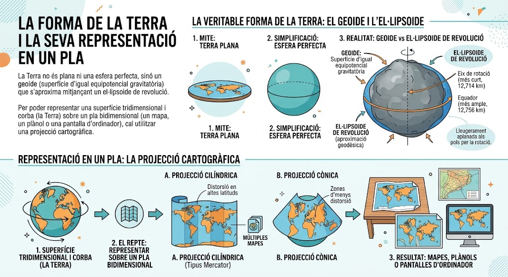

# Mòdul 1. Conceptes bàsics de cartografia i dades geogràfiques

## 1. Conceptes Generals sobre Projeccions Geogràfiques

**La Terra no és plana!!** Si algú us n'intenta convèncer aixequeu-vos i marxeu corrents sense ni dir adéu! Tampoc és una esfera perfecta. La Terra és un **geoide** irregular, lleig i deforme. Ens sap greu haver de ser noltros qui us obri els ulls a aquesta realitat.

I justament com que la terra no és plana ni tampoc és una esfera perfecta, els que fem mapes tenim molts maldecaps. Però molts. Mireu si no aquest vídeo, que ho explica molt bé.

<div class="iframe-wrap iframe-wrap--video">
  <iframe src="https://www.youtube-nocookie.com/embed/kIID5FDi2JQ"
          title="Vídeo: la forma de la Terra"
          loading="lazy"
          referrerpolicy="strict-origin-when-cross-origin"
          allow="accelerometer; clipboard-write; encrypted-media; gyroscope; picture-in-picture; web-share"
          allowfullscreen></iframe>
</div>

Com heu vist, el problema apareix quan volem representar aquesta superfície tridimensional i corba que és la Terra sobre un pla bidimensional (un mapa, un plànol o una pantalla d'ordinador). Idò bé, per mirar de resoldre el problema ens hem inventat el concepte de **sistemes geodèsics de referència**, que és una manera elegant de dir que fem totes les trampes que podem hora de representar la realitat en un mapa. 

*continuar amb geodesics/cartesians o plans.... i la relació Geodesics = esforoide de referència + punt fonamental, i cartesians= geodesic de referència + punt fonamental + projecció cartografica.... potser es pot posar enllac a video módul 12 de srs.*

<div id="mapa-espanya-wrap">
<link rel="stylesheet" href="https://unpkg.com/leaflet@1.9.4/dist/leaflet.css">
<style>
#mapa-espanya { height: 500px; width: 100%; }
#mapa-espanya .info { background: #fff; padding: 6px 10px; border-radius: 4px; font: 13px/1.4 system-ui, sans-serif; box-shadow: 0 1px 4px rgba(0,0,0,.3); }
#mapa-espanya .info button { margin-top: 4px; cursor: pointer; }
#mapa-espanya .espanya { cursor: grab; }
#mapa-espanya .logo-ide { background: rgba(255,255,255,.85); border-radius: 50%; padding: 3px; box-shadow: 0 1px 4px rgba(0,0,0,.3); line-height: 0; }
#mapa-espanya .logo-ide img { width: 64px; height: 64px; display: block; }
</style>
<div id="mapa-espanya"></div>
<script src="https://unpkg.com/leaflet@1.9.4/dist/leaflet.js"></script>
<script>
(function () {
const SPAIN = [
  [43.79,-7.69],[43.55,-6.60],[43.66,-5.85],[43.47,-4.90],[43.47,-3.80],
  [43.40,-3.00],[43.34,-2.30],[43.38,-1.79],[43.28,-1.45],[43.03,-1.32],
  [42.97,-0.75],[42.79,-0.53],[42.70,-0.05],[42.80,0.65],[42.85,0.70],
  [42.62,1.40],[42.48,1.45],[42.45,1.95],[42.35,2.45],[42.45,3.17],
  [42.32,3.32],[41.90,3.20],[41.65,2.80],[41.38,2.18],[41.10,1.25],
  [40.72,0.85],[40.36,0.40],[39.47,-0.32],[38.73,0.23],[38.34,-0.48],
  [37.63,-0.69],[37.55,-1.30],[36.83,-2.45],[36.72,-2.19],[36.74,-3.52],
  [36.72,-4.42],[36.50,-5.00],[36.11,-5.35],[36.00,-5.60],[36.53,-6.29],
  [36.95,-6.43],[37.21,-7.40],[37.55,-7.43],[38.02,-7.30],[38.45,-7.25],
  [38.88,-6.98],[39.20,-7.05],[39.66,-7.53],[40.20,-7.00],[40.85,-6.85],
  [41.15,-6.80],[41.50,-6.30],[41.80,-6.55],[41.95,-7.00],[42.05,-8.00],
  [41.88,-8.87],[42.25,-8.85],[42.88,-9.27],[43.25,-9.00],[43.37,-8.40],
  [43.50,-8.25]
];
const R = 6371008.8, RAD = Math.PI / 180, DEG = 180 / Math.PI;
const ORIGIN = L.latLng(40.2, -3.7);
function bearingDist(a, b) {
  const p1 = a.lat * RAD, p2 = b.lat * RAD, dl = (b.lng - a.lng) * RAD;
  const y = Math.sin(dl) * Math.cos(p2);
  const x = Math.cos(p1) * Math.sin(p2) - Math.sin(p1) * Math.cos(p2) * Math.cos(dl);
  const h = Math.sin((p2 - p1) / 2) * Math.sin((p2 - p1) / 2) + Math.cos(p1) * Math.cos(p2) * Math.sin(dl / 2) * Math.sin(dl / 2);
  return { brng: Math.atan2(y, x), d: 2 * R * Math.asin(Math.sqrt(h)) };
}
function destination(a, brng, d) {
  const dd = d / R, p1 = a.lat * RAD, l1 = a.lng * RAD;
  const p2 = Math.asin(Math.sin(p1) * Math.cos(dd) + Math.cos(p1) * Math.sin(dd) * Math.cos(brng));
  const l2 = l1 + Math.atan2(Math.sin(brng) * Math.sin(dd) * Math.cos(p1), Math.cos(dd) - Math.sin(p1) * Math.sin(p2));
  return L.latLng(p2 * DEG, ((l2 * DEG + 540) % 360) - 180);
}
const rel = SPAIN.map(function (p) { return bearingDist(ORIGIN, L.latLng(p[0], p[1])); });
const shape = function (c) { return rel.map(function (r) { return destination(c, r.brng, r.d); }); };
const map = L.map('mapa-espanya', { zoomControl: false }).setView([45, -3.7], 4);
// Logo IDE Menorca (cantonada superior esquerra, abans del control de zoom)
const logo = L.control({ position: 'topleft' });
logo.onAdd = function () {
  const div = L.DomUtil.create('div', 'logo-ide');
  div.innerHTML = '<img src="" alt="IDE Menorca" title="IDE Menorca">';
  L.DomEvent.disableClickPropagation(div);
  return div;
};
logo.addTo(map);
L.control.zoom({ position: 'topleft' }).addTo(map);
// Mapa base: OpenStreetMap (cal que el navegador enviï el Referer: referrerPolicy 'origin')
const osm = L.tileLayer('https://tile.openstreetmap.org/{z}/{x}/{y}.png', {
  maxZoom: 19,
  referrerPolicy: 'origin',
  attribution: '&copy; <a href="https://www.openstreetmap.org/copyright">OpenStreetMap</a> contributors'
}).addTo(map);
// Només s'usa si OSM bloqueja la pàgina (dades també d'OpenStreetMap)
const cartoFallback = L.tileLayer('https://{s}.basemaps.cartocdn.com/rastertiles/voyager/{z}/{x}/{y}{r}.png', {
  subdomains: 'abcd', maxZoom: 19,
  attribution: '&copy; <a href="https://www.openstreetmap.org/copyright">OpenStreetMap</a> contributors &copy; <a href="https://carto.com/attributions">CARTO</a>'
});
let osmBlocked = false;
function comprovaOSM() {
  fetch('https://tile.openstreetmap.org/0/0/0.png', { referrerPolicy: 'origin' })
    .then(function (r) { if (!r.ok) throw new Error('HTTP ' + r.status); })
    .catch(function (err) {
      console.warn('OpenStreetMap bloqueja o no respon:', err);
      osmBlocked = true;
      map.removeLayer(osm);
      cartoFallback.addTo(map);
      cartoFallback.bringToBack();
      info.update();
    });
}
L.polygon(shape(ORIGIN), { color: '#555', weight: 1, dashArray: '4 4', fill: false, interactive: false }).addTo(map);
let center = ORIGIN, grab = null;
const poly = L.polygon(shape(center), { color: '#c0392b', weight: 2, fillColor: '#e74c3c', fillOpacity: 0.45, className: 'espanya' }).addTo(map);
const handle = L.marker(center, { draggable: true, title: 'Arrossega per moure' }).addTo(map);
const info = L.control({ position: 'topright' });
info.onAdd = function () {
  this._div = L.DomUtil.create('div', 'info');
  L.DomEvent.disableClickPropagation(this._div);
  this.update();
  return this._div;
};
info.update = function () {
  const k = 1 / Math.cos(center.lat * RAD);
  this._div.innerHTML = '<b>Arrossega Espanya pel mapa</b><br>Latitud del centre: ' + center.lat.toFixed(1) + '°<br>Escala lineal aparent: ×' + k.toFixed(2) + '<br>Àrea aparent: ×' + (k * k).toFixed(2) + (osmBlocked ? '<br><small>OSM bloqueja aquesta pàgina (falta el Referer): es fa servir CARTO.</small>' : '') + '<br><button id="reset-espanya">Tornar a l\'origen</button>';
  const b = this._div.querySelector('#reset-espanya');
  if (b) b.onclick = function () { move(ORIGIN); handle.setLatLng(center); };
};
info.addTo(map);
function move(c) {
  center = L.latLng(Math.max(-75, Math.min(80, c.lat)), c.lng);
  poly.setLatLngs(shape(center));
  info.update();
}
poly.on('mousedown', function (e) {
  grab = { dlat: center.lat - e.latlng.lat, dlng: center.lng - e.latlng.lng };
  map.dragging.disable();
  L.DomEvent.preventDefault(e.originalEvent);
});
map.on('mousemove', function (e) {
  if (!grab) return;
  move(L.latLng(e.latlng.lat + grab.dlat, e.latlng.lng + grab.dlng));
  handle.setLatLng(center);
});
document.addEventListener('mouseup', function () {
  if (grab) { grab = null; map.dragging.enable(); }
});
handle.on('drag', function (e) { move(e.target.getLatLng()); });
comprovaOSM();
})();
</script>
</div>

De projeccions cartogràfiques n'hi ha un munt, tants com trampes diferents som capaços d'imaginar. I ja sabeu que si en alguna cosa destaca l'homo sapiens és en imaginar maneres de fer trampes. 

<figure markdown>
  { .captura }
  <figcaption>De la forma real de la Terra a la seva representació sobre un pla. 
  Imatge creada amb intel·ligència artificial (Gemini)</figcaption>
</figure>

### 1.1. El problema de la distorsió
Qualsevol projecció implica necessàriament una deformació o distorsió d'alguna de les propietats geomètriques. Cap mapa pot conservar simultàniament totes les propietats:

*   **Projeccions Conformes:** Mantenen la fidelitat dels **angles** i les formes de petites regions. Són les utilitzades en navegació i en la cartografia oficial.
*   **Projeccions Equivalents:** Mantenen les **superfícies** o àrees de forma proporcional, però deformen els angles i les formes.
*   **Projeccions Equidistants:** Mantenen les **distàncies** al llarg de determinades línies o des d'un punt central.

### 1.2. Sistemes de Referència Espacial (CRS) i Datums
Per situar un punt a la Terra necessitem un **Sistema de Referència Espacial** (*Spatial Reference System* - SRS/CRS):
*   **Coordenades Geogràfiques:** Expressades en graus de **latitud** (φ) i **longitud** (λ).
*   **Coordenades Projectades / Cartesianes:** Expressades en metres sobre un pla (X, Y, o *easting* i *northing*).
*   **Datum:** Paràmetre de referència que defineix la posició de l'el·lipsoide respecte al centre de la Terra. Canviar de datum implica un canvi significatiu en les coordenades d'un mateix punt.

---

## 2. Projeccions Geogràfiques Oficials a Espanya i Menorca

A l'estat espanyol i en l'àmbit de la Comunitat Autònoma de les Illes Balears, la normativa vigent (*Real Decreto 1071/2007*) estableix el sistema de referència geodèsic oficial.

### 2.1. El Sistema ETRS89
*   **Sistema de Referència Oficial:** **ETRS89** (*European Terrestrial Reference System 1989*).
*   **El·lipsoide de referència:** **GRS80**.
*   *Nota històrica:* Abans de la normativa de 2007 s'utilitzava el datum **ED50** (*European Datum 1950*). Aquest canvi va suposar un desplaçament d'uns **200 metres cap al sud-oest** en les coordenades de les Illes Balears. Qualsevol cartografia antiga en ED50 ha de ser reprojectada a ETRS89 abans de ser incorporada a un SIG municipal.

### 2.2. La Projecció UTM (Universal Transverse Mercator)
La projecció oficial per a cartografia terrestre a Espanya és la **UTM**:
*   És una projecció **cilíndrica, transversal i conforme**.
*   Divideix la Terra en **60 husos** (zones de 6° de longitud cadascun).
*   **L'arxipèlag balear (inclosa Menorca) es troba íntegrament al fus 31 nord (31N).**

### 2.3. Codificació EPSG Oficial per a Menorca
En els programes de SIG (QGIS, ArcGIS, visualitzadors web), els sistemes de referència s'identifiquen mitjançant codis del **EPSG** (*European Petroleum Survey Group*):

| Nom del Sistema / Projecció | Codi EPSG | Ús / Àmbit |
| :--- | :--- | :--- |
| **ETRS89 / UTM zone 31N** | **EPSG:25831** | **Oficial per a treball i cartografia vectorial/Ràster a Menorca** |
| WGS 84 (Geogràfiques - graus) | EPSG:4326 | Ús global, GPS de camp, estàndards web |
| WGS 84 / Pseudo-Mercator | EPSG:3857 | Capes base web (Google Maps, OpenStreetMap, Carto) |
| ED50 / UTM zone 31N | EPSG:23031 | **OBSOLET.** Només per a cartografia històrica anterior a 2007 |

> **Atenció per a tècnics locals:** En carregar dades cartogràfiques als visors municipals o QGIS, comproveu sempre que la capa estigui definida en **EPSG:25831**. Barrejar EPSG:23031 (ED50) amb EPSG:25831 (ETRS89) provocarà que els edificis o parcel·les apareguin "desplaçats" uns 200 metres a la mar o sobre la finca del veí.

---

## 3. Cartografia Bàsica vs. Cartografia Temàtica

A l'administració local treballem contínuament amb dos grans tipus de informació cartogràfica:

### 3.1. Cartografia Bàsica
La cartografia bàsica és aquella que s'obté mitjançant processos directes d'observació i mesurament de la superfície terrestre (topografia, fotogrametria). Serveix de suport fonamental per a qualsevol altra representació territorial.

*   **Característiques:**
    *   Proporciona la referència geomètrica i espacial del territori.
    *   Inclou elements naturals i artificials permanents: relleu (corbes de nivell), xarxa hidrogràfica, edificacions, xarxa viària, límits administratius.
    *   És d'interès general i serveix de base per a totes les administracions.
*   **Exemples a Menorca:**
    *   **BTN100 / BTN25:** Base Topogràfica Nacional (IGN).
    *   **Mapa Topogràfic de Menorca** (1:1.000 / 1:5.000) elaborat pel Consell Insular de Menorca.
    *   **Cartografia cadastral urbana i rústica** (Direcció General del Cadastre).

### 3.2. Cartografia Temàtica
La cartografia temàtica utilitza la cartografia bàsica com a fons de referència per a representar fenòmens, dades o conceptes específics d'un tema concret (social, econòmic, mediambiental, jurídic).

*   **Característiques:**
    *   Centrada en un aspecte o variable particular.
    *   Combina informació geogràfica amb atributs alfanumèrics.
    *   Fundamental per a la presa de decisions polítiques i tècniques.
*   **Exemples a Menorca:**
    *   **Plànol de Qualificació Urbanística del PGOU** d'un ajuntament (Maó, Ciutadella, Alaior, etc.).
    *   **Mapa d'Espais Naturals Protegits (ANLE/PRUG de s'Albufera des Grau)**.
    *   **Mapa del Camí de Cavalls (GR-223)** amb punts d'interès turístic i d'emergència.
    *   **Mapes de Risc d'Inundabilitat** (INUNCAT / ARPSI en barrancs com el de Algendar).
    *   **Mapa de Coberta Vegetal i Usos del Sol** de Menorca.

---

## 4. Ortofotografies i el Procés de Creació (Vol Fotogramètric)

### 4.1. Què és una Ortofoto?
Una **ortofoto** (o ortofotografia) és una imatge aèria rectificada mètricament. 

A diferència d'una fotografia aèria convencional (on existeixen deformacions causades per la perspectiva de la càmera i les diferències d'elevació del terreny), en una ortofoto **tots els punts tenen la mateixa escala** i la mateixa validesa mètrica que un mapa topogràfic.

!!! abstract "En una frase"
    **Ortofoto = fotografia aèria + ortorectificació**, és a dir, eliminar-hi
    la deformació de la perspectiva i l'efecte del relleu.

*   En una ortofoto es poden **mesurar distàncies, àrees i angles directament** sobre la imatge amb total precisió.

### 4.2. Com es crea una Ortofoto? El procés fotogramètric pas a pas

La creació d'una ortofoto d'alta resolució (per exemple, les ortofotos del projecte **PNOA** o les pròpies del Consell Insular) segueix les següents fases:

```
[1. Planejament del Vol] ──> [2. Execució del Vol i Captura] ──> [3. Punts de Control Terrestre (GCP)]
                                                                               │
[6. Generació Ortofoto Final] <── [5. Ortorectificació i Mosaicat] <── [4. Aerotriangulació i MDE]
```

1.  **Planificació i Execució del Vol Fotogramètric:**
    *   Un avió o drons equipat amb una càmera fotogramètrica mètrica realitza passades paral·leles sobre el territori.
    *   Es garanteix un **recobriment (encavalcament)** entre fotos: normalment un **60-80% de recobriment longitudinal** (al llarg de la línia de vol) i un **30-50% transversal** (entre línies paral·leles). Això permet la visió estereoscòpica (3D).
2.  **Mesura de Punts de Control Terrestre (GCP - Ground Control Points):**
    *   Equips de topògrafs mesuren amb GPS/GNSS de alta precisió punts clarament identificables a terra (creus pintades, cantonades de murs de pedra seca, fites).
    *   Aquests punts serveixen per a ancorar les imatges a les coordenades reals en el sistema **ETRS89 UTM 31N**.
3.  **Aerotriangulació i Ajust de Bloc:**
    *   Mitjançant càlculs matemàtics, es determinen exactament la posició (X, Y, Z) i l'orientació de la càmera en el moment de cada dispar.
4.  **Generació del Model Digital de l'Elevació (MDE / MDT):**
    *   A partir del parell d'imatges estereoscòpiques (o mitjançant sensors LiDAR aerotransportats), es genera un model 3D del terreny (MDT) que recull les altituds i pendents del territori.
5.  **Ortorectificació:**
    *   Aquest és el pas clau. S'aplica el MDT a cada píxel de la fotografia original per eliminar el desplaçament provocat pel relleu i la inclinació de l'objectiu. El píxel es projecta ortogonalment sobre el pla cartogràfic.
6.  **Mosaicat i Anivellament de Color:**
    *   Es combinen centenars o milers d'ortofotos individuals per formar un mosaic continu de tota la illa de Menorca, ajustant la lluminositat i el balanç de colors per evitar línies de tall visibles.

---

## 5. Exemples d'Aplicació Pràctica a Menorca

Per a un funcionari local de Menorca, la combinació d'aquests conceptes s'aplica diàriament en la gestió pública:

### Exemple 1: Verificació d'Infrafraccions Urbanístiques o Edificació en Sòl Rústic
*   **Eina:** Visualizador de la **IDE Menorca** (SITIBSA / Consell Insular).
*   **Procediment:** Es compara l'ortofoto PNOA actual amb ortofotos històriques (p. ex. vol de 1956, ortofoto de 2002, 2010, 2022).
*   **Aplicació:** Permet comprovar si un paret de pedra, una piscina o una ampliació d'un habitatge rural a **Alaior** o **Sant Lluís** es va construir abans o després de l'entrada en vigor de la Llei d'Espais Naturals (LEN) o del PGOU municipal.

### Exemple 2: Delimitació d'un camí públic (Camí de Cavalls / Camins Municipals)
*   **Capes utilitzades:** 
    *   *Cartografia Bàsica:* Linia de camins del Mapa Topogràfic de Menorca.
    *   *Cartografia Temàtica:* Llista de camins del Catàleg Municipal de Camins + Capa del Cadastre (parcel·lari).
    *   *Ortofoto:* Ortofoto recent de 10 cm/píxel.
*   **Projecció:** Totes les capes carregades en **EPSG:25831**. Permet mesurar l'amplada real de la traça del camí i detectar invasions de la propietat privada sobre el camí públic.

---

## 6. Exercicis Pràctics i de Consolidació de Coneixements

A continuació es presenten 4 exercicis pràctics pensats per als tècnics i administratius locals. Podeu intentar resoldre'ls i comprovar les solucions a la secció posterior.

---

### Qüestionari d'Exercicis

#### Exercici 1: Gestió de Projeccions en un projecte municipal
Un topògraf entrega a l'Ajuntament de Ciutadella un arxiu CAD (`.dwg`) amb el projecte de reforma d'una plaça urbana. Quan el tècnic municipal carrega el fitxer sobre el visor geogràfic de l'IDE Menorca (que treballa en ETRS89 UTM 31N), la plaça apareix desplaçada uns 200 metres endins del mar.
1.  Quin és el motiu més probable d'aquest desplaçament?
2.  Quin codi EPSG té l'arxiu original del topògraf i quin codi EPSG hauria de tenir?

#### Exercici 2: Distingir Cartografia Bàsica i Temàtica
Classifica els següents productes cartogràfics utilitzats a l'Ajuntament de Maó en **Cartografia Bàsica (CB)** o **Cartografia Temàtica (CT)**:
1.  Full 1:5.000 del Mapa Topogràfic de les Illes Balears amb corbes de nivell cada 5 metres.
2.  Plànol del PGOU que mostra la classificació del sòl (Sòl Urbà, Sòl Abalorable, Sòl Rústic Protegit).
3.  Capa vectorial de punts de contenidors de recollida selectiva i les seves rutes de recollida.
4.  Capa d'edificacions i línies d'illa de cases del Cadastre.
5.  Mapa de zones d'alta vulnerabilitat d'aqüífers a Menorca per contaminació de nitrats.

#### Exercici 3: Mesurament en Ortofoto vs. Fotografia Aèria
L'àrea de Medi Ambient vol calcular la superfície d'una bassa d'aigua situada al fons d'un barranc profund (com el Barranc de Algendar). 
1.  Per què NO és correcte mesurar la superfície directament sobre una fotografia aèria obliqua o no rectificada?
2.  Quina propietat té l'ortofoto que sí que permet mesurar aquesta superfície amb garanties jurídiques i tècniques?

#### Exercici 4: Elecció de Sistema de Coordenades
Reps un correu d'un ciutadà que vol informar de la caiguda d'un arbre al Camí de Cavalls. Et dona les següents coordenades obtingudes amb el seu telèfon mòbil: `39.8872º N, 4.2541º E`.
1.  Quin tipus de coordenades són i en quin codi EPSG solen estar basades les dades de GPS mòbil?
2.  Què hauries de fer per poder dibuixar aquest punt de manera exacta sobre el SIG municipal en ETRS89 UTM 31N?

---

## 7. Solucions i Respostes als Exercicis

### Solució a l'Exercici 1
1.  **Motiu del desplaçament:** L'arxiu entregat pel topògraf utilitza el sistema antic de referència **ED50** (*European Datum 1950*). A les Illes Balears, la diferència entre el sistema antic ED50 i l'oficial actual ETRS89 és d'aproximadament **200 metres en direcció Sud-Oest / Nord-Est**.
2.  **Codis EPSG:** L'arxiu del topògraf està en **EPSG:23031** (ED50 / UTM zone 31N). Per solucionar-ho, el tècnic ha de reprojectar o transformar l'arxiu al sistema oficial **EPSG:25831** (ETRS89 / UTM zone 31N).

### Solució a l'Exercici 2
1.  Mapa Topogràfic 1:5.000: **Cartografia Bàsica (CB)**. (Descriu la geometria i el relleu real del terreny).
2.  Plànol de classificació de sòl del PGOU: **Cartografia Temàtica (CT)**. (Representa un fenomen jurídic/administratiu sobre la base territorials).
3.  Capa de contenidors de residus: **Cartografia Temàtica (CT)**. (Informació sectorial de serveis municipals).
4.  Capa d'edificacions i línies de Cadastre: **Cartografia Bàsica (CB)**. (Serveix de base mètrica de la parcel·la i l'edificació).
5.  Mapa de vulnerabilitat d'aqüífers: **Cartografia Temàtica (CT)**. (Anàlisi mediambiental temàtic).

### Solució a l'Exercici 3
1.  **Fotografia aèria no rectificada:** Té efectes de perspectiva i distorsió provocats per l'orografia del barranc (les zones més altes semblen més grans i les zones fondes queden comprimides o desplaçades per la inclinació dels raigs visuals respecte del centre de la lent). La mesura d'àrees sobre aquesta imatge donaria un error significatiu.
2.  **Propietat de l'Ortofoto:** L'ortofoto ha passat per un procés d'**ortorectificació** utilitzant un Model Digital del Terreny (MDT). S'han corregit totes les distorsions de perspectiva i relleu, transformant la projecció central en una **projecció ortogonal**. Per tant, té una escala uniforme a tota la imatge i permet mesurar distàncies i superfícies directament amb la mateixa precisió que un mapa topogràfic.

### Solució a l'Exercici 4
1.  **Tipus de coordenades:** Són **coordenades geogràfiques** (Latitud i Longitud) expressades en graus decimals. El estàndard de la majoria de receptors GPS de dispositius mòbils i aplicacions web és el datum **WGS84** (**EPSG:4326**).
2.  **Acció en el SIG municipal:** Al programari SIG (ex. QGIS), s'ha de crear un punt introduint les coordenades X, Y en EPSG:4326 (Longitud `4.2541`, Latitud `39.8872`) i posteriorment sol·licitar al programa que el transformi/reprojecti al CRS del projecte municipal (**EPSG:25831 - ETRS89 UTM 31N**). Pràcticament tots els SIG moderns fan aquesta conversió al vol (*reprojection on-the-fly*).
