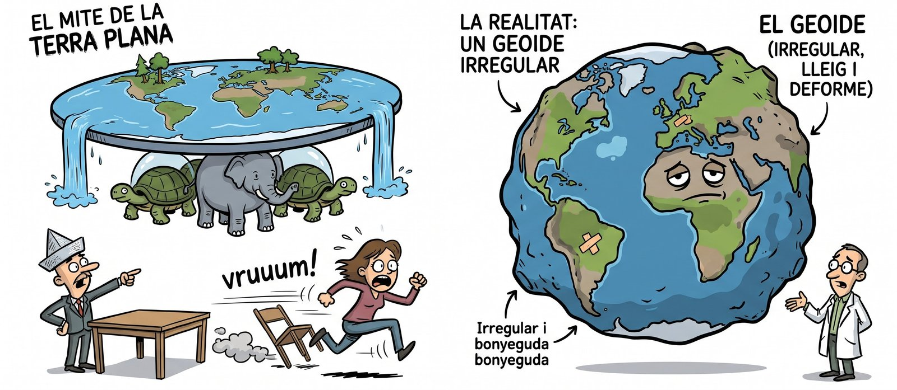

# 1.1. Conceptes generals

**La Terra no és plana!** Si algú t'ho intenta fer creure, aixeca't i marxa
corrents sense ni dir adéu. Tampoc no és una esfera perfecta: és un **geoide**
irregular, lleig i deforme. Ens sap greu haver de ser noltros qui t'obri els ulls
a aquesta realitat.

<figure markdown>
  { .captura }
  <figcaption>El mite, a l'esquerra. La realitat, a la dreta: irregular, lleig i deforme. Imatge creada amb intel·ligència artificial.</figcaption>
</figure>

I justament perquè la Terra no és plana ni tampoc una esfera perfecta, els qui
fem mapes tenim maldecaps. Però molts. Mira aquest vídeo, que ho explica molt bé.

  <iframe src="https://www.youtube-nocookie.com/embed/kIID5FDi2JQ"
          title="Vídeo: la forma de la Terra"
          loading="lazy"
          referrerpolicy="strict-origin-when-cross-origin"
          allow="accelerometer; clipboard-write; encrypted-media; gyroscope; picture-in-picture; web-share"
          allowfullscreen></iframe>

Com has vist, el problema apareix quan volem representar aquesta superfície
tridimensional i corba que és la Terra sobre un pla bidimensional: un mapa, un
plànol o una pantalla d'ordinador. Idò bé, per mirar de resoldre'l ens hem
inventat els **sistemes geodèsics de referència**.

A la secció següent explorarem de què va tot això, perquè és un dels conceptes
més importants a tenir clars sempre que hagis de treballar amb mapes.

## Exercici: qui va mesurar la Terra primer

- [ ] Esbrina en quin moment l'ésser humà ja tenia clar que la Terra era una
  esfera i es va fer el primer càlcul estimatiu de la seva mida.
- [ ] Cerca després una pàgina de terraplanistes i fes-hi una ullada.
- [ ] Intenta-hi detectar alguna incoherència.
