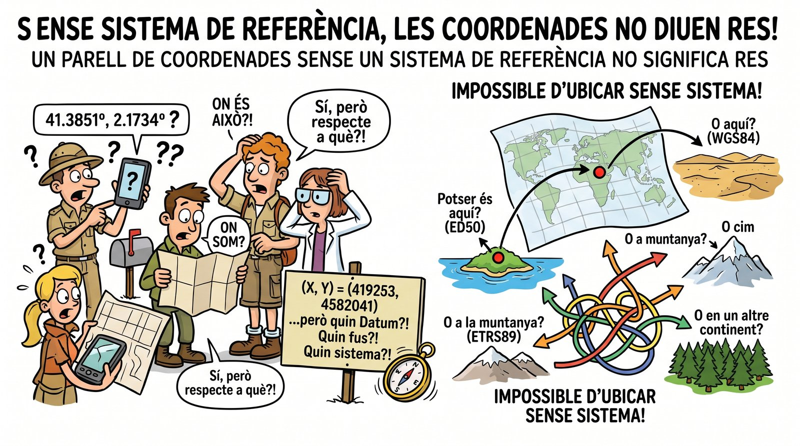

# 1.2. Un sistema de referència

Un sistema de referència és un sistema de coordenades en què es recolza qualsevol
cartografia que vulguis fer servir.

De sistemes de coordenades n'hi ha moltíssims, i per a cada un d'ells les
coordenades d'un mateix punt són diferents. Internacionalment se'ls anomena
**CRS** —*Coordinate Reference System*— o també **SRS** —*Spatial Reference
System*.

A la pràctica, el que has de tenir clar és que qualsevol parell de coordenades
que tinguis o que et donin ha de portar associat un sistema de coordenades
concret. Si no, no el podràs ubicar.

<figure markdown>
  { .captura }
  <figcaption>Les mateixes xifres poden caure a la mar, a la muntanya o a un altre continent. Imatge creada amb intel·ligència artificial.</figcaption>
</figure>

Posem un exemple. Si et truquen o t'envien per correu el parell de coordenades
**x: 593.302, y: 4.427.066** i no et diuen res més, no tens cap manera de saber a
quin punt del planeta corresponen. Sense el sistema de referència al qual estan
vinculades, no sabràs mai que són les coordenades del centre de l'univers
conegut, allà on es creu que va tenir lloc el big bang: la plaça de la
Constitució des Mercadal.

## Exercici: les coordenades de l'obelisc des Born

- [ ] Fes-ho com vulguis —Google Maps, cercant per internet, mirant un mapa— però
  esbrina les coordenades de l'obelisc des Born de Ciutadella.
- [ ] Intenta deduir què signifiquen els valors de les coordenades.

Per tant, quan treballes amb mapes és important saber què és exactament això dels
sistemes de referència i quins n'hi ha. A la secció següent hi entrem una mica en
detall.
