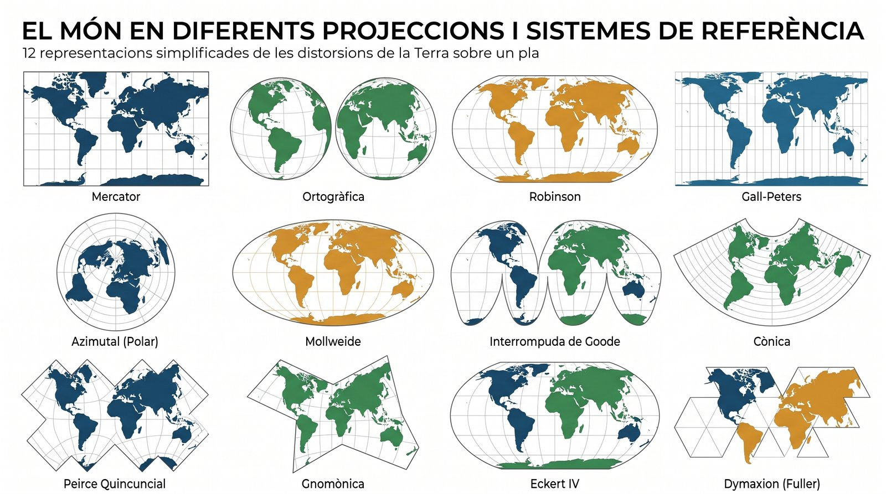
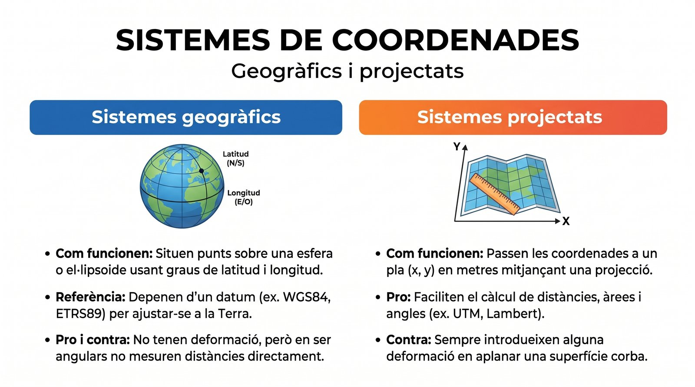
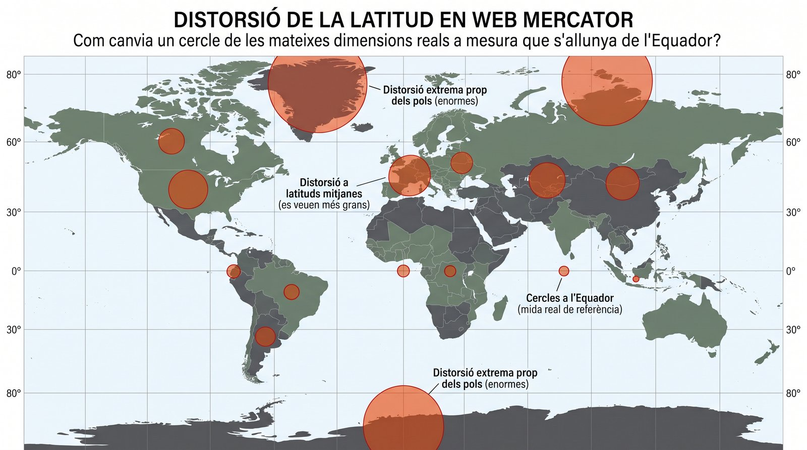

# 1.3. Quins sistemes de coordenades hi ha?

De sistemes de coordenades n'hi ha moltíssims. Segons quin sigui el propòsit que
tinguis i la zona del món on siguis, en faràs servir un o un altre.

<figure markdown>
  { .captura }
  <figcaption>Dotze maneres de dibuixar el mateix món. Cap no és la correcta.</figcaption>
</figure>

Per entendre-ho millor, mirem de classificar-los. La primera distinció que hem de
fer és entre els **sistemes geogràfics** i els **sistemes projectats**. Resumint:
els geogràfics defineixen les coordenades **en angles** des d'un punt de
referència; els projectats les defineixen per parells de coordenades amb
**unitats de distància** des d'un punt de referència.

<figure markdown>
  { .captura }
  <figcaption>Els geogràfics situen punts amb graus; els projectats els passen a un pla en metres.</figcaption>
</figure>

## Exercici: com creix Espanya si puja cap al nord

Aquesta és una eina que t'hem preparat per veure com canviaria la mida d'Espanya
si estigués a una altra latitud.

- [ ] Arrossega Espanya cap amunt i cap avall i mira com li canvia la mida.
- [ ] Fixa't en l'escala i l'àrea aparents que et diu el requadre de la dreta.
- [ ] Deixa-la a l'altura d'Escandinàvia i mira quantes vegades més grossa s'hi
  veu.
- [ ] Torna-la a l'origen amb el botó.

<link rel="stylesheet" href="https://unpkg.com/leaflet@1.9.4/dist/leaflet.css">

Això passa perquè la projecció **Web Mercator** és una projecció **conforme**: és
a dir, està dissenyada per conservar els angles i les formes locals, però a canvi
sacrifica la mida —l'àrea— a mesura que ens allunyem de l'equador. Més endavant
ho expliquem, ara no t'hi capfiquis.

??? info "Vols saber-ne més: com es produeix aquest efecte"
    És un efecte matemàtic i geomètric, i surt de tres coses:

    1. **L'estirament dels meridians.** A la Terra real, les línies de longitud
       s'ajunten a mesura que s'acosten als pols, fins que es toquen en un sol
       punt. En un mapa pla de Mercator, en canvi, es dibuixen com a línies
       rectes completament paral·leles. Això obliga a «estirar» horitzontalment
       els territoris propers als pols perquè ocupin tota l'amplada del mapa.

    2. **Compensació vertical per mantenir la forma.** Si només s'estirés el mapa
       horitzontalment, un cercle prop dels pols quedaria aixafat com un oval. Per
       evitar-ho i mantenir la propietat de ser conforme —que un cercle continuï
       sent un cercle i que els angles de navegació siguin exactes—, la projecció
       aplica exactament el mateix factor d'estirament en sentit vertical, i va
       separant cada vegada més els paral·lels de latitud.

    3. **El resultat.** Com que un cercle real s'estira tant d'ample com d'alt en
       la mateixa proporció —a raó d'1 / cos(latitud)—, conserva la forma rodona,
       però l'àrea es multiplica exponencialment:

        - A **0°**, a l'equador, el factor d'escala és 1: la mida real.
        - A **60°** de latitud, com Escandinàvia o el Canadà, l'escala es duplica,
          el doble d'ample i el doble d'alt, i el cercle ocupa **4 vegades més
          àrea** al mapa.
        - A **80°**, com Groenlàndia o l'Antàrtida, l'escala es multiplica gairebé
          per 6: el cercle sembla **més de 30 vegades més gran** del que és.
        - Als **90°**, als pols, la distorsió tendeix a l'infinit. Per això Web
          Mercator talla el mapa cap als 85° de latitud.

        <figure markdown>
          { .captura }
          <figcaption>Tots aquests cercles tenen la mateixa mida real.</figcaption>
        </figure>

    Aquesta és la raó per la qual a les aplicacions de mapes web Groenlàndia
    sembla tan grossa com tota l'Àfrica, quan en realitat l'Àfrica és unes 14
    vegades més gran.
