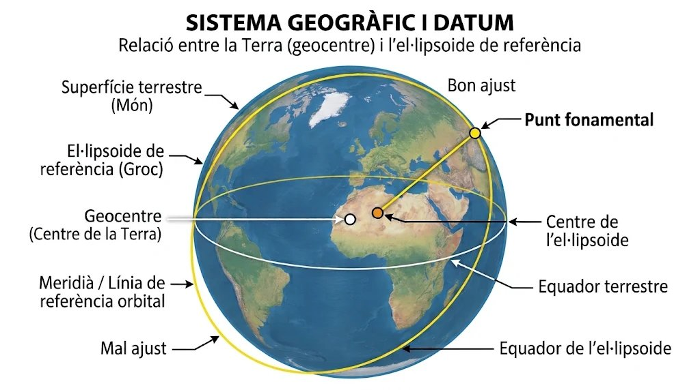

# 1.4. Els sistemes geogràfics

Aquests sistemes són molt fàcils d'entendre perquè es basen en tres conceptes
molt senzills:

1. Es defineix un **el·lipsoide** volumètric que vagi bé per al propòsit que
   tinguis.
2. Un cop definit, se situa en relació al geoide lleig terrestre: el centre de
   l'el·lipsoide i el **punt fonamental**.
3. I voilà! Les coordenades són angles respecte del meridià —les **longituds**— i
   de l'equador de referència —les **latituds**.

<figure markdown>
  { .captura }
  <figcaption>L'el·lipsoide s'ajusta bé allà on hi ha el punt fonamental, i pitjor a l'altra banda del món.</figcaption>
</figure>

Els sistemes geogràfics se solen fer servir per a la visualització i l'intercanvi
de dades globals, però tenen inconvenients que fan que no siguin gaire pràctics a
l'hora de treballar amb cartografia.

??? info "Vols saber-ne més: els inconvenients"
    El principal inconvenient és que **les unitats són angulars i no lineals**,
    de manera que no serveixen per mesurar directament sobre un pla.

    **Problemes pràctics**

    - **Els graus no equivalen a una distància constant.** 1° de latitud són uns
      111 km a tot arreu, però 1° de longitud val 111 km a l'equador, uns 85 km a
      40° N i 0 km als pols. No es pot aplicar el teorema de Pitàgores a les
      coordenades en graus.
    - **Calcular distàncies, àrees i angles és més complex.** Cal fer servir
      fórmules esfèriques o el·lipsoïdals —Haversine, Vincenty—, més costoses que
      la geometria plana dels sistemes projectats.
    - **No serveixen directament per fer un mapa pla.** Si dibuixes latitud i
      longitud com a x i y, el resultat queda deformat, sobretot a latituds
      altes.
    - **Singularitats.** La longitud té un salt a l'antimeridià, de +180° a
      −180°, i els pols són punts on la longitud no està definida. Això complica
      els càlculs i les consultes espacials: per exemple, un polígon que travessa
      els ±180°.

    **Altres inconvenients**

    - **Depenen del datum.** La mateixa coordenada en ED50, ETRS89 o WGS84 apunta
      a llocs diferents, amb diferències de desenes o centenars de metres si no es
      fa la transformació.
    - **Es poden escriure de moltes maneres** —DD, DMS, DDM— i amb ordres
      diferents —latitud-longitud o longitud-latitud—, cosa que provoca errors.
    - **Són poc intuïtives.** És més fàcil entendre «200 m» que «0,0018°».

    Per això, per treballar amb distàncies i àrees en una zona concreta se sol
    convertir a un sistema projectat, com ETRS89 / UTM 31N per a Menorca, i es
    deixen les coordenades geogràfiques per a l'emmagatzematge, l'intercanvi de
    dades i les visualitzacions globals.

## Exercici: el bar Latitud 40

- [ ] Elabora una hipòtesi de per què al port de Maó, davant el moll dels velers,
  hi ha un bar que es diu Latitud 40.
- [ ] Cerca a internet les coordenades geogràfiques de Maó.

## L'embolic de les coordenades geogràfiques

No, no és cap embolic. És molt senzill. Les coordenades geogràfiques són angles
i, de la mateixa manera que una distància te la poden donar en metres, decímetres
o quilòmetres, els angles te'ls poden donar en **graus decimals (DD)**, en
**graus i minuts decimals (DDM)** o en **graus, minuts i segons (DMS)**.

I entre ells hi ha una relació molt senzilla: un grau són 60 minuts, i un minut,
60 segons.

## Exercici: de graus decimals a graus, minuts i segons

- [ ] T'atreveixes a convertir unes coordenades de graus decimals a graus, minuts
  i segons, i a l'inrevés?
- [ ] Pots fer servir la calculadora o un full de càlcul.

!!! question "Necessites un cop de mà?"
    Si ho has intentat i no te'n surts, **no t'amoïnis**: hem preparat un full de càlcul perquè puguis veure com es fa i comprovar els teus resultats.

    [:material-table: Obre el full de càlcul per convertir coordenades](https://docs.google.com/document/d/109EhYMpNN3S0RPkYKT2_i7_jY2Vtx97f/edit?usp=sharing){ .md-button .md-button--primary target="_blank" } 

!!! tip "No t'espantis"
    Veuràs que és molt fàcil. I si hi vols donar més voltes, l'IGN té una
    [activitat sobre coordenades geogràfiques](https://educativo.ign.es/atlas-didactico/cartografia-eso/actividad_coordenadas_geogrficas.html)
    al seu atles didàctic.
