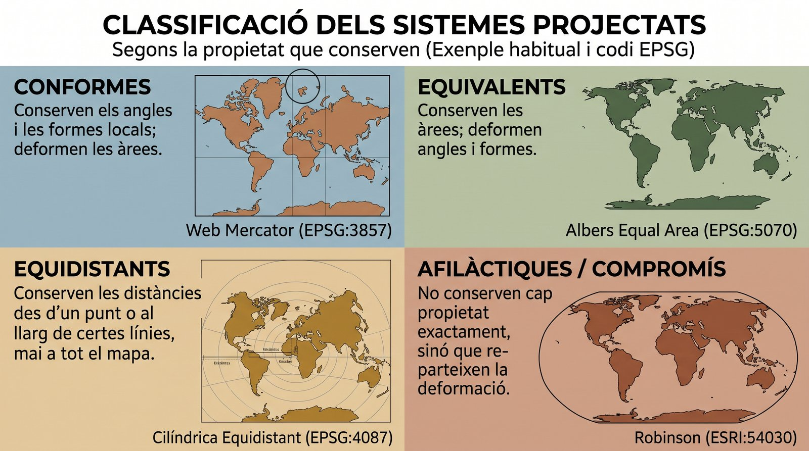
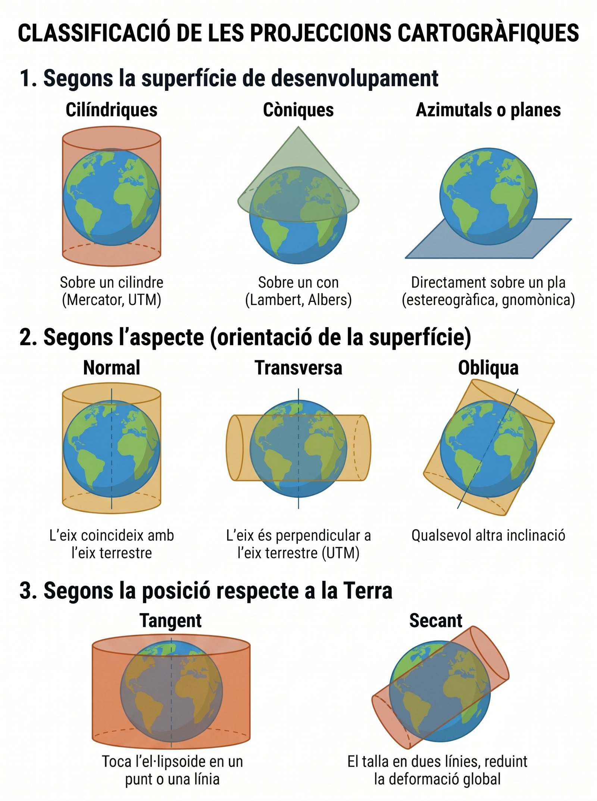

# 1.5. Els sistemes projectats

Per poder fer mapes en paper i facilitar-ne l'ús es van desenvolupar els sistemes
de coordenades projectades.

La idea és genial, i consisteix senzillament a **projectar** la superfície de la
Terra sobre un pla. Per fer-ho hi ha moltes maneres diferents i cadascuna dona un
resultat diferent. Com que transportar la realitat esfèrica i tridimensional a un
pla bidimensional és, literalment, impossible, sempre hi ha alguna cosa que es
deforma o s'espatlla. Te'n recordes, del vídeo del principi?

De fet, podríem dir que una de les maneres més habituals de **classificar els
sistemes projectats és justament en funció de la propietat que conserven**, que
és una altra manera de dir que els classifiquem segons allò que espatllen.

<figure markdown>
  { .captura }
  <figcaption>Cada família conserva una propietat i en sacrifica les altres.</figcaption>
</figure>

!!! info "D'on es compten els metres a Menorca"
    En els sistemes projectats, les coordenades expressen distàncies en metres
    respecte d'un origen definit per la projecció. En el cas d'**ETRS89 / UTM 31N
    (EPSG:25831)**, que és el sistema més habitual a Menorca, la coordenada **X**
    es mesura des del meridià central de la zona 31 —3° E—, al qual s'assigna un
    **fals est de 500.000 m** per evitar valors negatius, i la coordenada **Y**,
    la nord, es mesura des de l'equador.

## Exercici: els sistemes oficials a Espanya

- [ ] Esbrina quins són els sistemes de referència oficials a Espanya i quina
  normativa ho regula.
- [ ] Classifica'ls, amb tot el que has après, entre geogràfics i projectats.

Els sistemes projectats es classifiquen també atenent a altres criteris.

??? info "Vols saber-ne més: altres maneres de classificar-los"
    **1. Segons la superfície de desenvolupament**

    - **Cilíndriques:** sobre un cilindre (Mercator, UTM).
    - **Còniques:** sobre un con (Lambert, Albers).
    - **Azimutals o planes:** directament sobre un pla (estereogràfica,
      gnomònica).

    **2. Segons l'aspecte, és a dir, l'orientació de la superfície**

    - **Normal:** l'eix coincideix amb l'eix terrestre.
    - **Transversa:** l'eix és perpendicular a l'eix terrestre. És la base d'UTM.
    - **Obliqua:** qualsevol altra inclinació.

    **3. Segons la posició de la superfície respecte de la Terra**

    - **Tangent:** toca l'el·lipsoide en un punt o una línia.
    - **Secant:** el talla en dues línies, cosa que redueix la deformació global.

    <figure markdown>
      { .captura }
      <figcaption>Els tres criteris, un damunt l'altre.</figcaption>
    </figure>

    Un exemple pràctic: **ETRS89 / UTM 31N (EPSG:25831)**, molt usat a Menorca i
    a Catalunya, és una projecció **cilíndrica, transversa, secant i conforme**.
