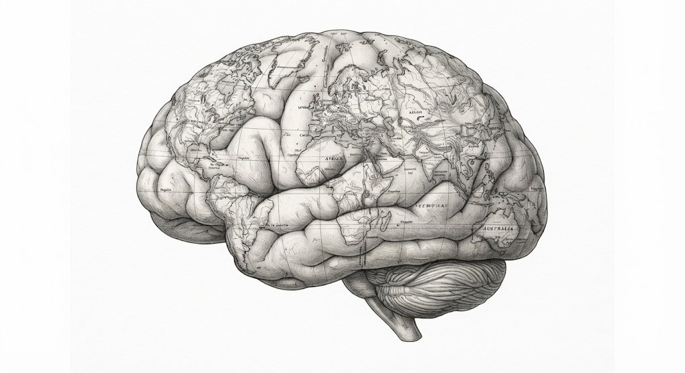

# 2.1. La idea de mapa

D'acord amb el diccionari de l'Institut d'Estudis Catalans, un mapa és la
«representació sobre una superfície plana de la superfície de la Terra o d'una
part d'ella segons una escala donada».

Però per als qui treballem amb cartografia aquesta definició se'ns queda curta,
una mica com dir que la poesia és fer frases curtes una sota l'altra.

Un mapa és, si ho penses bé, una eina de comunicació i de pensament. Tant és
així que, de manera quasi innata, tots tenim la capacitat de representar-nos un
mapa mental. És una forma de pensament primigènia que necessitem per poder
habitar el territori.

<figure markdown>
  { .captura }
  <figcaption>El mapa mental: la manera més antiga que tenim de pensar el territori.</figcaption>
</figure>

## Exercici: el camí més curt

- [ ] Fes un croquis de l'itinerari que consideris més curt per anar caminant
  des de l'aula de SILME fins a la seu del Consell Insular.
- [ ] Procura incloure-hi no només les vies de comunicació, sinó també els
  elements de referència que consideris rellevants.

Com a sistema de comunicació que és, la cartografia té les seves pròpies normes
d'ortografia i de gramàtica. Són aspectes com els codis de color, els valors i
els tipus de línia o l'ordre de representació, que cal atendre per assegurar
que el missatge o el propòsit del mapa arriba o es compleix de la millor manera
possible.

Una de les normes bàsiques és que tots els mapes representen la realitat i els
seus atributs emprant únicament tres elements geomètrics: **punts, línies i
polígons**. Un mateix element de la realitat, a una escala diferent, pot
representar-se de maneres diferents. Un riu, per exemple, pot representar-se
com una línia o també com un polígon.
