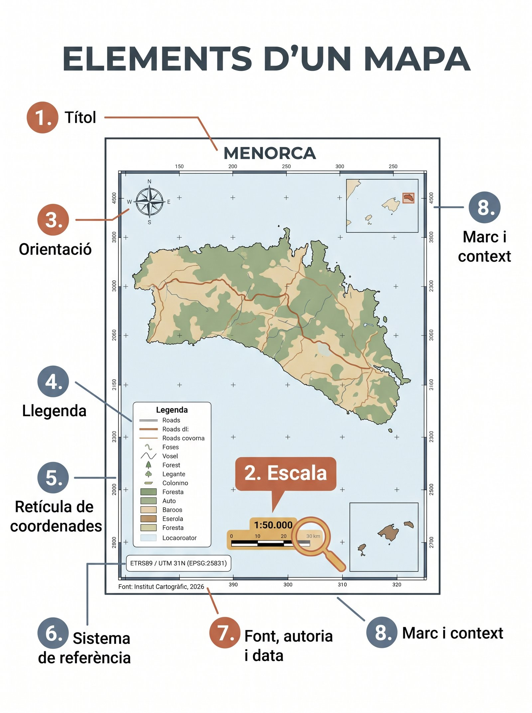

# 2.2. Els elements d'un mapa

Un mapa correctament construït ha d'incorporar un seguit d'elements.

<figure markdown>
  { .captura }
  <figcaption>Els vuit elements, situats sobre un mapa de Menorca.</figcaption>
</figure>

| Element | Pregunta a què respon | Què inclou |
|---|---|---|
| Títol | De què tracta el mapa? | Tema i zona representada |
| Escala | Quina relació hi ha entre el mapa i la realitat? | Escala numèrica i gràfica |
| Orientació | Cap on és el nord? | Fletxa del nord o rosa dels vents |
| Llegenda | Què signifiquen els símbols i els colors? | Signes convencionals, colors, trames |
| Retícula de coordenades | On és cada punt? | Graticulat (graus) o quadrícula (metres) |
| Sistema de referència | Quin datum i quina projecció s'han usat? | Per exemple, ETRS89 / UTM 31N (EPSG:25831) |
| Font, autoria i data | Qui l'ha fet, amb quines dades i quan? | Organisme, any, llicència |
| Marc i context | Què queda dins del mapa? | Marge, mapa de situació, insets |

De tots aquests n'hi ha un en què ens volem aturar, perquè és important per al
curs: el concepte d'escala.

L'**escala** és la relació entre una distància mesurada al mapa i la distància
corresponent a la realitat, i es pot expressar de dues maneres: **numèrica**
—per exemple, 1:50.000— o **gràfica** —una barra graduada, que es manté
correcta si el mapa s'amplia o es redueix.

Per tant és un quocient, i per entendre'l bé hem de pensar que el numerador fa
referència a les unitats del paper i el denominador, a les unitats de la
realitat. Així, 1:5.000 ho hem de pensar com que una determinada unitat del
mapa, posem centímetres, es correspon a cinc mil unitats de la realitat.

!!! info "La idea d'escala gran i escala petita no és el que sembla"
    Una escala és **gran** quan la fracció és gran, és a dir, quan el
    denominador és **petit**. Així, 1:1.000 és una escala més gran que
    1:100.000, perquè 1/1.000 és més gran que 1/100.000. És l'error més
    habitual dels alumnes.

    - **Escala gran:** territori petit, molt de detall —el plànol d'un barri—.
      Tot es veu gran!
    - **Escala petita:** territori gran, poc detall —el mapa d'Europa—. Tot es
      veu petit!

## Exercici: quant fa de debò

- [ ] Sabent això, calcula quina és la mida real d'un objecte que fa 0,2 mm en
  un mapa a escala 1:25.000.

??? info "Un cop fet l'exercici, llegeix aquest destacat, no abans!"
    El que acabes de fer és una cosa que no tothom fa i hauria de fer: calcular
    quin és el marge d'error o la precisió d'un determinat mapa.

    L'ull humà no distingeix de manera fiable una línia inferior a uns **0,2
    mm** sobre el paper. Aquest és l'**error gràfic** i, multiplicat pel
    denominador de l'escala, dona la precisió màxima real del mapa i, per tant,
    la mida mínima d'un element que s'hi pot representar.

    | Escala | 1 cm al mapa equival a | Error gràfic (0,2 mm) | Tipus |
    |---|---|---|---|
    | 1:1.000 | 10 m | 0,2 m | Gran |
    | 1:5.000 | 50 m | 1 m | Gran |
    | 1:25.000 | 250 m | 5 m | Mitjana |
    | 1:50.000 | 500 m | 10 m | Mitjana |
    | 1:1.000.000 | 10 km | 200 m | Petita |

    En conseqüència, no té sentit mesurar damunt un mapa 1:50.000 una distància
    amb precisió de centímetres, perquè el mapa mateix ja té un marge d'uns
    10 m. La divisió entre escala gran, mitjana i petita varia segons l'autor;
    la taula segueix un criteri orientatiu.
