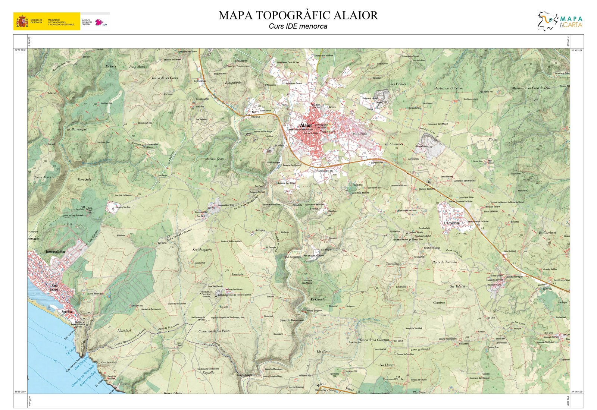
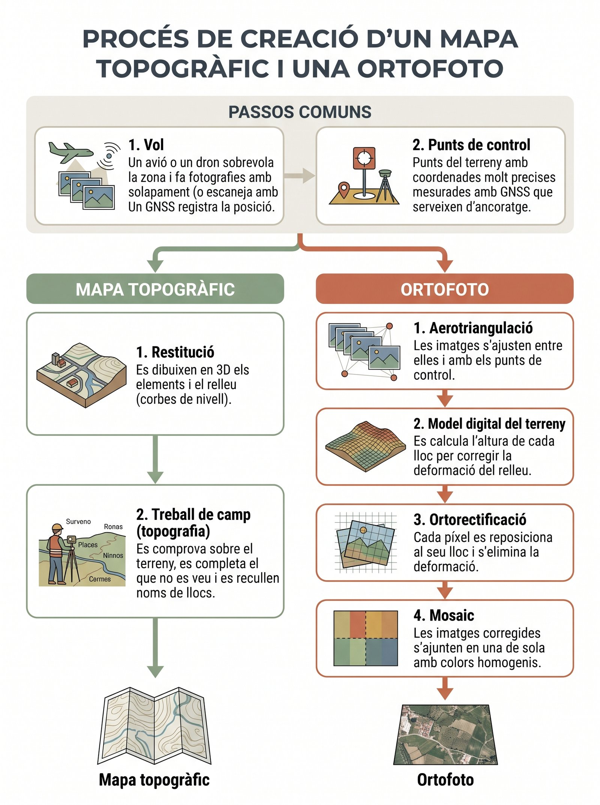

# 2.3. Mapes topogràfics i cartografia de referència

La **cartografia de referència** és la cartografia oficial de base d'un
territori, produïda per organismes públics amb criteris tècnics homogenis,
sobre la qual es construeix la resta de mapes, els temàtics.

Els dos productes bàsics són el **mapa topogràfic** i l'**ortofoto**. A Espanya
la producció de la cartografia de referència està ben organitzada i regulada
per llei, d'acord amb el Pla Cartogràfic Nacional. En essència podríem dir que
de les escales fins a 1:25.000 se n'ocupa l'Institut Geogràfic Nacional; de les
escales 1:5.000, el Govern autonòmic, i les escales més grans són competència
de l'administració local.

## El mapa topogràfic

Un mapa topogràfic és un mapa de propòsit general que representa, de manera
detallada i amb símbols convencionals, la forma del terreny —el **relleu**— i
els elements naturals i artificials que hi ha. No explica un tema concret, com
la població o la geologia, sinó que mostra el territori tal com és.

La gran diferència amb una fotografia és que el mapa **interpreta, selecciona i
simbolitza** la realitat: només mostra el que és útil i l'etiqueta amb un nom.

<figure markdown>
  { .captura }
  <figcaption markdown="span">Full del mapa topogràfic d'Alaior. [Obre'l a mida completa](img/03-mapa-topografic-alaior-gran.jpg){ target="_blank" } per llegir-hi el detall.</figcaption>
</figure>

## Exercici: construeix la llegenda

- [ ] Observa el detall del mapa topogràfic anterior i mira de construir-ne la
  llegenda, és a dir, fes una llista dels elements que s'hi representen.
- [ ] Fixa't que només n'hi ha un que no representa cap element físic del
  territori. Quin és? Bé, en realitat n'hi ha dos, però un és especialment
  important.

## Les ortofotos

Una **ortofoto** —o ortofotografia— és una imatge aèria, o de satèl·lit,
**corregida geomètricament** perquè tingui una escala uniforme a tota la imatge
i es pugui superposar a un mapa. Això permet **mesurar** distàncies i àrees
directament sobre ella i fer-la servir com un mapa.

??? info "Vols saber-ne més: la diferència amb una fotografia aèria normal"
    Una fotografia aèria té perspectiva —una càmera veu el món des d'un punt— i
    el relleu i la inclinació de la càmera la deformen: els edificis alts «es
    tomben» cap a l'exterior i l'escala no és la mateixa al cim d'una muntanya
    que a la vall. Una ortofoto elimina aquests efectes, i el resultat és una
    vista «des de dalt», com si cada punt es mirés de manera perpendicular.

    | | Fotografia aèria | Ortofoto |
    |---|---|---|
    | Escala | Variable dins la imatge | Uniforme |
    | Es pot mesurar? | No de manera fiable | Sí |
    | Es pot superposar a un mapa? | No directament | Sí |
    | Deformació pel relleu | Sí | Corregida |

    L'ortofoto mostra la realitat tal com és, sense simbolitzar ni etiquetar, i
    la seva qualitat es defineix per la **resolució** —la mida del píxel sobre
    el terreny, habitualment de pocs centímetres a uns 50 cm segons el vol—.
    Per això sol combinar-se amb el mapa vectorial, que aporta noms i símbols.

## Com s'elaboren els mapes topogràfics i les ortofotos

L'esquema següent te'n fa un resum.

<figure markdown>
  { .captura }
  <figcaption>Els dos productes parteixen del mateix vol i se separen a partir d'aquí.</figcaption>
</figure>

??? info "Vols saber-ne més: com s'elabora un mapa topogràfic"
    El mapa topogràfic s'elabora a partir d'imatges o mesures del terreny, que
    es converteixen en dades vectorials —punts, línies i polígons— i es
    dibuixen amb simbologia. Explicat de manera molt simplificada:

    1. **Xarxa de punts de control.** Es fixen punts al terreny amb coordenades
       molt precises, mesurades amb GNSS, el sistema de posicionament per
       satèl·lit. Serveixen d'ancoratge perquè el mapa quedi ben situat.
    2. **Captura de dades.** Un avió o un dron sobrevola la zona fent
       fotografies amb solapament entre elles —fotogrametria— o escanejant el
       terreny amb un làser —LiDAR—. El solapament permet veure el terreny en
       3D, com amb dos ulls.
    3. **Restitució.** A partir de les imatges o del núvol de punts es dibuixen
       en 3D els elements —carreteres, edificis, rius— i es genera el **model
       digital del terreny**, del qual surten les corbes de nivell.
    4. **Revisió de camp.** Es comprova sobre el terreny tot allò que no es veu
       bé a les imatges i es recullen els noms de lloc, la toponímia.
    5. **Disseny cartogràfic.** S'assignen símbols, colors i text, i es
       **generalitza** segons l'escala: a escales petites s'eliminen o se
       simplifiquen detalls perquè el mapa continuï essent llegible.
    6. **Control de qualitat i publicació.** Es verifica la precisió respecte
       als punts de control i el mapa es publica en paper o en format digital.

??? info "Vols saber-ne més: com s'elabora una ortofoto"
    Una ortofoto es crea a partir de fotografies aèries que es corregeixen una
    a una i es cusen en una sola imatge georeferenciada. De manera molt
    simplificada:

    1. **Vol fotogramètric.** Un avió, o un dron, fa fotografies verticals de
       la zona, amb solapament entre elles. Un GNSS i un sensor d'inclinació
       enregistren la posició i l'orientació de la càmera a cada foto.
    2. **Aerotriangulació.** Les imatges s'ajusten entre elles i amb els punts
       de control del terreny, per saber amb exactitud on era la càmera i cap
       on mirava.
    3. **Model digital del terreny.** Cal conèixer l'altura de cada lloc,
       perquè és el relleu el que deforma la imatge.
    4. **Ortorectificació.** Cada píxel es reposiciona al lloc que li
       correspon, tenint en compte la seva altura i la inclinació de la
       càmera. Això elimina la deformació.
    5. **Mosaic i equilibrat de color.** Les imatges corregides s'ajunten en
       una de sola, amb talls discrets i amb colors i llum homogenis.
    6. **Control de qualitat i publicació.** Es comprova la precisió i es
       publica amb coordenades en el sistema oficial, a Espanya ETRS89.

    Una ortofoto **veritable** va un pas més enllà: usa un model que inclou els
    edificis, de manera que no queden «tombats» ni amaguen el que hi ha a la
    seva vora.

## Els GPS i la seva precisió

La precisió d'un GPS dependrà del tipus de dispositiu que estiguis fent servir.
El quadre següent n'és un resum.

| Mètode | Com funciona | Precisió horitzontal típica |
|---|---|---|
| **GPS convencional** | El receptor calcula la posició només amb els satèl·lits | Uns 5 m —4,9 m en mòbils, sota cel obert— |
| **GPS diferencial (DGPS)** | Una estació base de coordenades conegudes calcula l'error i n'envia la correcció per ones de ràdio; el receptor GPS s'hi pot connectar | Submètrica a mètrica (valor orientatiu) |
| **Diferencial de precisió (RTK)** | Com el DGPS, però amb mesura de la fase de la portadora i enllaç en temps real amb la base | De l'ordre d'1 a 2 cm (valor orientatiu) |

## Exercici: a quina escala treballes

- [ ] Amb aquesta informació i el que has après de les escales, amb un GPS
  convencional, a quina escala estem treballant?
