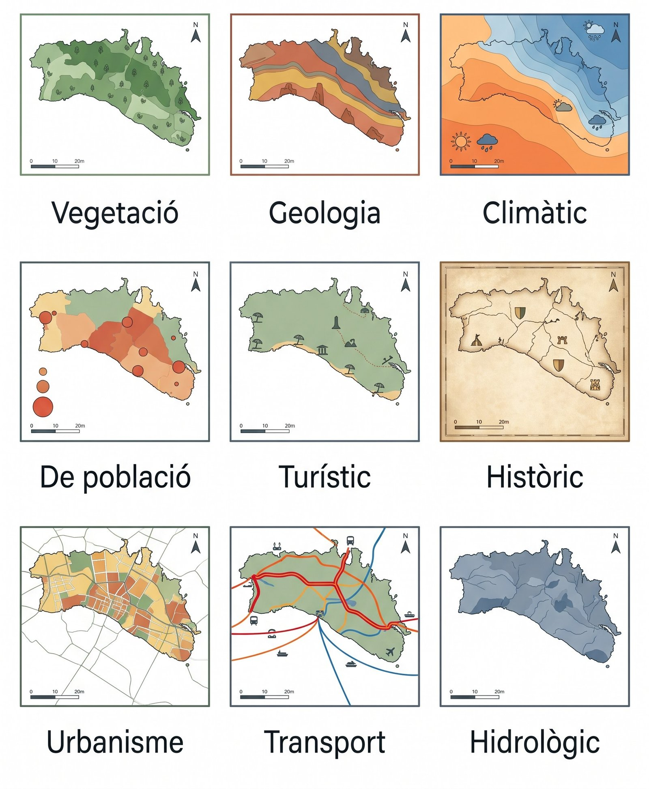

# 2.4. Mapes temàtics i sistemes d'informació geogràfica

A partir de la cartografia de referència podem crear els mapes temàtics. I aquí
s'obre tot un univers.

La **cartografia temàtica** representa sobre un mapa base la distribució
espacial d'un fenomen o d'una variable concreta: població, clima, usos del sòl,
delinqüència, geologia... A diferència de la cartografia de referència, que
mostra el territori en general —topogràfic, ortofoto—, aquí el **tema és el
protagonista** i el mapa base només serveix de context.

De mapes temàtics n'hi ha de moltíssims tipus diferents: de vegetació,
climàtics, de població, geològics. Fes-hi una ullada; per exemple, al canal d'X
que es diu [Amazing Maps](https://x.com/amazingmap?lang=ca).

<figure markdown>
  { .captura }
  <figcaption>Nou maneres de mirar la mateixa illa.</figcaption>
</figure>

!!! info "I aquí tanquem el mòdul tornant al principi"
    De fet, quasi qualsevol concepte es pot representar sobre un mapa. Perquè
    els mapes temàtics ens permeten explorar el potencial de la cartografia com
    a eina de comunicació.

## Exercici: els mapes del teu departament

- [ ] Descriu un o diversos mapes que consideris que seria interessant elaborar
  a partir de la informació de la teva àrea o departament.
- [ ] Pensa quin tipus d'informació se'n podria extreure, per exemple dels
  expedients, i què es podria representar en un mapa.

??? info "Vols saber-ne més: els sistemes d'informació geogràfica (SIG)"
    Un **sistema d'informació geogràfica (SIG)** és un sistema que permet
    capturar, gestionar, analitzar i visualitzar dades amb component espacial.
    Per exemple, QGIS.

    La clau d'un SIG és que cada **objecte geogràfic** —un punt, una línia o un
    polígon— té dues parts enllaçades:

    - **Geometria:** on és i quina forma té, en coordenades.
    - **Atributs:** una taula amb les seves característiques; per exemple, en
      una capa de municipis: nom, població i superfície.

    A partir d'aquí, i gràcies als SIG, un mapa temàtic no cal dibuixar-lo a
    mà: n'hi ha prou amb **simbolitzar la capa segons un atribut**. Per exemple,
    si als polígons de municipi hi tenim associat el valor de la població, es
    poden pintar de colors els municipis segons la població i s'obté un mapa
    coroplètic de població. A més, com que les dades són consultables, un SIG
    permet també **filtrar, calcular i fer operacions**, no només mostrar-les...
    però això ja és material per al curs avançat.
