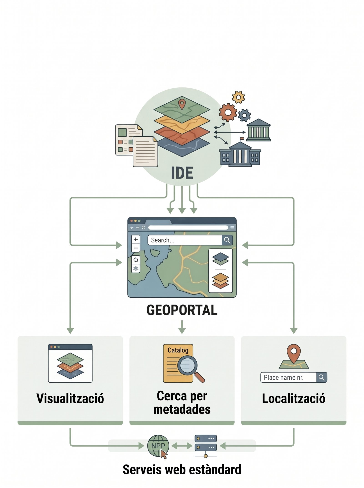

# 3.1. Conceptes bàsics sobre les IDE

Les infraestructures de dades espacials són un exemple de bones pràctiques de
col·laboració i interoperabilitat entre administracions, que s'hauria de posar
com a exemple més sovint.

## Què és una infraestructura de dades espacials (IDE)

Una **infraestructura de dades espacials (IDE)** és un conjunt de **dades,
metadades, tecnologies, polítiques, estàndards, recursos humans i usuaris**,
harmonitzats i integrats en un sistema virtual per **compartir informació
geogràfica a la xarxa**.

Dit de manera senzilla, és una gran biblioteca en línia de mapes i dades,
mantinguda per diferents administracions, on es pot trobar i consultar la
informació sense haver-la de demanar a cada organisme.

Una IDE es posa en pràctica mitjançant un **geoportal**, la web d'accés, que
com a mínim ha d'oferir:

- **Visualització** de les dades a través de serveis web.
- **Cerca** de conjunts de dades i serveis a través de les seves **metadades**:
  una fitxa que diu qui ha fet la dada, quan, a quina escala i amb quin sistema
  de referència.
- **Localització en un mapa** a partir d'un **nom geogràfic**, per exemple un
  municipi o un topònim.

<figure markdown>
  { .captura }
  <figcaption>De la IDE al geoportal, i del geoportal a les tres funcions mínimes.</figcaption>
</figure>

Els serveis web són uns protocols de comunicació que segueixen estàndards i
faciliten compartir informació. T'ho expliquem amb més detall a continuació.

??? info "Vols saber-ne més: els serveis web, explicats sense tecnicismes"
    Un **servei web** és una manera de demanar dades a un ordinador remot —un
    **servidor**— i rebre'n la resposta, sense haver de descarregar fitxers ni
    instal·lar res. Funciona com un restaurant: tu, o el programa que fas
    servir, com un visor web o el QGIS, fas la comanda, i la cuina —el servidor
    de l'organisme que té les dades— et serveix just el que has demanat.

    El més important és que les dades **continuen en origen**: sempre veus la
    versió actualitzada que té l'organisme, sense còpies velles al teu
    ordinador.

    Tots els serveis segueixen **estàndards internacionals**, de l'OGC, cosa
    que fa que funcionin amb qualsevol programa. Aquests són els més habituals:

    | Servei | Què et dona | Una analogia | Per a què serveix |
    |---|---|---|---|
    | **WMS** (*Web Map Service*) | Una **imatge** del mapa per a la zona i l'escala que demanes | Una fotografia del plat | Veure mapes i ortofotos, sense poder-ne modificar les dades |
    | **WMTS** | Imatges del mapa en **mosaics** ja preparats | La mateixa foto, però ja llesta i més ràpida | Fons de mapa que es carreguen àgilment |
    | **WFS** (*Web Feature Service*) | Les **dades mateixes**: punts, línies, polígons i els seus atributs | Els ingredients i la recepta perquè te'l puguis preparar tu | Consultar, filtrar, analitzar i descarregar les dades |
    | **Catàleg (CSW)** | Les **metadades**: fitxes que descriuen les dades disponibles | La fitxa d'una biblioteca, que explica qui ha preparat el plat, per què ho ha fet i quan | Cercar quines dades i serveis existeixen |

??? info "Vols saber-ne més: com es fa servir, a la pràctica"
    Per fer servir tots aquests tipus de serveis no cal saber programar. Només
    necessites les URL i una eina com el visualitzador de l'IDE Menorca, o el
    QGIS. Més endavant t'ho explicarem.

Les IDE serveixen per **no duplicar feina**, compartir dades entre
administracions i amb la ciutadania, i prendre decisions amb informació actual
i coherent. El marc legal que les regula es resumeix a l'apartat següent.

!!! info "Vols saber més? La Plataforma IDEE"
    La [Plataforma IDEE](https://plataforma.idee.es/) és el portal oficial de
    la IDE d'Espanya, gestionat pel Centre Nacional d'Informació Geogràfica
    (CNIG) de l'IGN. Al menú **Recursos** hi ha, entre altres:

    - Els **catàlegs** de dades i serveis.
    - El **visor de la IDEE**, per veure mapes sense instal·lar res.
    - El **directori de serveis**, amb els serveis web —WMS, WMTS, WFS...—
      disponibles.
    - Els **centres de descàrrega** i el geoportal europeu INSPIRE.

    També inclou apartats per a desenvolupadors —APIs i geocodificadors— i per
    a la implementació d'INSPIRE. Consultat el 22 de novembre del 2026.

## Exercici: explora el directori de serveis web

- [ ] A la [Plataforma IDEE](https://plataforma.idee.es/), entra a **Recursos ›
  Directori de serveis** i navega pels serveis disponibles.
- [ ] Tria **tres serveis** que consideris interessants per al teu àmbit
  professional o d'estudi i copia'n l'adreça (URL).
- [ ] Recull-los en una taula com aquesta:

| Nom del servei | Tipus (WMS, WMTS, WFS...) | URL | Organisme que el publica | Per què m'interessa |
|---|---|---|---|---|
| | | | | |
| | | | | |
| | | | | |
