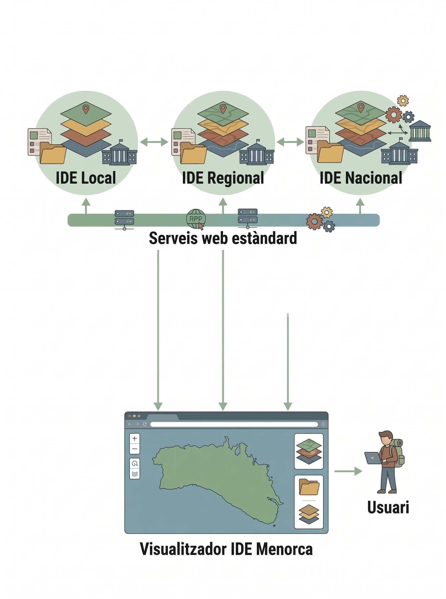

# 3.3. Les IDE vistes des de Menorca

Gràcies a les IDE, un usuari de Menorca pot veure, a través de les eines del
projecte IDE Menorca i en **una sola aplicació**, informació que prové de
**múltiples administracions**, sempre actualitzada i sense haver de saber d'on
surt cada dada.

!!! info "No totes les dades que hi veus són nostres"
    És important entendre que hi ha molta informació que es pot veure a través
    del visualitzador de l'IDE Menorca que prové directament d'altres
    administracions i que, per tant, no controlem. La idea és que cadascú es fa
    responsable de les dades que genera en l'exercici de les seves competències
    i, a més, s'ocupa que estiguin sempre disponibles a través d'un servei web
    per als altres.

## Un sol visor, moltes administracions

Així, gràcies a la idea de les IDE, en un visor genèric com el de l'IDE Menorca
l'usuari pot superposar capes que publiquen organismes diferents, com si fossin
del mateix lloc. Cada organisme manté i actualitza les seves dades, i el visor
les consulta a través dels **serveis web** —WMS, WFS...— explicats més amunt.

<figure markdown>
  { .captura }
  <figcaption>Cada administració publica els seus serveis; el visualitzador els ajunta en una sola pantalla.</figcaption>
</figure>

D'aquesta manera l'usuari pot gaudir d'uns quants avantatges:

- **Tot en un sol lloc:** no cal visitar la web de cada administració.
- **Dades sempre actualitzades:** les capes es consulten directament a
  l'organisme que les publica, no s'hi fan còpies que es quedin velles.
- **Transparència:** l'usuari no ha de saber d'on ve la informació que consulta
  ni com s'hi accedeix.
- **Capes combinables:** es poden superposar per veure relacions entre elles.

??? info "Vols saber-ne més: un exemple pràctic"
    Una persona vol saber si una parcel·la té alguna afectació d'ordenació del
    territori. Doncs pot veure la **parcel·la** (Cadastre), la **qualificació
    urbanística** (pla general), si queda dins d'un **espai protegit** (Xarxa
    Natura 2000) i si hi ha **afectacions de costes**, de manera combinada en
    el mateix mapa. I alternar les capes i consultar-les. Cada una prové d'una
    administració diferent:

    | Capa | Qui la publica | Què mostra |
    |---|---|---|
    | **Pla general** (planejament municipal) | Ajuntaments i Consell Insular, a través de l'IDE Menorca | La qualificació urbanística del sòl |
    | **Cadastre** | Dirección General del Catastro (Ministeri d'Hisenda) | Parcel·les i referències cadastrals |
    | **Xarxa Natura 2000** | Govern de les Illes Balears | Espais naturals protegits |
    | **Costes** | Ministeri per a la Transició Ecològica (MITECO) | Domini públic maritimoterrestre i altres afectacions del litoral |

## La informació local, mancomunada

L'IDE Menorca publica la informació de **tota l'administració local**. Això és
possible gràcies a un **conveni de col·laboració** entre els ajuntaments i el
Consell Insular, que ha permès **mancomunar** el servei. Així, en comptes que
cada ajuntament hagi de muntar la seva pròpia infraestructura, una única IDE a
escala insular respon a la demanda dels usuaris i també als requeriments
legals.

## Exercici: què hi trobes a faltar

- [ ] Ves a la [pàgina principal de l'IDE Menorca](https://ide.cime.es) i
  descobreix els recursos que s'hi publiquen.
- [ ] Què hi has trobat a faltar i què t'agradaria que s'hi afegís?
