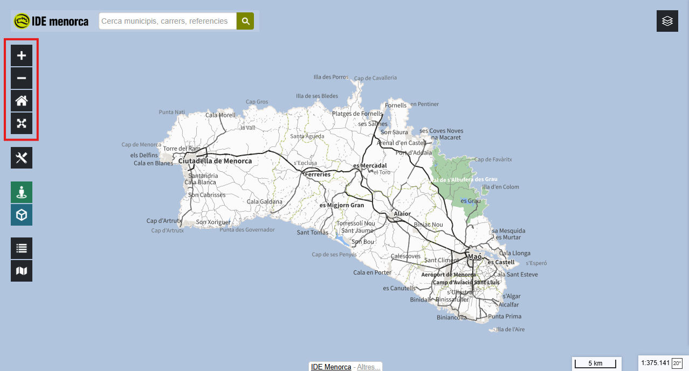

# 4.1. Eines de navegació sobre el mapa

## Objectiu

En acabar sabràs desplaçar el mapa, apropar-te i allunyar-te, i tornar a la
vista inicial quan et perdis.

## Passos

1. **Desplaçar el mapa.** Botó esquerre premut i arrossega.

2. **Apropar-se i allunyar-se.** Hi ha tres maneres, i només es diferencien en
   una cosa: cap a on s'apropen.

    | Com | Cap a on |
    |---|---|
    | Rodeta del ratolí | Cap al cursor. La més ràpida |
    | Doble clic | Cap al cursor, i hi centra el mapa |
    | Botons **+** i **−** | Cap al centre de la pantalla |

    Per això, amb els botons, allò que vols mirar l'has de tenir al mig abans
    de prémer: si el deixes a una vora, el zoom te l'allunya de la vista.

    <figure markdown>
      { .captura }
      <figcaption>A la columna esquerra, el zoom a dalt i, a sota, la casa i la pantalla completa.</figcaption>
    </figure>

3. **Tornar a l'extensió inicial.** La **casa** recupera la vista de tota
   l'illa. És la sortida d'emergència: quan no saps on ets, prem-la i comença
   de nou. Només canvia l'enquadrament, o sigui que el que tinguis carregat
   no es perd.

    !!! info "Quan comencis a carregar capes"
        En allunyar-te, algunes deixaran de dibuixar-se i semblarà que les has
        perdudes. Segueixen al mapa i tornen quan t'hi apropes. Ho veuràs a la
        [4.5](05-capes-tematiques.md).

4. **Pantalla completa.** Amaga la resta de la pàgina i deixa només el visor:
   tot el que guanyes és mapa. Se'n surt amb el mateix botó o amb ++esc++.

!!! tip "Si l'obres a la tauleta"
    Arrossega amb un dit i fes el zoom amb la pinça. La resta funciona igual.

## Exercici pràctic

**De l'illa sencera als carrers de Ferreries, i tornar.**

- [ ] Prem la **casa**: parteixes de tota Menorca a la pantalla.
- [ ] Amb la **rodeta**, apropa't fins que surtin els noms dels vuit municipis.
- [ ] **Doble clic** damunt **Ferreries**, i repeteix-ho fins a distingir-ne els
  carrers. Fixa't que el mapa es va movent cap a on apuntes.
- [ ] Allunya't tres passos amb **−** i torna amb **+**: acabes al mateix lloc.
- [ ] Ara arrossega Ferreries fins a una **vora** de la pantalla i prem **+**
  dues vegades. El poble se t'escapa: aquesta és tota la diferència entre els
  botons i la rodeta.
- [ ] Entra i surt de **pantalla completa**, i acaba tornant a prémer la
  **casa**.

!!! tip "La regla que et quedarà"
    Si ja saps on vols anar, apunta-hi amb la rodeta o amb el doble clic. Si
    vols mirar de prop el que ja tens a la pantalla, fes servir els botons.

---

!!! tip "Al manual de referència"
    [1. Interfície i navegació](../../../manuals/visor-generic/01-interficie.md)
