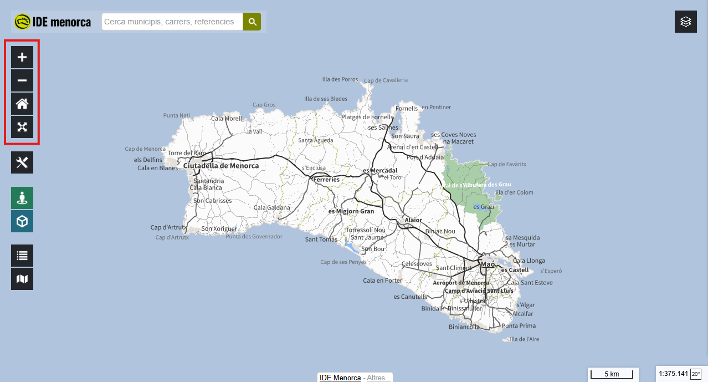

# 4.1. Eines de navegació sobre el mapa

## Objectiu

En acabar sabràs desplaçar el mapa, apropar-te i allunyar-te, i tornar a la
vista inicial quan et perdis.

<figure markdown>
  { .captura }
</figure>

## Passos

1. **Desplaçar el mapa.** Botó esquerre premut i arrossega.

2. **Apropar-se i allunyar-se.** Tres maneres:

    | Com | On actua |
    |---|---|
    | Rodeta del ratolí | Sobre el cursor. La més ràpida |
    | Doble clic | Sobre el cursor. Apropa i centra alhora |
    | Botons **+** i **−** | Al centre de la pantalla |

3. **Tornar a l'extensió inicial.** El botó de la **casa** recupera la vista de
   tota l'illa. És la sortida d'emergència quan t'has perdut.

    !!! warning "Si tens capes carregades"
        En allunyar-te poden desaparèixer de la vista. Segueixen al mapa: a
        aquella escala no es dibuixen. Tornen quan t'hi apropes.

4. **Pantalla completa.** Amaga la resta de la pàgina i deixa només el visor.
   Se'n surt amb el mateix botó o amb ++esc++.

## Exercici pràctic

1. Prem la **casa** per partir de l'extensió inicial.
2. Amb la **rodeta**, apropa't fins a veure els vuit municipis amb el nom.
3. **Doble clic** sobre **Ferreries** fins a distingir-ne els carrers.
4. Amb **+** i **−**, allunya't tres passos i torna. Fixa't que el mapa no es
   mou de lloc: el zoom va pel centre, i el doble clic no.
5. Torna a l'extensió inicial.

---

!!! tip "Al manual de referència"
    [1. Interfície i navegació](../../../manuals/visor-generic/01-interficie.md)
