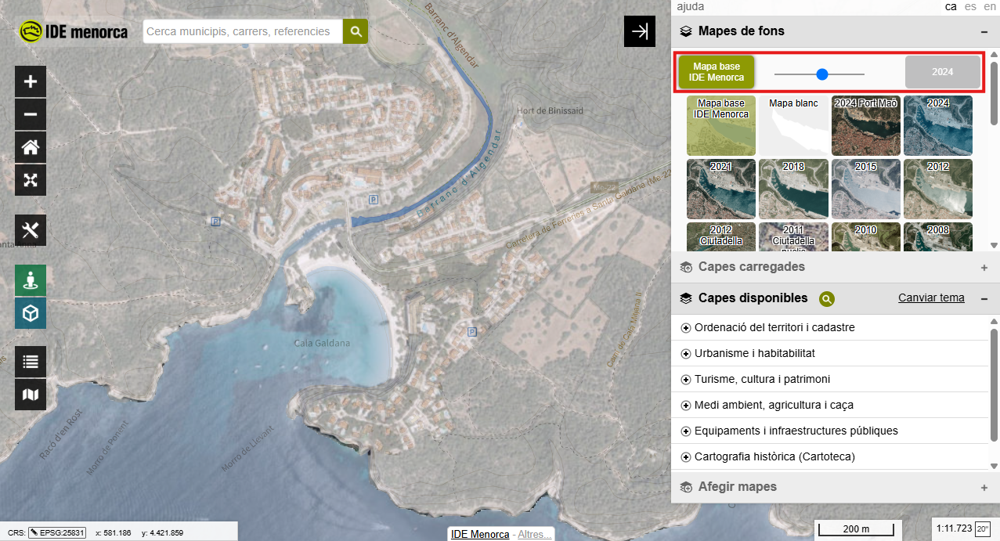

# 4.2. Control de mapes de fons

## Objectiu

En acabar sabràs triar el mapa de fons que et convé i comparar dues èpoques del
mateix lloc amb el control de transparència.

## Passos

1. **Desplegar els mapes de fons.** El panell de la dreta s'obre amb les
   **capes disponibles** a la vista; la secció dels **mapes de fons**, just a
   sobre, la trobaràs plegada.

2. **Moure el control de transparència.** És la barra de dalt de la secció. El
   visor té sempre **dos** mapes de fons carregats, no un, i del segon no en veus
   res perquè el control és del tot a un extrem. Arrossega'l i apareixerà: el
   control no aclareix el mapa, decideix quant en veus de cada un.

    <figure markdown>
      { .captura }
      <figcaption>Amb el control al mig, el dibuix del mapa base i la fotografia se superposen.</figcaption>
    </figure>

3. **Canviar un dels dos.** Els dos extrems del control són botons amb el nom
   de cada mapa. Prem el que vols substituir —el de l'esquerra es marca de
   **verd**; el de la dreta, de **blau**— i tria després el nou a la **graella
   de miniatures**, just a sota.

    !!! info "No tots cobreixen tota l'illa"
        Sis mapes de fons són d'àmbit limitat: 2024 Port Maó, els tres de
        Ciutadella (2012, 2011 nuclis i 2006) i els de nuclis (2005 i 1995).
        Fora de la seva zona la pantalla queda buida, i sembla una errada del
        visor quan no ho és. La resta cobreixen tota l'illa.

4. **Comparar dues èpoques.** Amb una ortofoto a cada extrem, el control és una
   màquina del temps: quan es va construir una cosa, com era la costa, què hi
   havia en un solar.

## Exercici pràctic

**Cala Galdana, de 1956 a avui.**

- [ ] Apropa't a **Cala Galdana** i desplega la secció **Mapes de fons**.
- [ ] Mou el **control de transparència** d'un extrem a l'altre: el mapa que
  apareix és el segon que ja tenies carregat.
- [ ] Posa l'ortofoto de **1956** a un extrem i la de **2024** a l'altre. Compte
  amb la graella: **2024**, no **2024 Port Maó**.
- [ ] Mou el **control de transparència** a poc a poc i cerca una cosa que hi
  hagi el 2024 i que el 1956 no hi fos.
- [ ] Canvia una ortofoto per **OSM**: no tots els mapes de fons són
  fotografies.

---

!!! tip "Al manual de referència"
    [2.2. Mapes de fons](../../../manuals/visor-generic/02-panell-capes.md#22-mapes-de-fons)
