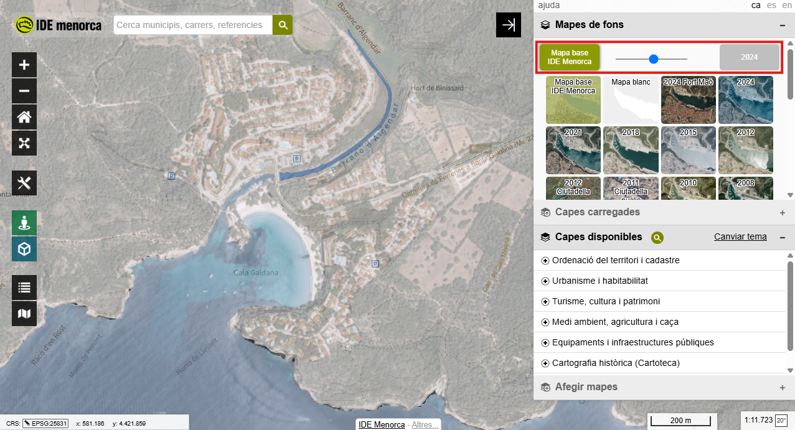

# 4.2. Control de mapes de fons

## Objectiu

En acabar sabràs canviar el mapa de fons i comparar dues èpoques del mateix
lloc amb el control lliscant.

<figure markdown>
  { .captura }
  <figcaption>Amb el control al mig, el dibuix del mapa base i la fotografia se superposen.</figcaption>
</figure>

## Passos

1. **Obrir el panell de mapes de fons.** És a la banda dreta de la pantalla.

2. **Canviar el mapa de fons.** Tria'n un de la graella de miniatures. El mapa
   es refresca sense moure's de lloc.

3. **Treballar amb dos mapes alhora.** El visor en carrega dos de sèrie: el
   mapa base de l'IDE Menorca i el **mapa blanc**. El **control lliscant** fon
   l'un amb l'altre.

    Per canviar-ne un, selecciona'l primer al control lliscant i tria després
    el nou de la graella.

    !!! warning "No tots cobreixen tota l'illa"
        Alguns mapes de fons són d'àmbit limitat: l'ortofoto del port de Maó,
        algunes de Ciutadella. Fora d'aquella zona no es veu res. Si la pantalla
        et queda buida, comprova que no t'hagis desplaçat fora de l'abast del
        mapa que tens triat.

## Exercici pràctic

**Cala Galdana, de 1956 a avui.**

1. Situa't sobre Cala Galdana.
2. Posa l'ortofoto de **1956** —el vol americà— a un costat del control
   lliscant i la de **2024** a l'altre.
3. Mou el control endavant i enrere.
4. Canvia ara un dels dos per **OSM** o **CARTO dark**: no tots els mapes de
   fons són fotografies.

---

!!! tip "Al manual de referència"
    [2.2. Mapes de fons](../../../manuals/visor-generic/02-panell-capes.md#22-mapes-de-fons)
