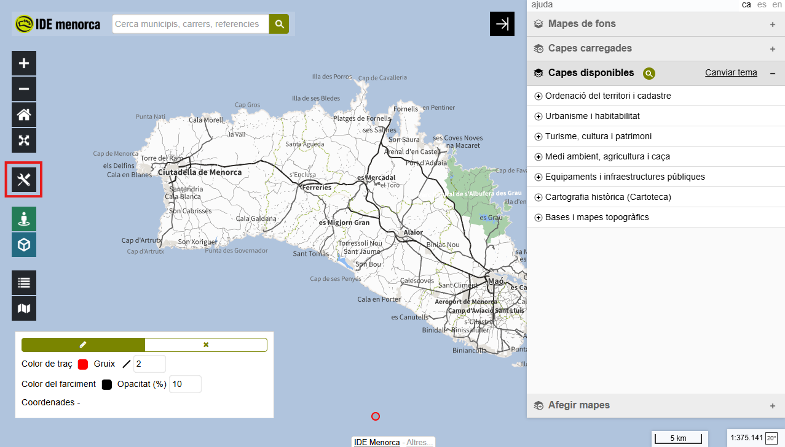
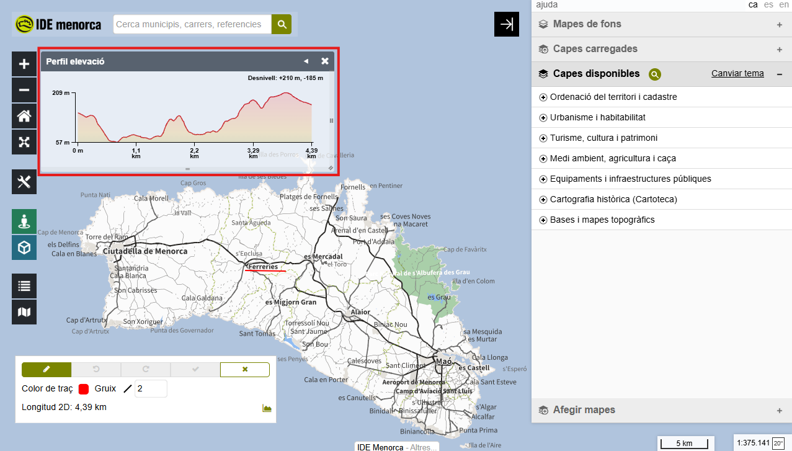

# 4.3. Mesurar i dibuixar elements

## Objectiu

En acabar sabràs dibuixar punts, línies i polígons sobre el mapa, i obtenir-ne
coordenades, distàncies i superfícies.

## Passos

1. **Obrir el panell d'eines.** És el botó de les eines creuades, a la columna
   esquerra. L'eina de dibuix i mesura té tres pestanyes: punts, línies i
   polígons.

    El panell es tanca en activar una eina diferent. Per canviar de pestanya,
    torna'l a obrir amb el mateix botó.

    <figure markdown>
      { .captura }
      <figcaption>El panell d'eines es torna a obrir amb el mateix botó cada vegada que es tanca.</figcaption>
    </figure>

2. **Dibuixar un punt.** Tria la pestanya **punts** i fes clic al mapa. Del
   punt en surten les **coordenades** i l'**elevació**.

3. **Mesurar una distància.** Tria la pestanya **línies** i ves fent clic a
   cada vèrtex. Acaba amb doble clic. La **longitud** es va actualitzant
   mentre dibuixes.

4. **Veure el perfil d'elevació.** No apareix sol: prem el botó de la
   muntanyeta, al costat de la longitud.

    <figure markdown>
      { .captura }
      <figcaption>El perfil d'elevació s'ha de demanar amb aquest botó.</figcaption>
    </figure>

5. **Mesurar una superfície.** Tria la pestanya **polígons** i dibuixa igual
   que amb les línies. En tancar la forma tens l'**àrea** i el **perímetre**.

    !!! note "Captura pendent — `img/43-poligon-pavello.png`"
        El polígon tancat sobre el pavelló del Menorca Bàsquet, amb l'àrea i el
        perímetre a la vista al panell de l'eina.

        Peu de foto previst: *Una vora clara: tothom el mesurarà pràcticament igual.*

    !!! note "Captura pendent — `img/43-poligon-poblat.png`"
        El polígon tancat sobre el recinte de Torre d'en Galmés, amb l'àrea i el
        perímetre a la vista al panell de l'eina.

        Peu de foto previst: *Una vora difusa: on acaba el poblat és una decisió de qui mesura.*

6. **Esborrar el que has dibuixat.** La **paperera** esborra tot el dibuix, amb
   confirmació prèvia. La **goma** esborra només els elements que tinguis
   seleccionats.

## Exercici pràctic

**Quants camps de bàsquet caben dins d'un poblat talaiòtic?**

1. Situa't sobre el **pavelló del Menorca Bàsquet**, a Maó. Dibuixa-hi un
   **punt** i apunta'n les coordenades i l'elevació.
2. Amb un **polígon**, mesura la superfície del pavelló.
3. Vés a **Torre d'en Galmés**, a Alaior, i dibuixa-hi un **punt**: compara'n
   l'elevació amb la de Maó.
4. Amb un **polígon**, mesura el recinte del poblat.
5. Divideix una superfície per l'altra: **quants pavellons hi caben?**
6. Traça una **línia** que travessi el turó del poblat i prem el botó del
   perfil per veure'n el relleu.
7. Esborra-ho tot amb la paperera.

!!! tip "Quin resultat ha de sortir"
    Unes **set o vuit vegades**: el pavelló fa uns 4.600 m² i el que se'n pot
    delimitar a l'ortofoto, uns 35.000 m².

    Segons [fonts oficials](https://www.menorca.es/es/Poblado_talayotico_de_Torre_den_Galmes/8446),
    el jaciment fa **66.240 m²**: el doble del que es distingeix des de l'aire.

---

!!! tip "Al manual de referència"
    [3.1. Dibuixar i mesurar](../../../manuals/visor-generic/03-eines/01-dibuixar-mesurar.md)
