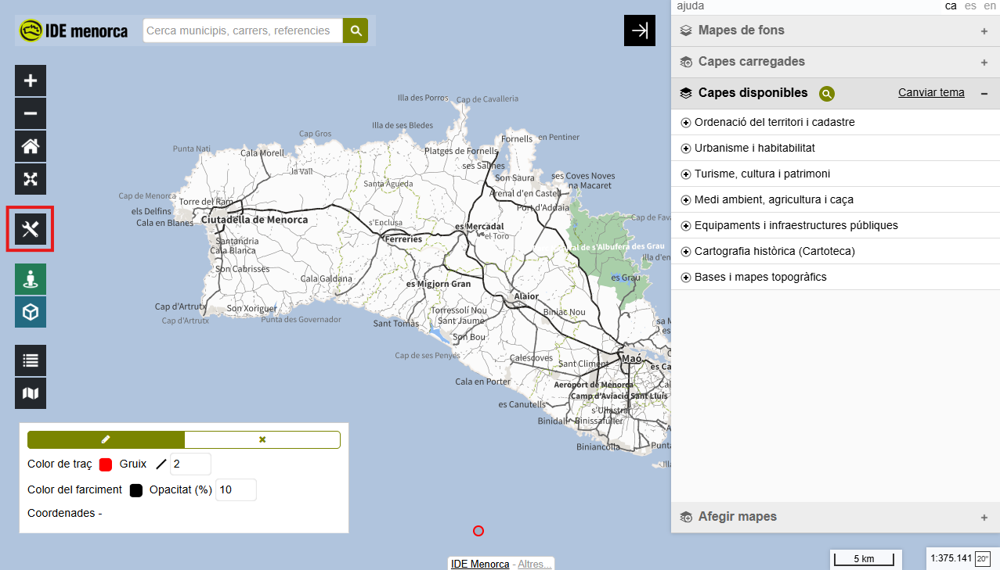
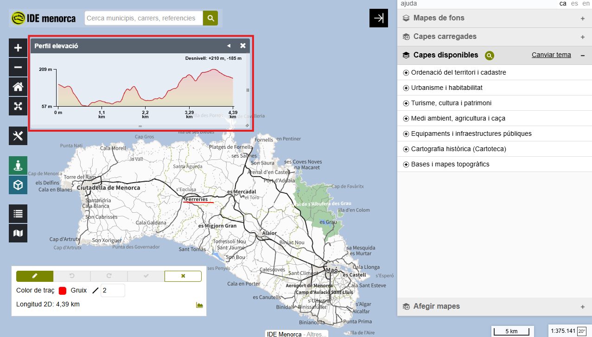
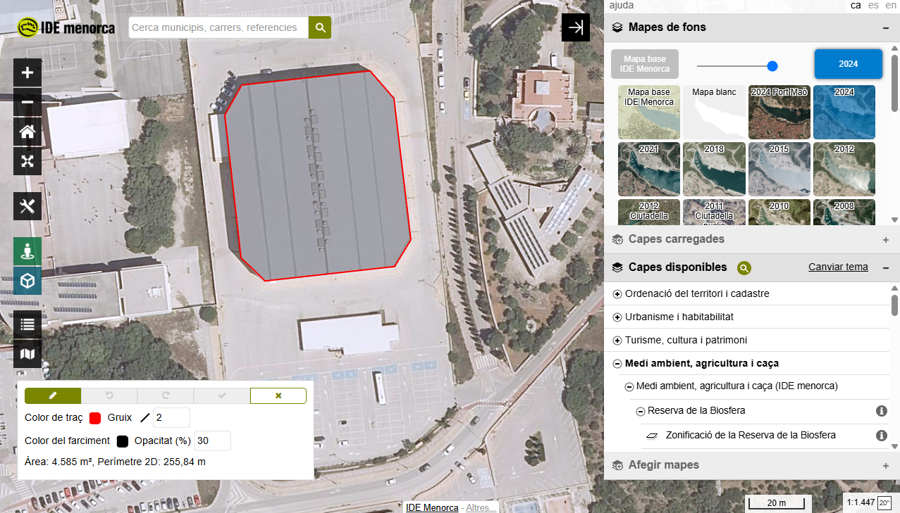
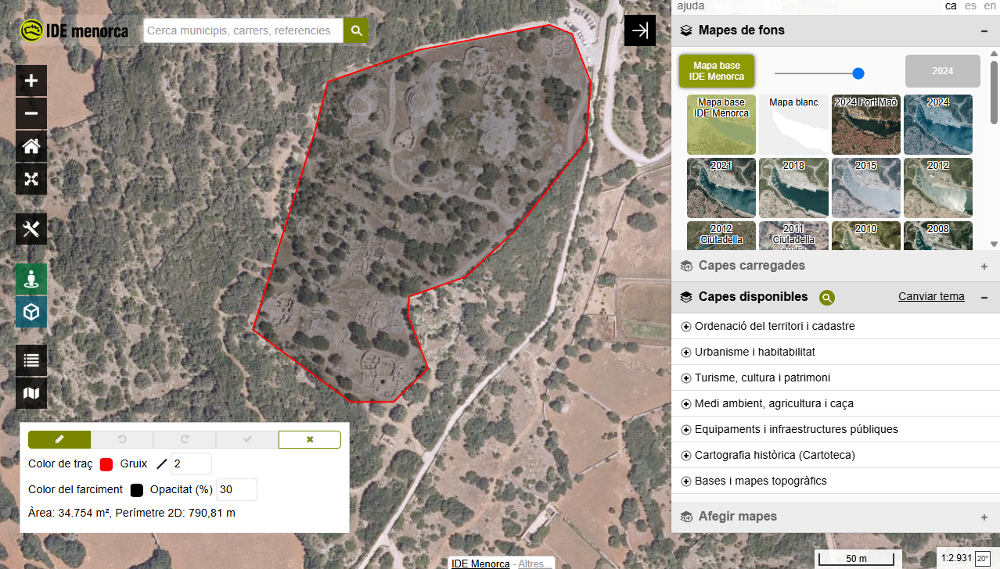
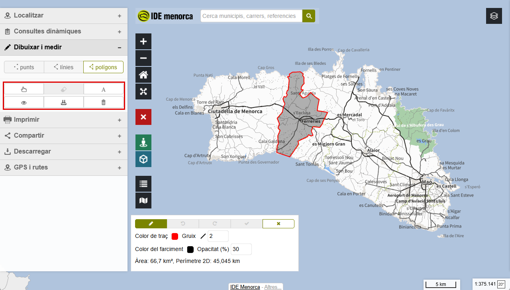

# 4.3. Mesurar i dibuixar elements

## Objectiu

En acabar sabràs dibuixar punts, línies i polígons sobre el mapa, i llegir-ne
les coordenades, la longitud i la superfície sense fer cap càlcul.

## Passos

1. **Obrir Dibuixar i medir.** El botó de les eines creuades, a la columna
   esquerra, obre la llista d'eines del visor. Desplega-hi **Dibuixar i medir**:
   a dalt hi ha les tres pestanyes —**punts**, **línies** i **polígons**— i a
   sota, sis eines que serveixen per a les tres.

    El panell es tanca en desplegar una eina diferent. Per tornar-hi, obre'l
    amb el mateix botó.

    <figure markdown>
      { .captura }
      <figcaption>El panell d'eines es torna a obrir amb el mateix botó cada vegada que es tanca.</figcaption>
    </figure>

2. **Dibuixar un punt.** Tria la pestanya **punts** i fes clic al mapa; no cal
   prémer el **llapis** abans.

    Sobre el mapa apareix un **panell flotant**: és on tries el color i el gruix
    del traç, on tens les fletxes de desfer i refer, i on es llegeix el
    resultat. En el cas del punt, les **coordenades** i l'**elevació**.

3. **Mesurar una distància.** Tria la pestanya **línies**, vés fent clic a cada
   vèrtex i acaba amb doble clic. La **longitud** es va actualitzant mentre
   dibuixes, i la fletxa que gira enrere desfà el vèrtex que t'hagi sortit
   tort.

4. **Veure el perfil d'elevació.** No apareix sol: prem el botó de la
   muntanyeta, al costat de la longitud. Hi tens la corba del terreny i el
   desnivell acumulat, el que puja i el que baixa.

    <figure markdown>
      { .captura }
      <figcaption>El perfil d'elevació s'ha de demanar amb aquest botó.</figcaption>
    </figure>

5. **Mesurar una superfície.** Tria la pestanya **polígons**, dibuixa igual que
   amb les línies i acaba amb doble clic. Tens l'**àrea** i el **perímetre**:
   els metres quadrats d'un solar, d'una zona verda o d'un tros de bosc.

    

    <figure markdown>
      { .captura }
      <figcaption>Un contorn clar: tothom el mesurarà pràcticament igual.</figcaption>
    </figure>
    <figure markdown>
      { .captura }
      <figcaption>Un contorn difús: on acaba el poblat és una decisió de qui mesura.</figcaption>
    </figure>
    

6. **Fer servir les sis eines comunes.** Al panell de l'esquerra, sota les
   pestanyes, hi ha sis botons que valen per als tres tipus de dibuix.

    <figure markdown>
      { .captura }
      <figcaption>Les sis eines comunes són al panell de l'esquerra, no al flotant que surt sobre el mapa.</figcaption>
    </figure>

    | Botó | Què fa |
    |---|---|
    | Mà | Selecciona un element. Amb ++shift++ premuda en selecciones més d'un |
    | Goma | Esborra els elements que tinguis seleccionats |
    | **A** | Posa una etiqueta de text als elements seleccionats |
    | Ull | Amaga o torna a mostrar tot el que has dibuixat |
    | Fletxa avall | Descarrega el dibuix en un fitxer, amb les elevacions si les vols |
    | Paperera | Esborra tot el dibuix, amb confirmació prèvia |

## Exercici: quants pavellons de bàsquet caben dins d'un poblat talaiòtic?

- [ ] Escriu **Pavelló Menorca** al quadre de cerca i posa de fons l'**ortofoto
  de 2024** ([4.2](02-mapes-de-fons.md)).
- [ ] Dibuixa-hi un **punt** i apunta'n les coordenades i l'elevació.
- [ ] Amb un **polígon**, mesura la superfície del pavelló.
- [ ] Vés a **Torre d'en Galmés**, a Alaior, i dibuixa-hi un **punt**:
  compara'n l'elevació amb la de Maó.
- [ ] Amb un **polígon**, mesura el recinte del poblat. Selecciona'l després amb
  la **mà**, arrossega'n un vèrtex i mira com canvia l'àrea: el contorn del
  poblat el decideixes tu.
- [ ] Divideix una superfície per l'altra: **quants pavellons hi caben?**
- [ ] Traça una **línia** que travessi el turó del poblat i prem el botó del
  perfil per veure'n el relleu.
- [ ] Esborra-ho tot amb la paperera.

!!! tip "Quin resultat ha de sortir"
    Unes **set o vuit vegades**: el pavelló fa uns 4.600 m², i el recinte del
    poblat que es distingeix a l'ortofoto, uns 35.000 m².

    Segons [fonts oficials](https://www.menorca.es/es/Poblado_talayotico_de_Torre_den_Galmes/8446),
    el jaciment fa **66.240 m²**: el doble del que es distingeix des de l'aire.
    No és cap errada del visor, que mesura exactament el que dibuixes.
    Encertar on acaba el poblat ja és cosa teva.

---

!!! tip "Al manual de referència"
    [3.1. Dibuixar i mesurar](../../../manuals/visor-generic/03-eines/01-dibuixar-mesurar.md)
