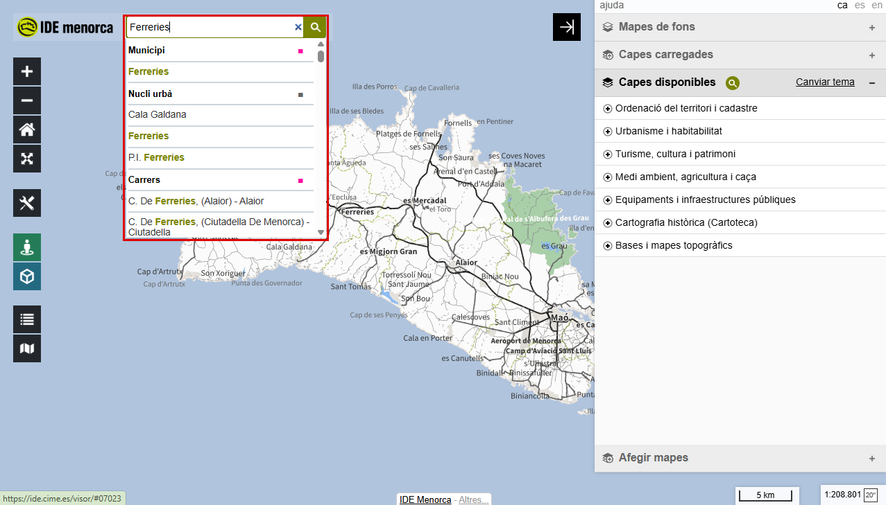
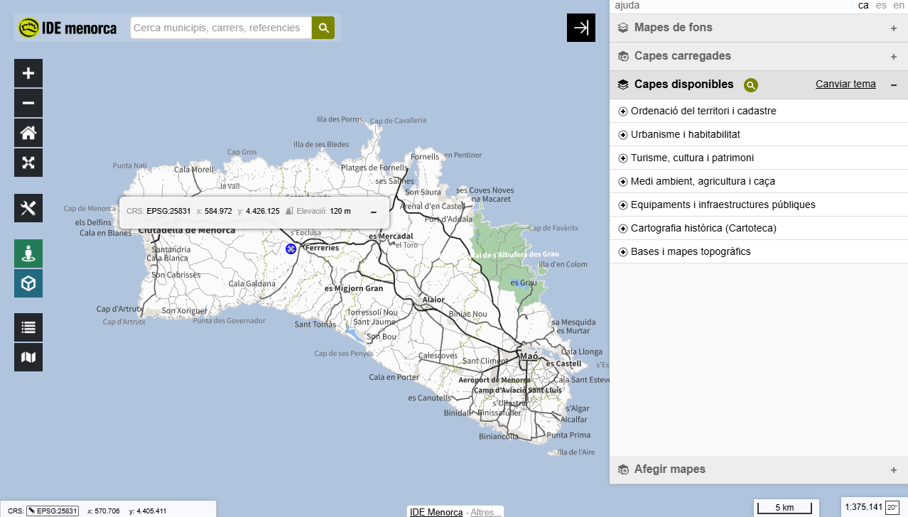
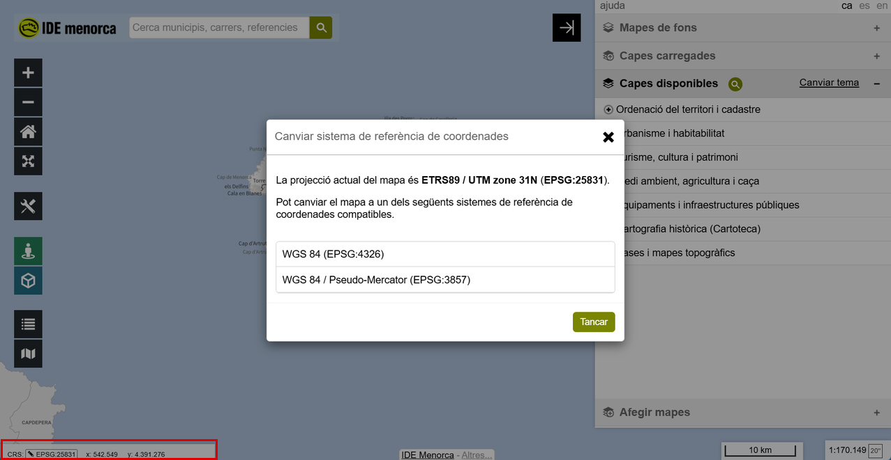

# 4.4. Localitzar i obtenir coordenades

## Objectiu

En acabar sabràs trobar un lloc pel nom i obtenir les coordenades i l'elevació
de qualsevol punt del mapa.

## Passos

1. **Cercar un lloc pel nom.** Escriu-lo al quadre de cerca de la capçalera i
   tria un resultat de la llista: el visor s'hi situa. Hi valen municipis,
   nuclis i carrers, però també **equipaments** i **referències cadastrals**:
   amb «Pavelló Menorca» hi arribes igual que amb una adreça.

    <figure markdown>
      { .captura }
      <figcaption>El cercador troba municipis, nuclis, carrers, equipaments i referències cadastrals.</figcaption>
    </figure>

2. **Obtenir les coordenades d'un punt.** Fes clic sobre el mapa: el requadre et
   dona el sistema de referència, les **coordenades** i l'**elevació** del punt.
   Si allà hi ha elements d'alguna capa carregada, hi afegeix la seva informació
   a sota ([4.6](06-consulta-atributs.md)).

    <figure markdown>
      { .captura }
      <figcaption>Cada clic al mapa dona el sistema de referència, les coordenades i l'altitud del terreny.</figcaption>
    </figure>

3. **Llegir les coordenades del cursor.** L'indicador del cantó inferior
   esquerre va donant, en temps real, el sistema de referència actiu i les
   coordenades d'allà on tens el ratolí: per saber on ets no has de fer clic
   enlloc.

4. **Canviar el sistema de coordenades.** Prem aquest mateix indicador i tria'n
   un altre del quadre que s'obre: el punt no es mou, només canvia la manera
   d'escriure'l.

    <figure markdown>
      { .captura }
      <figcaption>L'indicador de baix a l'esquerra obre aquest quadre: hi surt la projecció actual i les que hi són compatibles.</figcaption>
    </figure>

    !!! info "La llista no sempre és la mateixa"
        Els sistemes que t'ofereix depenen del mapa de fons que tinguis posat
        ([4.2](02-mapes-de-fons.md)): si en poses un d'incompatible amb el
        sistema actual, el visor te'l canvia tot sol. No ho has fet malament.

!!! tip "Metres o graus, segons per a què"
    De sèrie el visor treballa en **ETRS89 / UTM zone 31N (EPSG:25831)**,
    l'oficial a les Illes Balears, i et dona les coordenades en **metres**: és
    el que esperarà qualsevol informe tècnic d'aquí. En **WGS 84 (EPSG:4326)**
    el mateix punt s'escriu en **graus** —la latitud i la longitud de tota la
    vida—, que és el que entenen les aplicacions de mapes del telèfon.

## Exercici pràctic

**Quant puja un carrer de Ferreries?**

- [ ] Cerca un **carrer de Ferreries** al quadre de cerca i tria'l de la llista.
- [ ] Fes **clic a un extrem** del carrer i apunta'n les coordenades i
  l'elevació.
- [ ] Fes **clic a l'altre extrem** i resta les dues elevacions: això és el que
  puja el carrer.
- [ ] Prova ara el cercador amb **Pavelló Menorca**: no li has de donar cap
  adreça.
- [ ] Canvia el sistema de coordenades a **WGS 84** i torna a fer clic al mateix
  punt: els números passen de metres a graus, però el lloc és el mateix.
- [ ] Torna a **ETRS89 / UTM 31N** i passeja el cursor mirant l'indicador de
  baix.

---

!!! tip "Al manual de referència"
    [1.6. Sistema de coordenades i coordenades del cursor](../../../manuals/visor-generic/01-interficie.md#16-sistema-de-coordenades-i-coordenades-del-cursor)
