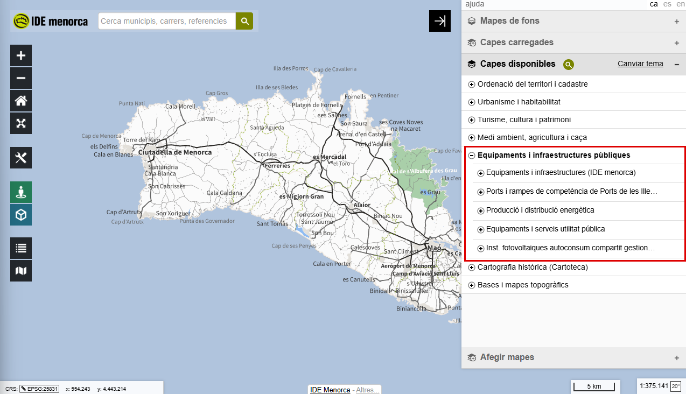
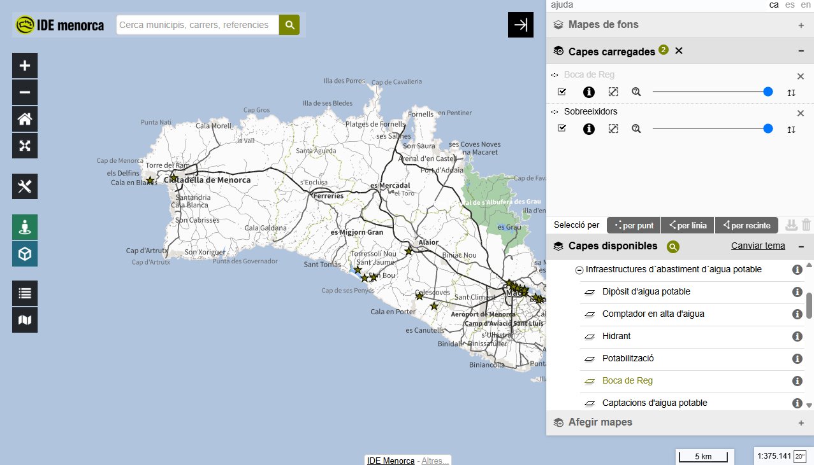

# 4.5. Buscar i carregar capes temàtiques

## Objectiu

En acabar sabràs trobar una capa d'informació, carregar-la al mapa i ajustar
com es veu. Una capa és cada conjunt de dades que el visor dibuixa damunt del
mapa de fons: els hidrants d'un nucli, les zones de la Reserva de la Biosfera
o les parcel·les del cadastre.

## Passos

1. **Desplegar un bloc temàtic.** El panell de la dreta ja s'obre per **Capes
   disponibles**: set blocs que es reparteixen tot el que pots carregar.

    - Ordenació del territori i cadastre
    - Urbanisme i habitabilitat
    - Turisme, cultura i patrimoni
    - Medi ambient, agricultura i caça
    - Equipaments i infraestructures públiques
    - Cartografia històrica (Cartoteca)
    - Bases i mapes topogràfics

    <figure markdown>
      { .captura }
      <figcaption>Desplegar un bloc encara no et dona capes: a sota hi ha més nivells.</figcaption>
    </figure>

    !!! info "L'enllaç «Canviar tema», a dalt de tot"
        Aquests set blocs són els del **tema per defecte**. L'enllaç **Canviar
        tema** recarrega el visor amb una altra configuració: un arbre de capes
        diferent, i també unes altres eines i uns altres mapes de fons. N'ofereix
        quatre —capes per origen de dades, de medi ambient, de turisme i
        d'ordenació del territori— i un accés per a usuaris restringits. Si el
        visor no s'assembla al que expliquem aquí, mira quin tema tens posat.

2. **Baixar fins a la capa.** Sota el bloc hi ha serveis i grups de capes, i no
   sempre els mateixos: unes capes les tens a un parell de clics i unes altres
   s'amaguen quatre o cinc nivells més avall. El cursor et diu si ja hi has
   arribat.

    | Cursor | Vol dir |
    |---|---|
    | Mà | Això es pot afegir al mapa: fes-hi clic |
    | Selecció de text | Encara ets en un nivell intermedi: desplega'l |

3. **Carregar la capa.** Fes-hi clic i es dibuixa damunt del mapa de fons. A
   l'arbre queda **ressaltada en verd**, per si després dubtes de si la tens
   posada.

4. **Buscar-la pel nom.** Si ja saps què vols, la **lupa** del costat de «Capes
   disponibles» va més de pressa: a partir del tercer caràcter et surten les
   capes que diuen allò al títol o a la descripció, amb el servei d'on ve
   cadascuna.

5. **Comprovar què tens carregat.** La secció **Capes carregades**, just a sobre
   de les disponibles, es queda plegada: desplega-la i hi tens tot el que has
   afegit. Mentre és plegada, un **cercle verd** en diu el nombre i la creu del
   costat les treu totes de cop.

    !!! info "Si carregues una capa i no la veus"
        Mira'n el títol en aquesta llista: si surt en **gris clar**, a l'escala
        on ets no es dibuixa. Apropa't i tornarà a aparèixer.

6. **Ajustar com es veu.** Cada capa carregada porta la seva fila d'eines, just
   sota el títol.

    | Eina | Per a què |
    |---|---|
    | Casella | Amagar i tornar a mostrar la capa sense treure-la |
    | **i** | Veure d'on surt la capa, qui la manté i amb quines condicions |
    | Marc amb fletxa | Ajustar el mapa a l'extensió de la capa: la manera ràpida de trobar-la si no la veus |
    | Lupa | Consultar la capa per atributs. Ho veuràs a la [4.6](06-consulta-atributs.md) |
    | Control de transparència | Deixar veure a través de la capa el que hi ha a sota |
    | Fletxes verticals | Canviar l'ordre: quina capa tapa quina |
    | Creu, al costat del títol | Treure aquella capa del mapa |

    Al final de la llista, en canvi, hi ha una fila **Selecció per** que no és
    de cap capa en concret: actua sobre **totes** les que tinguis carregades. La
    faràs servir a la [4.6](06-consulta-atributs.md).

    <figure markdown>
      { .captura }
      <figcaption>A dalt, les eines d'una capa. A baix, la fila de selecció, que actua sobre totes les capes carregades.</figcaption>
    </figure>

## Exercici pràctic

**La Reserva de la Biosfera, damunt del teu poble.**

- [ ] Carrega la **Zonificació de la Reserva de la Biosfera**, del tema **Medi
  ambient, agricultura i caça**.

    ??? tip "Si no la trobes, aquest és el camí"
        1. **Medi ambient, agricultura i caça** — el bloc
        2. **Medi ambient, agricultura i caça (IDE menorca)** — el servei
        3. **Reserva de la Biosfera** — el grup de capes
        4. **Zonificació de la Reserva de la Biosfera** — la capa
- [ ] Cerca el **teu municipi** ([4.4](04-localitzar-coordenades.md)) i mira
  fins on hi arriba la zonificació.
- [ ] Posa de fons una **ortofoto** ([4.2](02-mapes-de-fons.md)): la capa tapa
  el terreny.
- [ ] Amb el **control de transparència**, fes la capa més transparent fins que es vegi la
  fotografia a sota.
- [ ] Amaga-la i torna-la a mostrar amb la **casella**.
- [ ] Busca ara **Biosfera** amb la **lupa**: la que ja tens carregada hi surt en
  cursiva.
- [ ] Treu-la del mapa amb la **creu**.

!!! tip "El fons i les capes no són el mateix"
    Del mapa de fons només en pots tenir dos alhora
    ([4.2](02-mapes-de-fons.md)) i serveixen per situar-te. Les capes són la
    informació que hi poses a sobre: les vas acumulant, i l'ordre decideix
    quina tapa quina.

---

!!! tip "Al manual de referència"
    [2.3. Buscar i afegir capes](../../../manuals/visor-generic/02-panell-capes.md#23-buscar-i-afegir-capes)
    i [2.5. Capes carregades](../../../manuals/visor-generic/02-panell-capes.md#25-capes-carregades)
