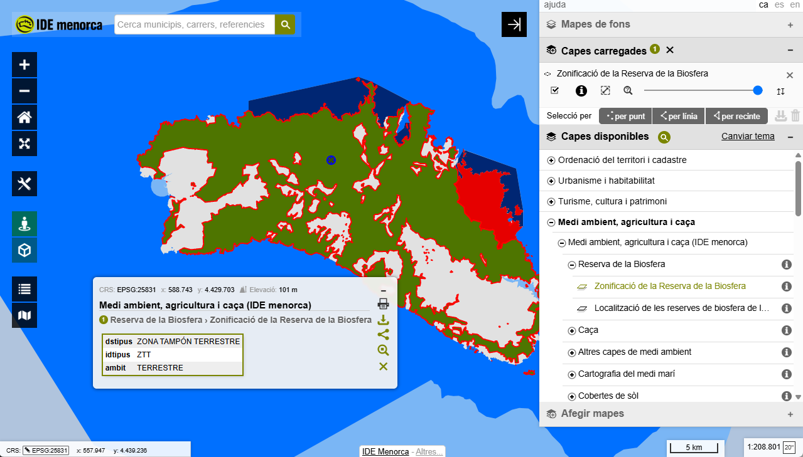
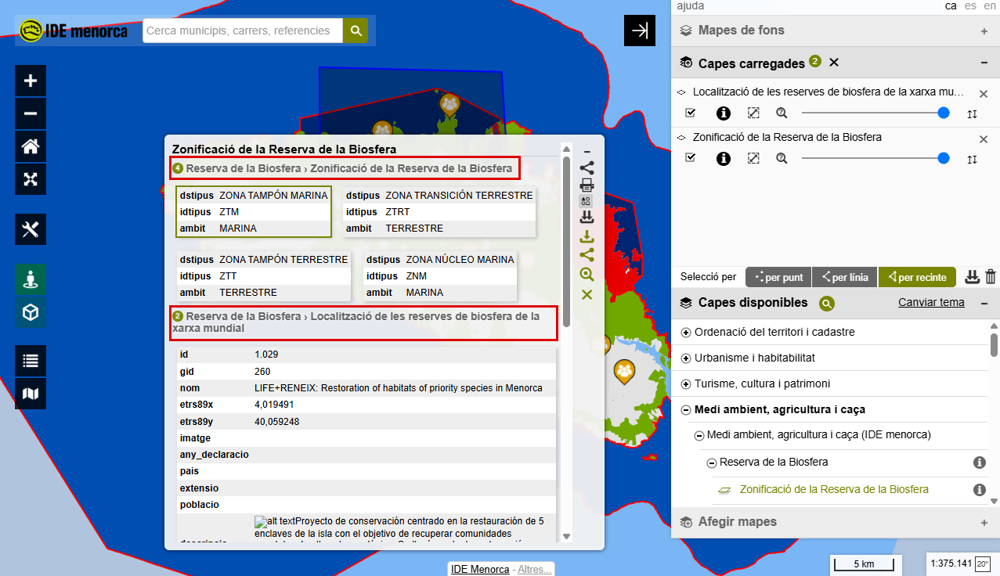

# 4.6. Consulta dels atributs de les capes carregades

## Objectiu

En acabar sabràs seleccionar elements sobre el mapa i llegir les dades que
porten. Cada element d'una capa —una zona, un hidrant, una parcel·la— arrossega
una fitxa de dades: com es diu, de quin tipus és, quina extensió té. Són els
seus **atributs**.

## Passos

1. **Carregar la capa que vols consultar.** La selecció només mira les capes que
   tinguis a **Capes carregades** ([4.5](05-capes-tematiques.md)). Sense cap, els
   botons **per línia** i **per recinte** estan apagats.

2. **Fer clic sobre un element.** Al final de la llista de capes carregades hi ha
   la fila **Selecció per**, amb **per punt** triat de sèrie. Fes clic sobre el
   mapa i s'obre el requadre de resultats.

    <figure markdown>
      { .captura }
      <figcaption>A dalt, el mateix que et dona un clic al mapa sense capes carregades. A sota, d'on surt l'element i els seus atributs.</figcaption>
    </figure>

3. **Llegir el requadre.** És el mateix que ja et sortia a la
   [4.4](04-localitzar-coordenades.md): a dalt hi tens les coordenades i
   l'elevació del punt. A sota hi apareix d'on surt l'element —el servei, i
   després el camí fins a la capa— i la taula dels seus atributs.

4. **Seleccionar-ne uns quants de cop.** Amb **per línia** o **per recinte**,
   dibuixa sobre el mapa i acaba amb doble clic: hi entren tots els elements que
   toquin el que has dibuixat.

5. **Llegir resultats de més d'una capa.** La selecció mira **totes** les capes
   carregades, no només una. Quan en surten de diverses, els resultats es
   presenten agrupats i un **cercle verd** diu quants n'hi ha de cada capa.

    <figure markdown>
      { .captura }
      <figcaption>Amb dues capes carregades, els resultats surten agrupats i comptats per capa.</figcaption>
    </figure>

6. **Netejar la selecció.** La **paperera** de la fila **Selecció per** treu del
   mapa tot el que hi hagis seleccionat.

## Exercici pràctic

**Quants tipus de zona té la Reserva de la Biosfera?**

- [ ] Carrega la **Zonificació de la Reserva de la Biosfera**
  ([4.5](05-capes-tematiques.md)).
- [ ] Fes clic sobre una zona i mira què diu l'atribut **`dstipus`**.
- [ ] Busca'n una de **marina** i una de **terrestre**: l'atribut canvia.
- [ ] Dibuixa un **recinte** sobre un tros de costa i compta quants valors
  diferents de `dstipus` et surten de cop.
- [ ] Carrega també la **Localització de les reserves de biosfera de la xarxa
  mundial** i torna a seleccionar: els resultats surten agrupats per capa.
- [ ] Neteja-ho tot amb la **paperera**.

!!! tip "No totes les capes porten la mateixa informació"
    La Zonificació té tres atributs i prou: `dstipus`, `idtipus` i `ambit`. La
    de Localització en té més d'una dotzena, amb el nom del projecte, l'any de
    declaració, l'extensió, la població i una descripció. Els atributs els
    decideix qui publica la capa, i per això canvien tant d'una a l'altra.

---

!!! tip "Al manual de referència"
    [4. Selecció gràfica d'elements](../../../manuals/visor-generic/04-seleccio-grafica.md)
