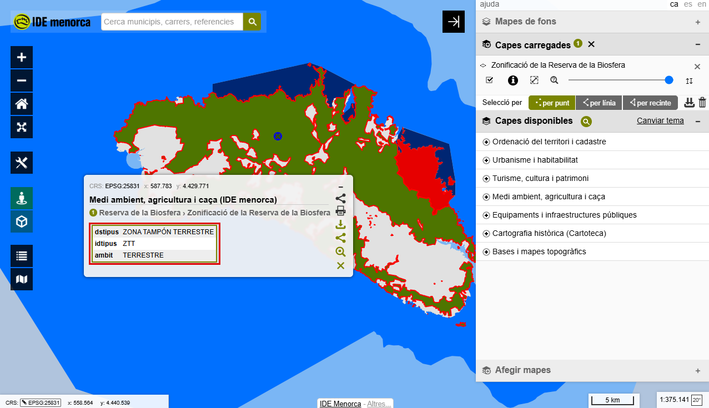
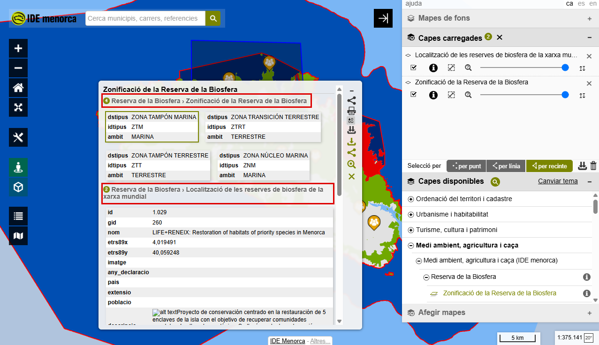

# 4.6. Consulta dels atributs de les capes carregades

## Objectiu

En acabar sabràs seleccionar elements sobre el mapa i llegir la informació que
porten associada.

## Passos

1. **Tenir una capa carregada.** La selecció només actua sobre capes que ja
   siguin al panell de capes carregades. Sense cap, els botons **per línia** i
   **per recinte** estan apagats.

2. **Seleccionar un element amb un clic.** Sota la capa carregada hi ha la fila
   **Selecció per**, amb **per punt** triat de sèrie. Fes clic sobre un element
   del mapa.

    <figure markdown>
      { .captura }
      <figcaption>El requadre diu de quina capa surt l'element i en llista els atributs.</figcaption>
    </figure>

3. **Llegir el requadre.** A dalt hi surt **de quina capa** prové l'element, i a
   sota la taula amb els seus **atributs**. La selecció busca a **totes** les
   capes carregades, no només a la que té la fila a sobre.

4. **Seleccionar-ne diversos.** Amb **per línia** o **per recinte**, dibuixa
   sobre el mapa i acaba amb doble clic. Se seleccionen tots els elements que
   toquin el que has dibuixat.

5. **Llegir resultats de diverses capes.** Quan els elements vénen de capes
   diferents, els resultats s'agrupen per capa, i un **cercle verd** indica
   quants n'hi ha de cadascuna.

    <figure markdown>
      { .captura }
      <figcaption>Amb dues capes carregades, els resultats surten agrupats i comptats per capa.</figcaption>
    </figure>

6. **Netejar la selecció.** La **paperera** de la fila de selecció treu del mapa
   tot el que hi hagis seleccionat.

## Exercici pràctic

1. Carrega la **Zonificació de la Reserva de la Biosfera**, com a la secció
   anterior.
2. Fes clic sobre una zona i mira què diu l'atribut **`dstipus`**.
3. Busca'n una de **marina** i una de **terrestre**: veuràs que l'atribut
   canvia.
4. Dibuixa un **recinte** sobre una zona de costa i mira quantes en seleccionés
   de cop.
5. Carrega també la **Localització de les reserves de biosfera de la xarxa
   mundial** i torna a seleccionar: els resultats surten agrupats per capa.
6. Neteja-ho tot amb la paperera.

!!! tip "No totes les capes porten la mateixa informació"
    La Zonificació té tres atributs; la de Localització en té més d'una dotzena,
    amb nom, any de declaració, superfície i fins i tot un correu de contacte.
    Els atributs els decideix qui publica la capa.

---

!!! tip "Al manual de referència"
    [4. Selecció gràfica d'elements](../../../manuals/visor-generic/04-seleccio-grafica.md)
