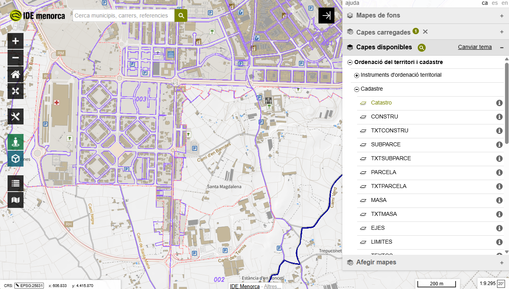
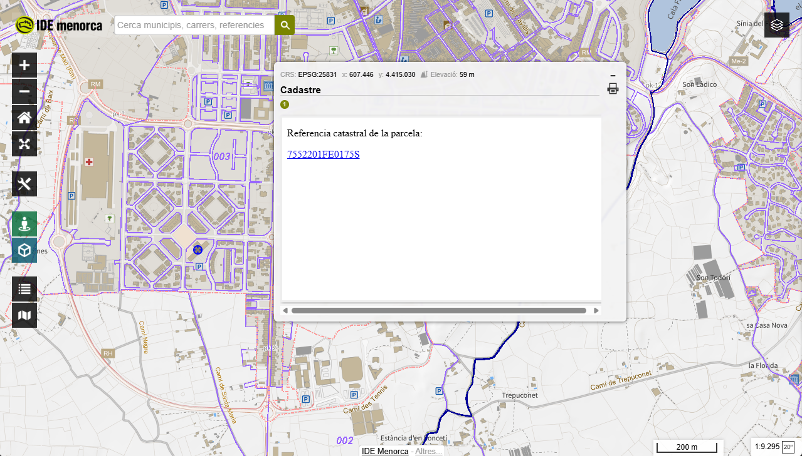

# 4.7.2. Treballar amb el cadastre

## Objectiu

En acabar sabràs anar de la referència cadastral al mapa i del mapa a la
referència, i obrir la fitxa oficial d'una parcel·la. En aquesta secció
faràs servir la **referència cadastral** de 14 caràcters, la que identifica la
parcel·la ([4.7.1](07-referencia-cadastral.md)). És la que demana qualsevol
tràmit i la que el Cadastre entén.

## Passos

1. **Carregar la cartografia cadastral.** És a les capes disponibles, dins
   **Ordenació del territori i cadastre → Cadastre**
   ([4.5](05-capes-tematiques.md)). Carrega-hi **`Catastro`**: és la que dibuixa
   la cartografia cadastral sencera. Les altres del grup —`PARCELA`, `CONSTRU`,
   `MASA`…— són les capes individuals que `Catastro` reuneix, per si només
   en vols una.

    <figure markdown>
      { .captura }
      <figcaption>De tot el grup Cadastre, la capa que dibuixa les parcel·les senceres és Catastro.</figcaption>
    </figure>

2. **De la referència al mapa.** El quadre de cerca de la capçalera —el mateix
   de la [4.4](04-localitzar-coordenades.md)— accepta referències cadastrals.
   Escriu-ne una i el visor s'hi situa.

3. **Del mapa a la referència.** Fes clic sobre una parcel·la, com a la
   [4.6](06-consulta-atributs.md). Aquesta capa no treu cap taula d'atributs: el
   que et dona és la **referència cadastral**, i és un **enllaç**.

    <figure markdown>
      { .captura }
      <figcaption>La referència cadastral és, alhora, l'enllaç que obre la fitxa oficial.</figcaption>
    </figure>

4. **Obrir la fitxa oficial.** L'enllaç obre la Seu Electrònica del Cadastre
   **en una pestanya nova**, amb les dades d'aquella parcel·la. No perds el
   mapa: el visor es queda obert a la pestanya d'abans.

    !!! tip "El visor situa, el Cadastre certifica"
        El visor et serveix per **trobar** la parcel·la i veure-la en context.
        El document amb validesa oficial surt de la **Seu Electrònica del
        Cadastre**, no d'aquí.

!!! warning "La cartografia cadastral ve de fora"
    No és de l'IDE Menorca: la serveix la Direcció General del Cadastre. Es nota
    al requadre de consulta: on les capes pròpies tenen els botons de
    descarregar i compartir, aquesta només hi deixa imprimir.

## Exercici: de quin edifici és aquesta referència?

- [ ] Carrega la cartografia cadastral.
- [ ] Cerca la referència **`7552201FE0175S`** al quadre de cerca.
- [ ] Fes clic sobre la parcel·la: en surt la referència cadastral.
- [ ] Obre la fitxa oficial amb l'enllaç.
- [ ] Compara l'adreça que dona el Cadastre amb el que veus al mapa.

!!! tip "L'edifici el coneixes"
    És la plaça de la Biosfera, 5, de Maó: la seu del Consell Insular de
    Menorca.

---

!!! tip "Al manual de referència"
    [7. El cadastre](../../../manuals/visor-generic/07-cadastre.md)
