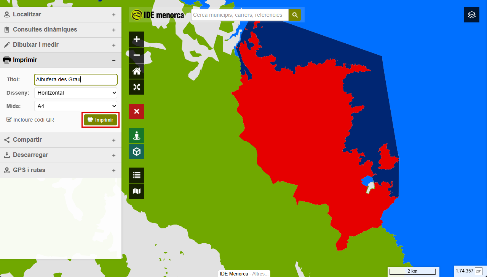
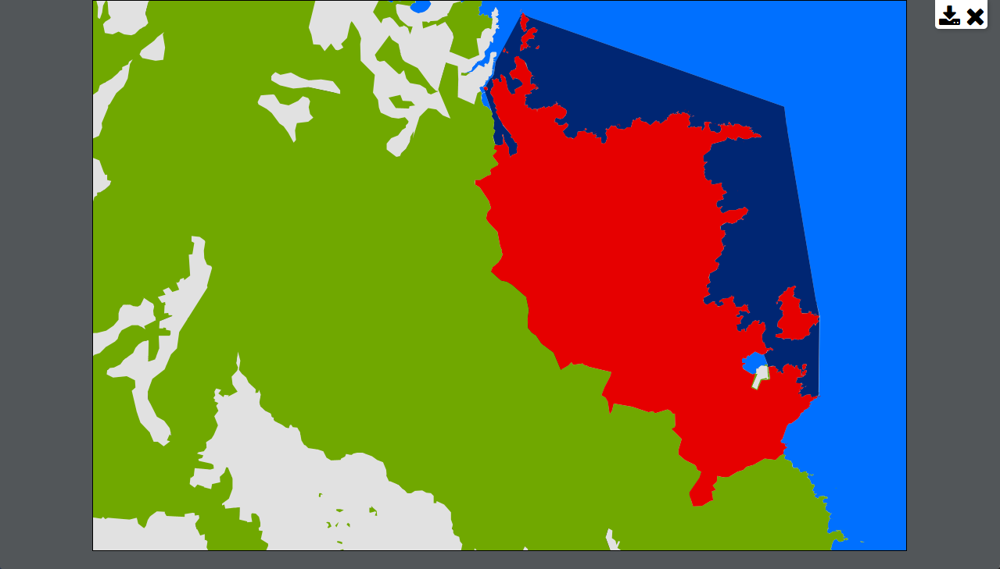

# 4.8. Imprimir

## Objectiu

En acabar sabràs generar un PDF del mapa que tens a la pantalla, amb el títol,
l'escala i la llegenda de les capes carregades.

## Passos

1. **Deixar el mapa com el vols imprimir.** Carrega-hi les capes i tria el
   mapa de fons: el PDF surt del que tinguis a la pantalla. L'enquadrament
   l'acabaràs d'ajustar al final.

2. **Obrir l'eina Imprimir.** És al panell d'eines, el de les eines creuades de
   la columna esquerra ([4.3](03-mesurar-dibuixar.md)).

    <figure markdown>
      { .captura }
      <figcaption>El títol, el disseny i la mida es decideixen abans de generar el PDF.</figcaption>
    </figure>

3. **Omplir les opcions.** Títol, orientació del full, mida i si hi vols el codi
   QR. El QR porta al mapa que ha generat el PDF: qui el rebi imprès el pot
   tornar a obrir al visor.

4. **Prémer Imprimir i ajustar l'enquadrament.** S'obre una previsualització amb
   un marc sobre el mapa. El que hi quedi a dins és el que sortirà al PDF, no el
   que es veia abans: ajusta l'escala amb la **roda del ratolí** i arrossega el
   mapa per centrar-hi el que vols.

    <figure markdown>
      { .captura }
      <figcaption>A la previsualització s'ajusten l'enquadrament i l'escala abans de generar el PDF.</figcaption>
    </figure>

5. **Descarregar el PDF.** Amb el botó de descàrrega del marge superior dret.
   La creu del costat tanca la previsualització sense generar res.

## Exercici pràctic

- [ ] Carrega la **Zonificació de la Reserva de la Biosfera**
  ([4.5](05-capes-tematiques.md)).
- [ ] Enquadra el **nucli urbà del teu municipi**.
- [ ] Obre **Imprimir**, posa-hi un títol, tria full **A4 horitzontal** i marca el
  **codi QR**.
- [ ] Ajusta l'escala amb la roda del ratolí i descarrega el PDF.
- [ ] Obre'l i comprova-hi tres coses: el **títol**, l'**escala** i la **llegenda**
  de la capa.
- [ ] Escaneja el **QR** amb el mòbil: ha d'obrir el mateix mapa al visor.

!!! tip "La llegenda només surt si hi ha capes"
    Un PDF del mapa de fons sol no porta llegenda. Si vols que el document
    s'expliqui per si mateix, carrega abans les capes que diuen què s'hi veu.

---

!!! tip "Al manual de referència"
    [3.2. Imprimir](../../../manuals/visor-generic/03-eines/02-imprimir.md)
