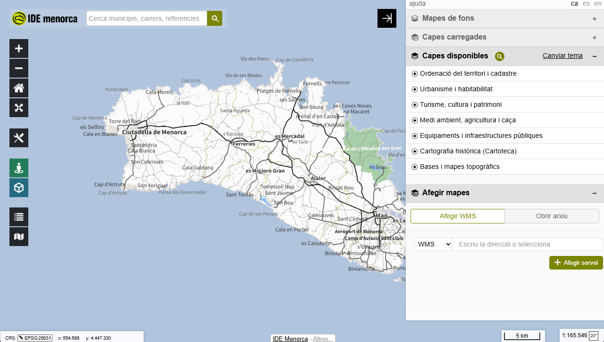
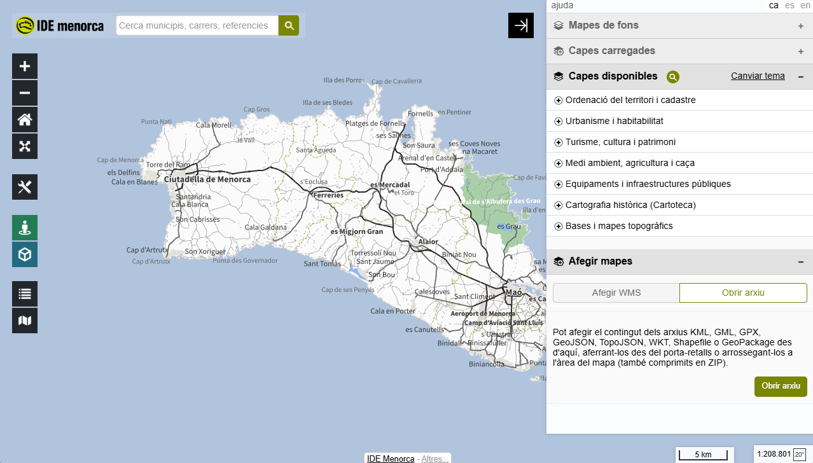
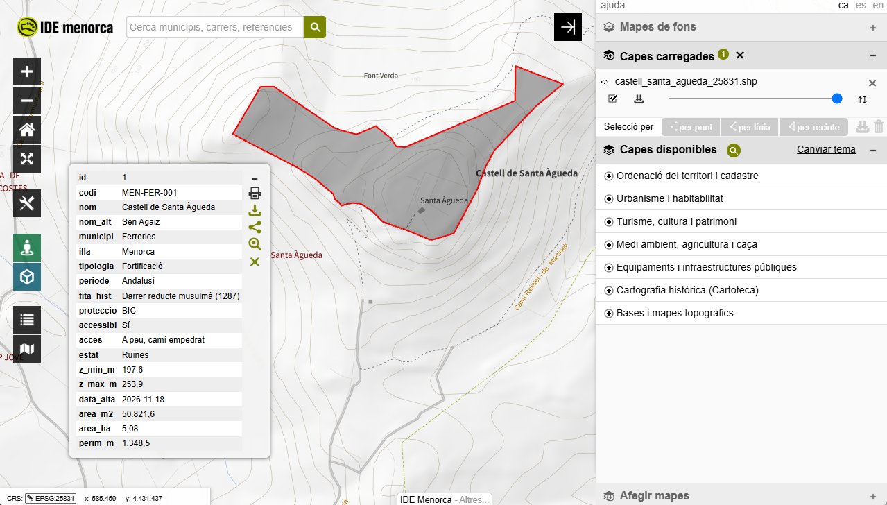

# 4.9. Visualitzar fitxers de cartografia

## Objectiu

En acabar sabràs carregar al visor un fitxer de cartografia teu, consultar-ne
els atributs i tornar-lo a descarregar en un altre format.

## Passos

1. **Obrir «Afegir mapes».** És a baix de tot del panell de capes. Té dues
   pestanyes: **Afegir WMS**, per a serveis, i **Obrir arxiu**, per als fitxers
   del teu ordinador.

    <figure markdown>
      { .captura }
      <figcaption>Afegir mapes, a baix de tot del panell de capes, serveix tant per a serveis com per a fitxers.</figcaption>
    </figure>

2. **Carregar el fitxer.** Hi ha tres camins i tots tres van a parar al mateix
   lloc: triar-lo des de la pestanya **Obrir arxiu**, aferrar-lo des del
   porta-retalls, o **arrossegar-lo damunt el mapa**.

    <figure markdown>
      { .captura }
      <figcaption>La segona pestanya d'Afegir mapes és la dels fitxers, i hi diu quins formats accepta.</figcaption>
    </figure>

    Admet **KML**, **GML**, **GPX**, **GeoJSON**, **TopoJSON**, **WKT**,
    **Shapefile** i **GeoPackage**, també comprimits en **ZIP**.

3. **Consultar els atributs.** Fes clic damunt un element del fitxer i en
   surten els atributs, com a la [4.6](06-consulta-atributs.md).

    <figure markdown>
      { .captura }
      <figcaption>Encara que la fila de selecció surti apagada, el clic sobre l'element en retorna els atributs.</figcaption>
    </figure>

4. **Tornar-lo a descarregar en un altre format.** La fila del fitxer té la
   seva pròpia icona de descàrrega, al costat de la casella. El torna a treure
   en KML, GML, GeoJSON, WKT, Shapefile o GeoPackage: és una manera ràpida de
   convertir de format sense sortir del visor.

5. **Comprovar que es queda.** Recarrega la pàgina: el fitxer hi continua
   carregat.

!!! info "El sistema de referència no importa"
    El visor reprojecta el fitxer ell mateix: tant se val que vingui en 25831,
    en 4326 o en ED50.

!!! info "Diferències amb una capa normal"
    Un fitxer teu no es comporta del tot com una capa del catàleg:

    - La fila **Selecció per** surt **apagada**. Tot i així, el clic damunt un
      element en retorna els atributs igualment.
    - L'eina **Descarregar** del panell d'eines **no el baixa**: només treballa
      amb les capes del catàleg. Si hi vas amb un fitxer teu carregat, et dirà
      que no hi ha capes carregades.

## Exercici: de GeoJSON a Shapefile

Aquest exercici tanca el cercle: treure dades del visor i tornar-les-hi a
posar.

- [ ] Dibuixa un polígon damunt el mapa amb l'eina de dibuix
  ([4.3](03-mesurar-dibuixar.md)).
- [ ] Descarrega'l en **GeoJSON**.
- [ ] Torna'l a carregar al visor, arrossegant-lo damunt el mapa.
- [ ] Comprova que surt a **Capes carregades** amb el nom del fitxer.
- [ ] Recarrega la pàgina: hi ha de continuar.
- [ ] Descarrega'l un altre cop, ara des de la icona de la seva fila, i tria
  **Shapefile**.

!!! tip "És el que faràs amb la cartografia del teu ajuntament"
    El mateix camí serveix per mirar al visor un fitxer que t'hagin passat o
    que hagis preparat tu, i veure'l damunt la cartografia de l'illa.

---

!!! tip "Al manual de referència"
    [8. Fitxers propis](../../../manuals/visor-generic/08-fitxers-propis.md)
