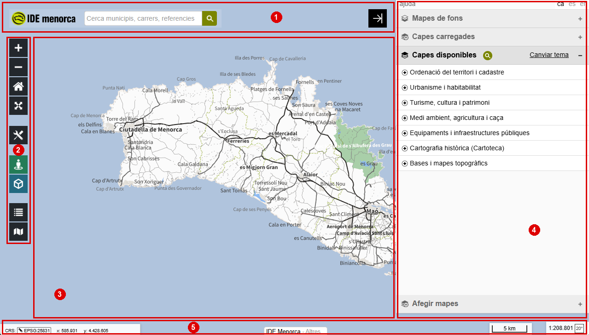

# Mòdul 4. Visor genèric de l'IDE Menorca

El visor genèric és l'aplicació amb què es consulta la cartografia de l'IDE
Menorca. En aquest mòdul aprendràs a fer-lo servir i descobriràs què hi pots
trobar, que és molt més del que sembla a primera vista.

És un mòdul pràctic: cada secció acaba amb un exercici per provar al visor el
que acabes de llegir. Ho farem tot des del navegador, i hi pots entrar sempre
que vulguis, des d'on vulguis.

## En acabar el mòdul

Podràs consultar amb quatre clics l'enllumenat d'un carrer, els plans
d'ordenació del territori o els béns d'interès cultural d'un municipi, entre moltes altres funcions.

Pel camí hauràs après a moure't pel mapa, a triar què hi vols veure, a mesurar
sobre el terreny, a consultar la informació de qualsevol element, a treballar
amb el cadastre, a imprimir el resultat i a carregar-hi fitxers teus.

## La pantalla

Val la pena dedicar-hi un minut abans de començar. El visor té **cinc zones**,
i cada secció del mòdul treballa en una o dues.

<figure markdown>
  { .captura }
  <figcaption>Les cinc zones de la pantalla del visor.</figcaption>
</figure>

| | Zona | Què hi trobaràs | On es treballa |
|---|---|---|---|
| **1** | **Capçalera** | El quadre de cerca | [4.4](04-localitzar-coordenades.md), [4.7](07-cadastre.md) |
| **2** | **Columna esquerra** | Zoom, extensió inicial, pantalla completa, panell d'eines, Street View, vista d'ocell, llegenda i mapa de situació. | [4.1](01-navegacio.md), [4.3](03-mesurar-dibuixar.md), [4.8](08-imprimir.md) |
| **3** | **El mapa** | Tota la superfície central | A totes |
| **4** | **Panell de la dreta** | Mapes de fons, capes carregades, capes disponibles i «Afegir mapes». Dalt de tot també tenim ajuda i canvi d'idioma. | [4.2](02-mapes-de-fons.md), [4.5](05-capes-tematiques.md), [4.6](06-consulta-atributs.md), [4.9](09-fitxers-propis.md) |
| **5** | **Barra inferior** | Coordenades del cursor, atribucions i escala | [4.4](04-localitzar-coordenades.md) |

!!! tip "La llista completa és al manual"
    Per seguir el curs, amb les cinc zones n'hi ha prou. Si en vols el detall
    —els quinze elements de la interfície, un per un— el trobaràs a
    [1.1. Les parts de la pantalla](../../../manuals/visor-generic/01-interficie.md).

## Les nou seccions

| | Secció | Què hi aprendràs |
|---|---|---|
| 4.1 | [Eines de navegació sobre el mapa](01-navegacio.md) | Desplaçar el mapa, apropar-te i allunyar-te, i tornar a la vista inicial |
| 4.2 | [Control de mapes de fons](02-mapes-de-fons.md) | Canviar el mapa de fons i comparar dues èpoques del mateix lloc |
| 4.3 | [Mesurar i dibuixar elements](03-mesurar-dibuixar.md) | Dibuixar punts, línies i polígons, i obtenir-ne distàncies i superfícies |
| 4.4 | [Cercar un lloc i obtenir coordenades](04-localitzar-coordenades.md) | Trobar un lloc pel nom i obtenir les coordenades de qualsevol punt |
| 4.5 | [Cercar i carregar capes temàtiques](05-capes-tematiques.md) | Trobar una capa d'informació, carregar-la al mapa i ajustar com es veu |
| 4.6 | [Consulta dels atributs de les capes carregades](06-consulta-atributs.md) | Seleccionar elements i llegir la informació que porten associada |
| 4.7 | [Treballar amb el cadastre](07-cadastre.md) | Localitzar una parcel·la cadastral i obrir-ne la fitxa oficial |
| 4.8 | [Imprimir](08-imprimir.md) | Generar un PDF del mapa amb el títol, l'escala i la llegenda |
| 4.9 | [Visualitzar fitxers de cartografia](09-fitxers-propis.md) | Carregar un fitxer teu, consultar-ne els atributs i descarregar-lo |

Estan pensades per fer-se en ordre: cada una dona per sabuda l'anterior.

!!! tip "Tingues el visor obert mentre llegeixes"
    Obre el [visor genèric](https://ide.cime.es/visor) en una altra finestra i
    tingue'l a mà. Totes les seccions acaben amb un exercici que s'hi fa, i la
    manera d'aprendre'n és fent-los.
