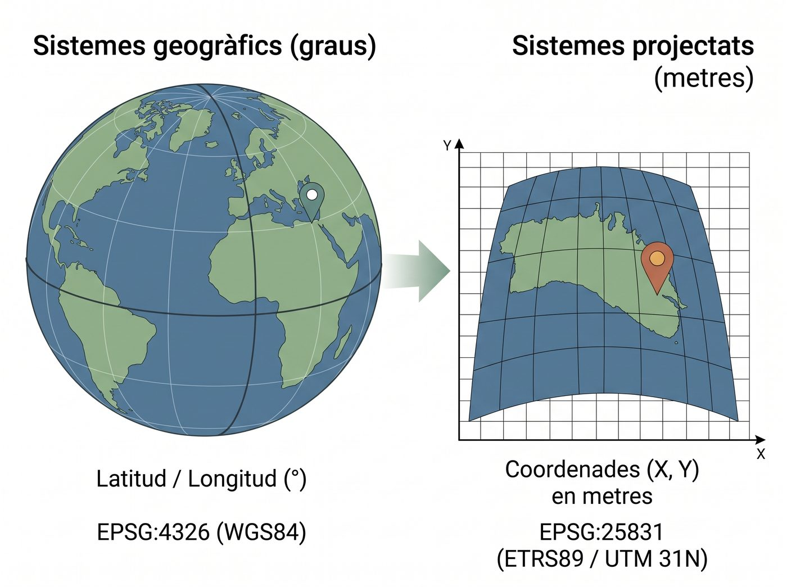
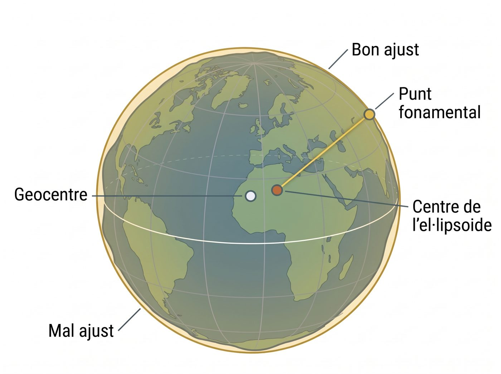

# 1.1. Sistemes de referència: què passa quan tocam l'EPSG del visor?

Recordes allò que dèiem al curs bàsic que un parell de coordenades sense sistema
de referència no serveix per a res? Idò al visor de l'IDE Menorca això es veu a
l'instant.

De manera resumida, tenim dues grans famílies de sistemes de referència
([1.3 del curs bàsic](../../basic/modul-1-cartografia/03-quins-sistemes.md)):

- Els sistemes geogràfics (en graus) Situen els punts sobre una esfera o
  el·lipsoide mitjançant angles de latitud i longitud (com el famós EPSG:4326 o
  WGS84 que fan servir els GPS i Google Maps). Són genials per guardar dades
  globals, però pèssims per mesurar distàncies directament perquè un grau no
  mesura el mateix a l'Equador que a Ciutadella.
- Els sistemes projectats (en metres): Que per a fer tornar 'plana' la Terra i
  poder-la representar en un paper (o una pantalla d'ordinador) inevitablement
  la deformen d'alguna manera. Però, això sí, aconsegueixen donar-nos
  coordenades (X, Y) en metres, no en graus i això ens ajuda molt a l'hora de
  treballar.

<figure markdown>
  { .captura }
  <figcaption>Dels graus sobre l'el·lipsoide als metres sobre el pla.</figcaption>
</figure>

??? info "Vols saber-ne més: què és exactament el Datum? Que n'he sentit a parlar però no ho tinc clar."
    El Datum en sistemes geogràfics no és res més que un model matemàtic que
    **defineix com és l'el·lipsoide** de referència del sistema i quina és la
    seva **posició relativa** a la terra. És a dir que podem resumir que datum és
    l'el·lipsoide + la seva posició.

    Hi ha dos tipus de Datums, els locals i els globals.

    - **Datums locals** (com l'antic ED50): Encaixaven l'el·lipsoide perquè
      s'ajustés molt bé a una zona concreta (Europa), encara que a l'altra punta
      del món quedés desplaçat.
    - **Datums geocèntrics globals** (com WGS84 o ETRS89): Fan coincidir el
      centre de l'el·lipsoide directament amb el centre de masses de la Terra
      (geocentre), de manera que serveixen per a tot el planeta.

    <figure markdown>
      { .captura }
      <figcaption>Un datum local s'ajusta bé a prop del punt fonamental, i pitjor a l'altra banda del món.</figcaption>
    </figure>

??? info "Vols saber-ne més: el Datum en sistemes projectats"
    Un sistema projectat no es crea mai des del no-res: sempre parteix d'un
    sistema geogràfic i, per tant, hereta el seu Datum. El procés sempre té dos
    passos: primer situam el punt sobre l'el·lipsoide mitjançant el Datum (en
    graus) i, tot seguit, aplicam una fórmula matemàtica (la projecció, com la
    UTM) per "aplanar" aquell el·lipsoide sobre un mapa en metres. Per això el
    nom complet del nostre sistema oficial té dues parts separades per una
    barra: ETRS89 / UTM zona 31N. La primera part (ETRS89) indica el Datum (com
    hem encaixat l'el·lipsoide a la Terra) i la segona (UTM zona 31N) indica la
    Projecció (com l'hem aplanat).

Els sistemes de referència a Espanya es regulen pel **Reial decret 1071/2007,
de 27 de juliol**. Els oficials són els següents:

| Àmbit geogràfic / Escala | Sistema oficial | Codi EPSG |
|---|---|---|
| **Sistemes geogràfics** | | |
| **Península i Illes Balears (Menorca)** | **ETRS89** | **EPSG:4258** |
| Illes Canàries | REGCAN95 | EPSG:4081 |
| **Sistemes projectats** | | |
| **Est peninsular, Catalunya i Illes Balears (Menorca)** | **ETRS89 / UTM zona 31N** | **EPSG:25831** |
| Centre i gran part de la península | ETRS89 / UTM zona 30N | EPSG:25830 |
| Galícia i oest peninsular | ETRS89 / UTM zona 29N | EPSG:25829 |
| Illes Canàries | REGCAN95 / UTM zones 27N i 28N | EPSG:4082 / EPSG:4083 |
| Mapes generals de tot l'Estat | ETRS89 / Cònica Conforme de Lambert (LCC) | EPSG:3034 |
| Península / Illes Balears (mareògraf local a cada illa) | REDNAP (Nivell mitjà del mar a Alacant a la península) | EPSG:5782 (península) |

A la pràctica a Menorca fem servir per defecte sempre el sistema **EPSG:25831**,
però si entres al visor veuràs que els altres dos sistemes de referència que hi
trobaràs no estan a la llista. Són l'**EPSG:4326**, que és un sistema de
coordenades geogràfiques que pren el sistema GPS com a estàndard, i el
**EPSG:3857** que és un estàndard de facte popularitzat per Google.

??? info "En vols saber més? L'apassionant història de l'EPSG:4326 i l'EPSG:3857."
    Bé, això d'apassionant era només un reclam per aconseguir que obrissiu el
    quadre... però una mica interessant sí que és:

    **EPSG:4326.**

    És un sistema de coordenades geogràfiques i fa referència al datum WGS84. És
    l'estàndard mundial lligat al sistema GPS nord-americà i el que empra el GPS
    del telèfon o el Garmin si vas al camp. L'any 1989 es va definir el ETRS89 i
    era una adaptació per Europa del WGS84. La diferència és que el punt
    fonamental de l'ETRS89 es va col·locar sobre la placa tectònica euroasiàtica
    (vet aquí el seu nom ve de European Terrestrial Reference System de l'any
    89). És a dir que l'ETRS89 es mou amb Europa, de manera que les coordenades
    d'una parcel·la o d'un vèrtex geodèsic a Menorca no canvien amb el temps,
    mentre que el **WGS84 és un sistema global** que no segueix el moviment de
    la placa. A causa de la deriva continental (uns 2,5 cm/any), avui dia hi ha
    un desplaçament d'uns **70–80 centímetres** entre `EPSG:4258` (ETRS89) i
    `EPSG:4326` (WGS84).

    **`EPSG:3857` (Web Mercator o Pseudo-Mercator)** no ve de cap organisme
    geodèsic ni de cap llei: va néixer l'any **2005 de la mà de Google Maps**
    per resoldre un problema purament informàtic de velocitat.

    Aquesta és la seva història i per què és tan peculiar:

    - **La "drecera" matemàtica de Google:** Quan Google va crear Google Maps,
      necessitava que els mapes carreguessin a l'instant tallant el món en
      quadradets (tessel·les). Calcular la projecció de Mercator real sobre un
      el·lipsoide xafat (com el WGS84) requeria fórmules matemàtiques pesades
      per als servidors i navegadors de l'època. Els enginyers de Google van fer
      una drecera: van agafar les coordenades del datum **WGS84**
      (el·lipsoïdal), però a l'hora d'aplicar la projecció de Mercator **van fer
      veure que la Terra era una esfera perfecta**. D'aquí ve el seu nom tècnic:
      *WGS 84 / Pseudo-Mercator*.
    - **El codi pirata `900913`:** Al principi, l'organisme EPSG es va negar a
      donar-li un codi oficial perquè considerava que barrejar un datum
      el·lipsoïdal amb una fórmula esfèrica era una aberració geodèsica. Com que
      els programes SIG necessitaven un número per identificar-lo, la comunitat
      de programari lliure (GeoServer, OpenLayers) es va inventar el codi
      **`EPSG:900913`** —si el llegeixes com a lletres, posa **GOOGLE**.
    - **L'acceptació oficial (`3857`):** Com que OpenStreetMap, Bing, ESRI i
      gairebé tot internet el van adoptar per poder superposar capes sobre
      Google Maps, l'any 2008 l'EPSG va acabar cedint i li va assignar el codi
      definitiu **`EPSG:3857`**.

## Exercici: canvia el sistema de referència

Obre el visor de l'IDE Menorca (<https://ide.cime.es/visor>) i segueix els passos i
contesta les preguntes següents:

- [ ] 1. Passa el cursor per sobre l'àrea del mapa i fixa't en les coordenades i
  el codi EPSG que apareix a baix a l'esquerra.
- [ ] 2. Ara canvia el sistema de referència de EPSG:25831 a EPSG:4326. Fixa't
  com canvia la forma de Menorca i el format de les coordenades.
- [ ] 3. A la **plantilla d'exercicis** escriu les coordenades en els tres
  sistemes de referència del far de Cavalleria (si fas clic sobre el mapa podràs
  copiar còmodament les coordenades). I explica en quines unitats està cada un
  d'ells.
- [ ] 4. Fixa't ara que al canviar els sistemes de referència apareix una
  fletxeta al costat de determinats mapes de fons.
- [ ] 5. Ara, amb l'EPSG:25831 seleccionat, escull el mapa d'OpenStreetMap.
  Veuràs que automàticament canvia el sistema de referència. Apunta a la
  **plantilla d'exercicis** quin és el sistema de referència d'OpenStreetMap
  (OSM) i el del mapa base del Govern Balear?
- [ ] 6. Juga una estona a modificar els mapes de fons i els sistemes de
  referència i procura comprendre per què passa el que passa al visor.

**NOTA. Recorda que si t'emociones molt i el visor queda embussat pots
fer CTRL+F5 per a reiniciar-lo i aquí no ha passat res.**

!!! info "Per què el visor canvia de sistema de referència"
    Els mapes de fons són imatges que ja estan preparades en algun servidor,
    llestes per a ser visualitzades. Alguns mapes de fons els hem fet nosaltres,
    altres el govern balear, altres el govern estatal i alguns són d'abast
    mundial fets per altres organismes. Cadascun té el seu sistema de referència
    en funció del seu objectiu i propòsit. Alguns, molt poquets, admeten dos o
    tres sistemes de referència perquè fer-ho implica que s'han de duplicar les
    imatges preparades o triplicar.

    El visor de l'IDE Menorca fa una cosa que els informàtics en diuen reprojecció al
    vol (on the fly) perquè tots els mapes de fons, i també la resta de
    cartografia, es pugui superposar. Per aquest motiu és important saber de què
    va tot això per no fer-se un embolic.
