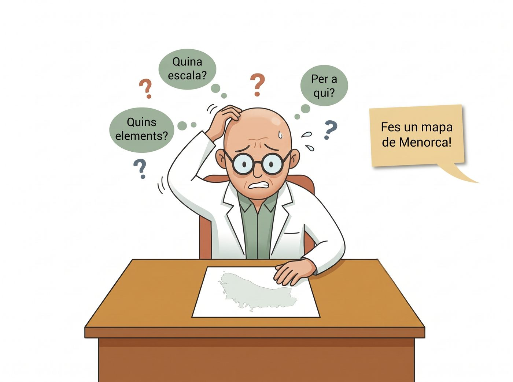

# 1.2. Els elements d'un mapa: l'escala de representació

De manera general tots sabem el que és un mapa i els elements que el conformen.
En un mapa, a més de la cartografia, hi ha d'haver un títol, una llegenda, una
orientació, les coordenades i una barra d'escala, com a mínim
([2.2 del curs bàsic](../../basic/modul-2-mapes/02-elements-dun-mapa.md)).

<figure markdown>
  { .captura }
  <figcaption>Abans de fer un mapa, cal tenir clar per a què és.</figcaption>
</figure>

Al fer un mapa és molt important tenir clar quin és el propòsit que tenim, i
escollir bé els elements a representar, la manera com els representem i l'escala
de representació per atendre el millor possible a aquest propòsit.

A l'escala ens hi volem aturar un moment perquè hi ha un parell de
consideracions a fer.

!!! info "L'escala"
    L'escala és la relació matemàtica entre una distància mesurada sobre el mapa
    i la seva distància real sobre el terreny. S'expressa com una fracció (1:D):
    per exemple, en un mapa a escala 1:25.000, 1 cm al mapa equival a 25.000 cm
    (250m) a la realitat.

    Com que és una fracció, convé recordar la regla d'or:

    - **Escala gran (denominador petit, p. ex. 1:1.000):** Les coses es veuen
      grans. Representa un territori petit amb molt de detall (el mapa d'un
      carrer).
    - **Escala petita (denominador gran, p. ex. 1:250.000):** Les coses es veuen
      petites. Representa un territori extens amb poc detall (tota l'illa de
      Menorca o les Balears).

## La precisió cartogràfica: l'error gràfic de 0,2 mm

Tota cartografia té un límit de precisió lligat a l'escala a la qual s'ha
produït. En cartografia clàssica s'assumeix que l'ull humà no és capaç de
distingir sobre el paper detalls o línies més fines de 0,2 mm. Aquesta mesura
s'anomena error gràfic i determina tant la mida mínima d'un objecte que es pot
dibuixar com el marge d'error posicional de les dades:

Precisió màxima (en metres) = (0,2 mm x Denominador de l'escala) / 1.000

Aquesta taula et serà molt útil per visualitzar la precisió d'un mapa en funció
de l'escala.

| Escala | 1 cm equival a | Marge d'error (0,2 mm) | Ús habitual |
|---|---|---|---|
| **1:1.000** | 10 m | 0,2 m (20 cm) | Cartografia urbana de detall i obra civil |
| **1:5.000** | 50 m | 1 m | Cartografia topogràfica insular o autonòmica |
| **1:25.000** | 250 m | 5 m | Mapa Topogràfic Nacional (MTN25) |
| **1:50.000** | 500 m | 10 m | Mapes generals comarcals o insulars (MTN50) |
| **1:250.000** | 2,5 km | 50 m | Mapes regionals o de síntesi |

## Què implica això quan feim servir el visor de l'IDE Menorca?

Aquest concepte en un entorn digital és especialment important. En un entorn
digital podem fer zoom fins a veure una escala d'1:100 a la pantalla, però fer
zoom no augmenta mai la precisió original de la dada. Si superposes una capa
dibuixada a escala 1:25.000 (que arrossega un marge d'error de ± 5 m) damunt una
ortofoto d'alta resolució (25 cm/píxel), és completament normal que els límits
no encaixin. L'escala d'origen de la capa és la que mana sempre sobre la
fiabilitat de qualsevol mesura o comprovació legal.

!!! info "La cartografia s'ha d'interpretar"
    Per tant una línia, posem per cas d'una cartografia a escala 1:25000, té una
    precisió en el seu posicionament de 5 metres i per tant cal INTERPRETAR la
    cartografia tenint en compte aquest fet.

??? info "Vols saber-ne més: i quan treballem amb un GPS?"
    La precisió d'un GPS dependrà del tipus de dispositiu que estiguis fent
    servir. El quadre següent n'és un resum.

    | Mètode | Com funciona | Precisió horitzontal típica |
    |---|---|---|
    | **GPS convencional** | El receptor calcula la posició només amb els satèl·lits | Uns 5 m —4,9 m en mòbils, sota cel obert— |
    | **GPS diferencial (DGPS)** | Una estació base de coordenades conegudes calcula l'error i n'envia la correcció per ones de ràdio; el receptor GPS s'hi pot connectar | Submètrica a mètrica (valor orientatiu) |
    | **Diferencial de precisió (RTK)** | Com el DGPS, però amb mesura de la fase de la portadora i enllaç en temps real amb la base | De l'ordre d'1 a 2 cm (valor orientatiu) |

## Exercici: les parets seques i el PTI

Obre el visor de l'IDE Menorca (<https://ide.cime.es/visor>) i segueix els passos i
contesta les preguntes següents:

- [ ] 1. Fes un zoom a una zona de sòl rústic on només hi hagi tanques de paret
  seca. Posa la ortofoto de 2024 de mapa de fons i posa-li una mica de
  transparència.
- [ ] 2. Carrega la capa de parets seques (Bases i mapes topogràfics → Base de
  referència IDE Menorca → Parets seques 1:5000).
- [ ] 3. Fes un zoom fins a una escala aproximada a 1:5000 i observa la
  cartografia.
- [ ] 4. Ara aproxima't al màxim que permeti el visor i torna a observar la
  cartografia. Fes una impressió de pantalla i aferra-la a la **plantilla
  d'exercicis**.
- [ ] 5. Torna a un zoom d'extensió total a Menorca (icona de la caseta).
- [ ] 6. Carrega ara el grup de capes des Sòl Rústic de la Revisió del PTI (Pla
  Territorial Insular → Revisió del PTI (2023) → Revisió PTI. 01 Sòl Rústic
- [ ] 7. Visualitza el mapa cada cop a una escala més gran. Què passa quan
  superes l'escala 1:25000? Saps interpretar per què? Escriu la resposta a la
  **plantilla d'exercicis.**

??? info "Vols saber-ne més: com podem saber a quina escala està cada cartografia?"
    Després en parlarem perquè per aquest motiu i molts d'altres que després
    veurem, es va crear el concepte de **Metadades** (les veuràs a la
    [4.3](../modul-4-visor-generic/03-metadades.md)). En tot cas aquesta taula fa
    un resum de les principals cartografies i la seva escala.

    | Cartografia | Escala de referència |
    |---|---|
    | Mapa base CAIB | 1:5000 |
    | Mapa de referència IDE Menorca | S'ajusta a l'escala del mapa fins un màxim d'escala 1:5000 en sòl rústic i 1:1000 en sòl urbà. |
    | Ortofotos de tot Menorca | En sentit estricte, **una ortofoto no té una escala fixa, sinó una resolució espacial** (la mida del píxel sobre el terreny). Tot i així, a la pràctica se li assigna una **escala equivalent** (o màxima escala d'ús) per saber amb quina cartografia vectorial es pot combinar o imprimir sense que es vegi pixelada ni perdi precisió. Per a les ortos de tot Menorca podem considerar 1:5000 |
    | Ortofotos urbanes | 1:1000 |
    | Pla Territorial Insular | 1:25000 |
    | Instruments de planejament municipal | 1:5000 en sòl rústic 1:1000 en sòl urbà |
    | Plans Directors Sectorials | 1:5000 de manera general però dependrà de l'instrument concret. |
