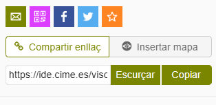
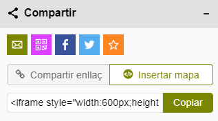

# 4.2. Compartir el mapa o incloure'l en una pàgina web

## Objectiu

En acabar aquesta secció sabràs generar un enllaç a la vista que tens oberta,
obrir el visor ja situat en un punt o en una parcel·la, i incrustar el visor en
una pàgina web.

## Passos

1. **Prepara la vista.** Posa el mapa de fons, les capes, el zoom i els dibuixos
   que vulguis ensenyar. L'enllaç ho conserva **tot**: escala, extensió, mapes de
   fons, capes carregades, objectes seleccionats, dibuixos, cerques i fitxers
   afegits.

2. **Obre Compartir.** És al panell d'eines (la icona de les eines creuades, a la
   columna esquerra). A la pestanya **Compartir enllaç** tens:

    - **Copiar**: l'enllaç va al porta-retalls, a punt per enganxar-lo a un
      correu o a un document.
    - **Escurçar**: el converteix en un enllaç curt.
    - **Codi QR**: per obrir el mapa amb el mòbil.
    - El **sobre**, per enviar-lo per correu, i les icones de xarxes socials i de
      marcadors.

    <figure markdown>
      { .captura }
      <figcaption>L'enllaç generat conserva l'estat sencer del visor.</figcaption>
    </figure>

    !!! warning "Si no el pot escurçar"
        Com més coses hi ha carregades, més llarg és l'enllaç. Si l'escurçador
        diu que l'URL és massa llarga, treu alguna capa, dibuix o resultat de
        cerca i torna-ho a provar.

3. **Obre el visor en un punt o en una parcel·la.** No sempre cal passar per
   Compartir: afegint un paràmetre a l'adreça, el visor s'obre ja situat.

    | Adreça | El visor s'obre... |
    |---|---|
    | `https://ide.cime.es/visor?x=607446&y=4415030` | Centrat en aquestes coordenades, en ETRS89 UTM 31N (EPSG:25831) |
    | `https://ide.cime.es/visor?refcad=7552201FE0175S` | A la parcel·la d'aquesta referència cadastral, ressaltada en vermell |

    !!! tip "Útil per a llistats i informes"
        Si tens un llistat de parcel·les o de punts, pots muntar l'enllaç de
        cadascun només canviant la referència o les coordenades. Amb una
        referència de 20 caràcters també funciona: el visor en fa servir els 14
        primers.

4. **Incrusta el visor en una pàgina web.** A la pestanya **Insertar mapa**
   surt el codi HTML (una etiqueta `<iframe>`) per enganxar a la pàgina, amb la
   mida que indiquis.

    <figure markdown>
      { .captura }
      <figcaption>El codi surt amb una amplada i una alçada fixes.</figcaption>
    </figure>

    !!! warning "Abans d'enganxar-lo"
        - La mida és fixa en píxels: en una pantalla petita es pot desmuntar.
        - L'adreça ha de començar per `https://`. Si la pàgina és segura, el
          navegador bloqueja els mapes que arriben per `http://`.

!!! note "Captures pendents"
    Se'n faran de noves per al curs. De moment hi ha les del manual.

## Exercici: un mapa per enviar

- [ ] Carrega una capa temàtica i fes zoom a una zona que coneguis.
- [ ] Dibuixa-hi un punt o un polígon.
- [ ] Obre **Compartir**, **copia** l'enllaç i obre'l en una **finestra
  privada** del navegador: hi has de veure el mateix, dibuix inclòs.
- [ ] Prova d'**escurçar-lo**. Si no et deixa, treu alguna cosa i torna-hi.
- [ ] Escaneja el **codi QR** amb el mòbil.
- [ ] Escriu a la barra d'adreces `https://ide.cime.es/visor?refcad=` seguit
  d'una referència cadastral de 14 caràcters i comprova que el visor s'hi
  situa.
- [ ] Obre la pestanya **Insertar mapa** i mira quina amplada i quina alçada
  porta el codi.

---

!!! tip "Al manual de referència"
    [3.4. Compartir](../../../manuals/visor-generic/03-eines/04-compartir.md)
