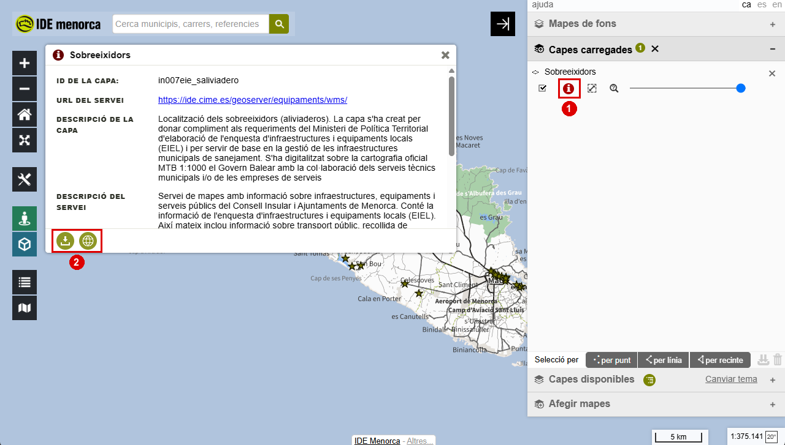
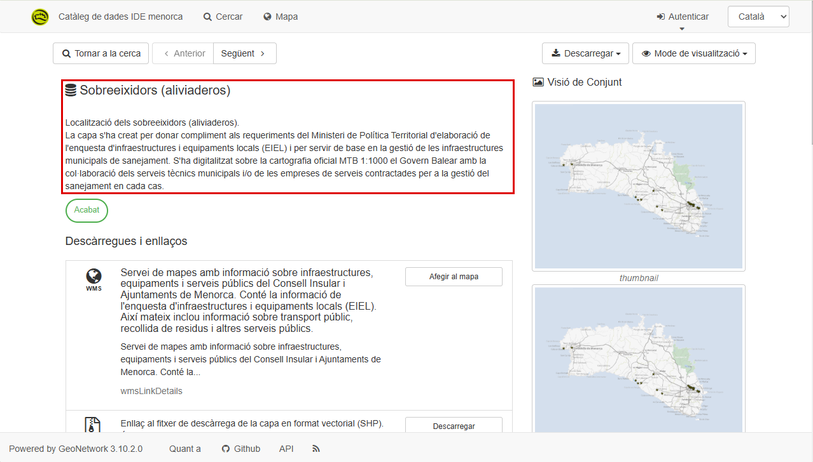

# 4.3. Metadades de la informació

## Objectiu

En acabar aquesta secció sabràs consultar d'on surt una capa, qui la manté,
cada quan s'actualitza i amb quines condicions es pot fer servir. També sabràs
descarregar-la sencera.

## Passos

1. **Obre la fitxa de la capa.** Al panell de capes, prem la **i** de la capa
   que t'interessi. Hi trobaràs:

    | Dada | Què et diu |
    |---|---|
    | Identificador i URL del servei | Com es diu la capa dins el servei i des d'on es publica |
    | Descripció de la capa i del servei | Què conté |
    | Contacte | La persona i l'organització de contacte, amb correu i telèfon |
    | Limitació d'ús i restriccions d'accés | En quines condicions la pots fer servir (la llicència) |

    <figure markdown>
      { .captura }
      <figcaption>La i obre la fitxa (1). Al peu hi ha els botons de descàrrega i de metadades completes (2).</figcaption>
    </figure>

2. **Descarrega la capa sencera.** En les capes de l'IDE Menorca, al peu de la
   fitxa hi ha un botó que baixa un ZIP amb la capa en molts formats:
   Shapefile, GeoPackage, GeoJSON, KML, DWG, DGN i l'estil SLD.

    !!! info "No és el mateix que l'eina Descarregar"
        L'eina **Descarregar** del panell d'eines baixa el que veus o el que has
        seleccionat. El botó de la fitxa baixa la **capa sencera**.

3. **Consulta les metadades completes.** L'altre botó obre la fitxa
   sencera de la capa al **catàleg de metadades** de l'IDE Menorca. Hi ha la
   informació que no cap a la fitxa del visor: el resum, les dates, cada quan
   s'actualitza, l'escala, el sistema de referència i la qualitat de les dades.

    <figure markdown>
      { .captura }
      <figcaption>La mateixa capa al catàleg de metadades.</figcaption>
    </figure>

!!! warning "Les capes d'altres organismes"
    Amb una capa afegida d'un servei extern, la fitxa no porta aquests dos
    botons.

## Exercici: d'on surt aquesta capa?

- [ ] Carrega la capa **Sobreeixidors** i obre'n la fitxa amb la **i**.
- [ ] Apunta qui n'és el contacte i amb quines condicions es pot fer servir.
- [ ] Descarrega el **ZIP** i mira quins formats hi ha a dins.
- [ ] Obre les **metadades completes** i cerca-hi a quina escala es va fer i
  cada quan s'actualitza.
- [ ] Afegeix una capa d'un servei extern ([8.5 del manual](../../../manuals/visor-generic/08-fitxers-propis.md#85-afegir-un-servei-wms)),
  obre'n la fitxa i compara-la amb la de l'IDE Menorca.

---

!!! tip "Al manual de referència"
    [2.5. Capes carregades](../../../manuals/visor-generic/02-panell-capes.md#25-capes-carregades)
