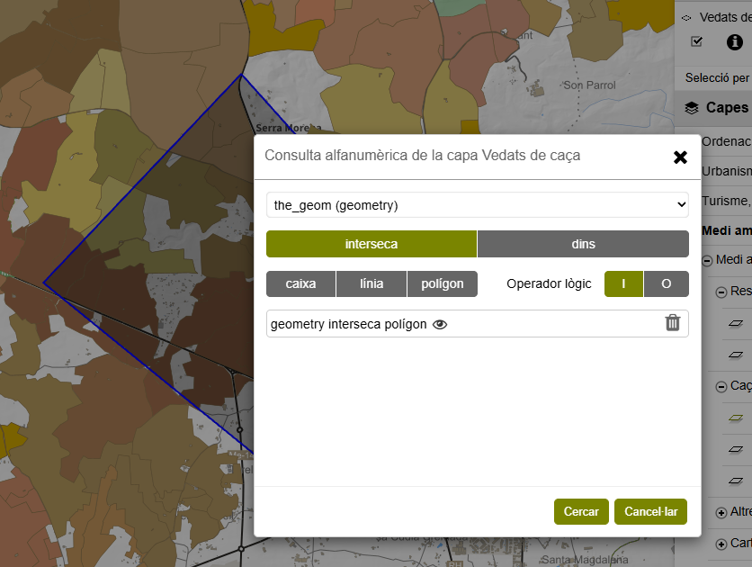
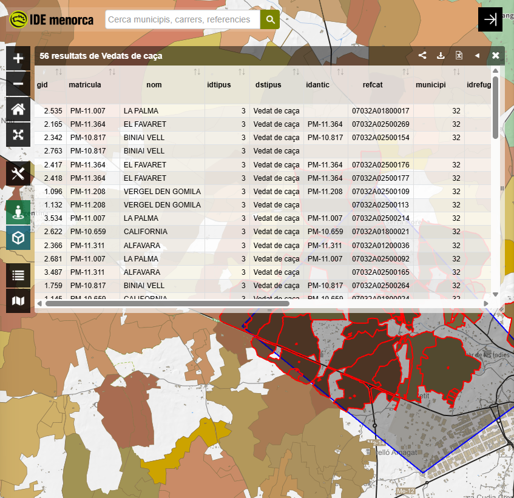

# 4.4. Selecció espacial i alfanumèrica de dades espacials

## Objectiu

En acabar aquesta secció sabràs seleccionar elements pel lloc que ocupen al mapa i pels valors dels
seus atributs.

## Selecció espacial

Al curs bàsic ja vas seleccionar elements **per punt**, **per línia** i **per
recinte** ([4.6 del curs bàsic](../../basic/modul-4-visor/06-consulta-atributs.md)).
Aquí aprendràs què pots fer amb el que has seleccionat.

1. **Selecciona uns quants elements.** Amb **per recinte**, dibuixa una zona i
   tanca-la amb doble clic.

2. **Mostra'ls tots al mapa.** Al mapa només en surt un. Prem el botó de la
   **quadrícula** del requadre de resultats: es dibuixen tots. Amb la **lupa**,
   el mapa s'hi centra.

3. **Descarrega'ls.** La **fletxa avall** del requadre baixa tots els resultats:
   KML, GML, GeoJSON, WKT, GPX, Shapefile o GeoPackage. Hi pots afegir l'elevació
   del Model Digital del Terreny.

4. **Comparteix-los.** El botó **Compartir** del requadre fa un enllaç que torna
   a obrir aquesta mateixa selecció.

!!! note "Captura pendent — `img/04-seleccio-tots-resultats.png`"
    El requadre de resultats amb «Mostrar tots els resultats al mapa» activat.

## Selecció alfanumèrica: les consultes

Ara no cerques **on és** una cosa, sinó **quines** compleixen una condició.

1. **Obre la consulta.** A **Capes carregades**, prem la **lupa** de la capa.

2. **Tria l'atribut, el criteri i el valor.** Els criteris canvien segons el
   tipus d'atribut: per a un text, «igual que», «conté», «comença per»...; per a
   un número, «major que», «menor que»... Prem **Afegir**.

3. **Afegeix-hi més criteris, si cal.** Els pots encadenar amb **i** (s'han de
   complir tots) o amb **o** (n'hi ha prou que se'n compleixi un).

4. **Prem Cercar.** Els resultats surten en una taula i ressaltats en vermell al
   mapa. Si prems una fila, el mapa s'hi centra.

!!! tip "Veure només els resultats"
    Amaga la capa al panell de capes carregades: al mapa només hi quedaran els
    elements trobats.

!!! note "Captura pendent — `img/04-consulta-dialeg.png`"
    El diàleg de consulta amb dos criteris encadenats amb «i».

## Combinar-ho: el filtre espacial

Una consulta també pot filtrar pel lloc.

1. A la llista d'atributs, tria **`the_geom`**.
2. Tria el criteri:
    - **Interseca**: els elements que toquen el que dibuixis.
    - **Dins**: només els que hi queden sencers a dins.
3. Tria què dibuixes (**caixa**, **línia** o **polígon**) i dibuixa-ho al mapa.
   El criteri apareix a la llista, sense haver de prémer **Afegir**.

    <figure markdown>
      { .captura }
      <figcaption>El polígon dibuixat ja és a la llista de criteris.</figcaption>
    </figure>

4. Prem **Cercar**. Els elements trobats surten a la taula i ressaltats en
   vermell al mapa.

    <figure markdown>
      { .captura }
      <figcaption>Els vedats de caça que toquen el polígon.</figcaption>
    </figure>

## Exercici: els registres de pluvials en mal estat

- [ ] Carrega la capa **Registres de pluvials**.
- [ ] Obre'n la consulta i cerca els que tenen `dsestat` **igual que** «Dolent».
  Quants n'hi ha?
- [ ] Afegeix-hi **i** `dsnucli` **igual que** «Maó». Quants en queden?
- [ ] Amaga la capa i mira on són.
- [ ] Descarrega els resultats en **GeoJSON**.
- [ ] Fes una consulta nova amb `the_geom` **dins** una zona que dibuixis al
  centre de Maó.

---

!!! tip "Al manual de referència"
    [4. Selecció gràfica d'elements](../../../manuals/visor-generic/04-seleccio-grafica.md)
    i [5. Consultes](../../../manuals/visor-generic/05-consultes.md)
