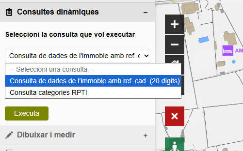

# 4.5. Consultes dinàmiques

## Objectiu

En acabar aquesta secció sabràs treure un informe de les dades d'una parcel·la o
d'un immoble a partir de la seva referència cadastral.

## Passos

1. **Obre Consultes dinàmiques.** És al panell d'eines, a la columna esquerra.

2. **Tria la consulta.** N'hi ha dues:

    | Consulta | Referència cadastral | Què et diu |
    |---|---|---|
    | **Dades de l'immoble** | De 20 caràcters (l'immoble) | Si té cèdula d'habitabilitat, certificat energètic o llicència turística, i les seves dades |
    | **Categories RPTI** | Només la de 14 caràcters (la parcel·la) | Quines categories de sòl rústic del Pla Territorial Insular toca la parcel·la, i quins riscos, amb la superfície i el percentatge de cadascun |

    Si no recordes la diferència entre les dues referències, la tens a la
    [4.7.1 del curs bàsic](../../basic/modul-4-visor/07-referencia-cadastral.md).

    <figure markdown>
      { .captura }
      <figcaption>Les dues consultes que hi ha ara mateix.</figcaption>
    </figure>

3. **Escriu la referència cadastral** i prem **Executa**.

4. **Llegeix l'informe.** S'obre en una pestanya nova. El de categories RPTI
   porta un mapa de la parcel·la per a cada tema.

!!! warning "No és un document oficial"
    L'informe té només valor informatiu: es genera automàticament amb les dades
    de l'IDE Menorca. No substitueix l'informe que pugui fer l'administració
    competent.

## Exercici: l'informe d'una parcel·la

- [ ] Treu l'informe de **Categories RPTI** de la parcel·la
  **07032A00400195**. Quina categoria de sòl ocupa més superfície?
- [ ] Té algun risc natural?
- [ ] Ara treu l'informe de **Dades de l'immoble** de la referència
  **07032A004001950001IP**. Té cèdula d'habitabilitat?
