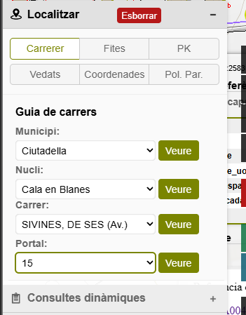
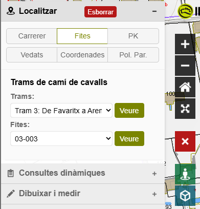
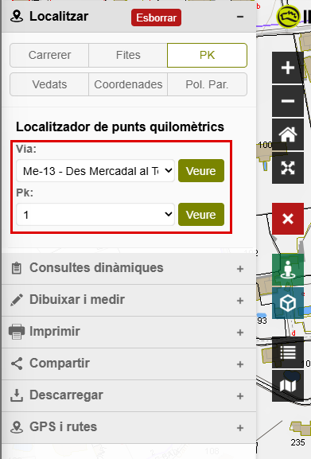
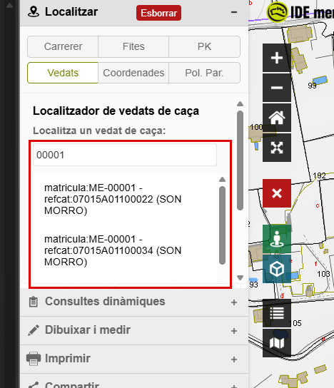
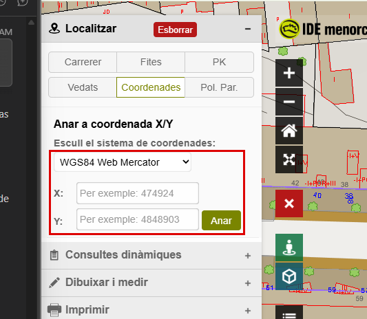
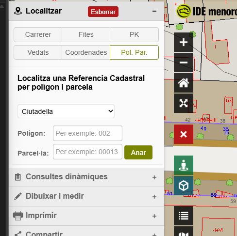

# 4.6. Localitzadors específics

## Objectiu

En acabar aquesta secció sabràs fer servir els localitzadors especialitzats: punts quilomètrics,
vedats de caça i la resta.

## Passos

1. **Obre Localitzar.** És al panell d'eines, a la columna esquerra. Té sis
   pestanyes.

2. **Tria la pestanya i omple-la:**

    | Pestanya | Per trobar... | Com |
    |---|---|---|
    | **Carrerer** | Una adreça | Municipi, nucli, carrer i portal. Cada nivell té el seu botó **Veure** |
    | **Fites** | Una fita del Camí de Cavalls | Tria el tram i la fita |
    | **PK** | Un punt quilomètric | Tria la carretera i el punt quilomètric |
    | **Vedats** | Un vedat de caça | Escriu almenys tres caràcters de la matrícula o del nom, i tria'l de la llista |
    | **Coordenades** | Un punt | Tria el sistema de referència i escriu la X i la Y |
    | **Pol. Par.** | Una parcel·la rústica | Tria el municipi i escriu el polígon i la parcel·la |

3. **Prem Veure o Anar.** El mapa s'hi centra.

4. **Neteja el mapa.** El botó vermell **Esborrar** treu del mapa el que hagis
   localitzat.

<figure markdown>
  { .captura }
  <figcaption>Carrerer</figcaption>
</figure>
<figure markdown>
  { .captura }
  <figcaption>Fites</figcaption>
</figure>
<figure markdown>
  { .captura }
  <figcaption>PK</figcaption>
</figure>
<figure markdown>
  { .captura }
  <figcaption>Vedats</figcaption>
</figure>
<figure markdown>
  { .captura }
  <figcaption>Coordenades</figcaption>
</figure>
<figure markdown>
  { .captura }
  <figcaption>Pol. Par.</figcaption>
</figure>

!!! tip "No cal escriure els zeros"
    A **Pol. Par.**, el visor completa els zeros: pots escriure «2» en lloc de
    «002».

!!! info "Tres sistemes de referència"
    A **Coordenades** pots triar WGS84 Web Mercator, ETRS89 UTM 31N o WGS84. Si
    les coordenades no et cauen on toca, comprova que has triat el sistema
    correcte.

## Exercici: sis maneres de trobar un lloc

- [ ] **Carrerer**: troba l'adreça de la teva feina.
- [ ] **Fites**: troba la fita **03-003** del tram 3 del Camí de Cavalls.
- [ ] **PK**: troba el punt quilomètric 1 de la **Me-13**.
- [ ] **Vedats**: escriu **00001**. De quina finca és el vedat?
- [ ] **Coordenades**: amb **WGS84 Web Mercator**, ves a X 474924, Y 4848903.
- [ ] **Pol. Par.**: troba una parcel·la del teu municipi.
- [ ] Neteja-ho tot amb **Esborrar**.
