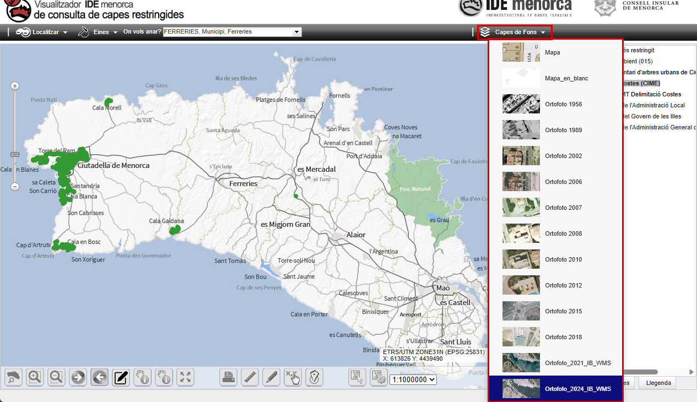
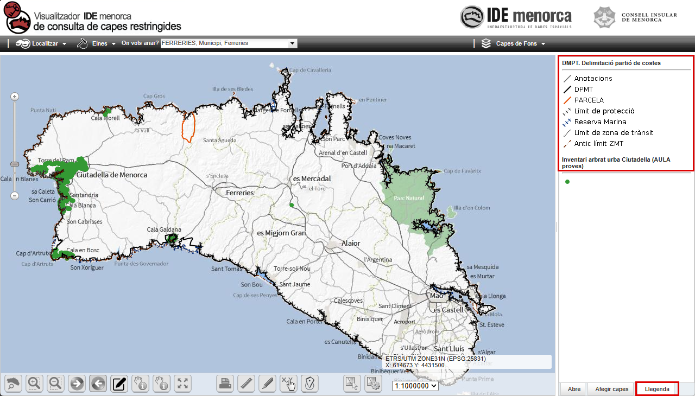

# 5.2. Control de capes i mapes de fons

## Objectiu

En acabar aquesta secció sabràs encendre capes, canviar el mapa de fons i
mirar la llegenda al visor restringit, i què canvia respecte del visor genèric.

## Capes

Les capes són al panell de la dreta, a la pestanya **Arbre**. Obre un grup amb
el **+** i marca la casella de la capa per encendre-la.

<figure markdown>
  { .captura }
  <figcaption>Les capes restringides (1) i les generals (2).</figcaption>
</figure>

1. **Capes d'accés restringit:** les que s'han configurat per al teu usuari.
2. **La resta de grups:** capes d'accés públic, com les del visor genèric ([4.5 del curs bàsic](../../basic/modul-4-visor/05-capes-tematiques.md)).

## Mapes de fons

Són al menú **Capes de Fons**, a dalt a la dreta. Tria'n un a la llista: **Mapa**,
**Mapa en blanc** o una ortofoto, de la del 1956 a la del 2024.

<figure markdown>
  { .captura }
  <figcaption>Els mapes de fons, en un menú a part.</figcaption>
</figure>

## Llegenda

La pestanya **Llegenda**, al panell de la dreta, mostra la llegenda de les
capes enceses. Al visor genèric, la llegenda és a la columna esquerra.

<figure markdown>
  { .captura }
  <figcaption>Una llegenda per a cada capa encesa.</figcaption>
</figure>

## Afegir capes

La pestanya **Afegir capes** serveix per afegir serveis i capes de fora, com
**Afegir mapes** al visor genèric. En aquest curs no la veurem.

## Exercici: capes i fons

- [ ] A **Capes d'accés restringit**, obre **Medi Ambient** i encén l'inventari
  d'arbres urbans de Ciutadella.
- [ ] Fes zoom a Ciutadella fins que vegis els arbres un per un.
- [ ] Posa de fons l'**Ortofoto 2024 IB WMS** i després
  l'**Ortofoto 2021 IB WMS**. Hi veus els mateixos arbres?
- [ ] Encén **DPMT Delimitació Costes** i obre la **Llegenda**. Quin color té
  la línia del DPMT?
- [ ] Torna a posar de fons el **Mapa**.
