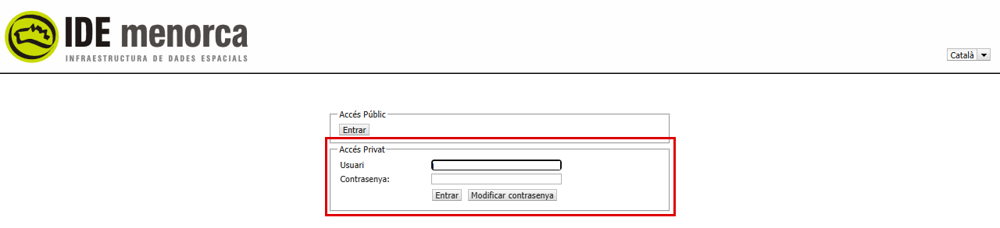
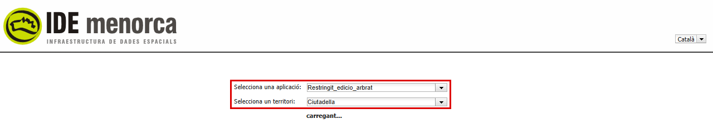
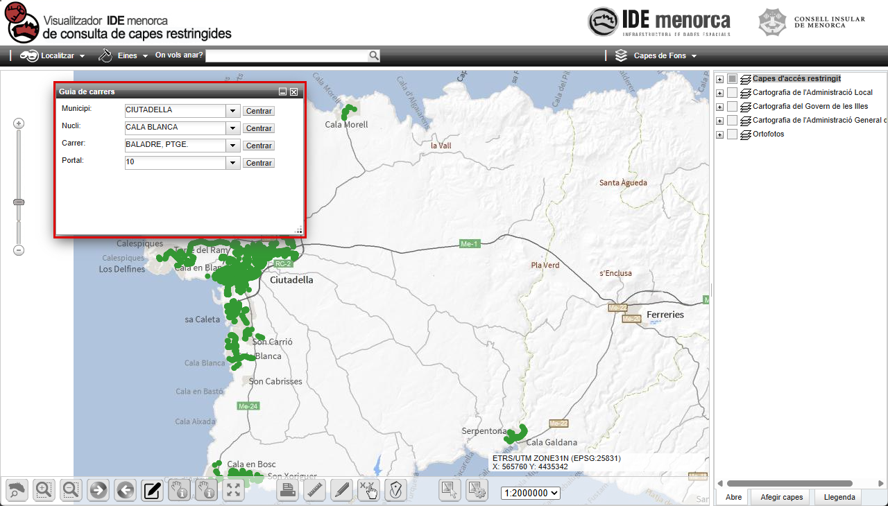
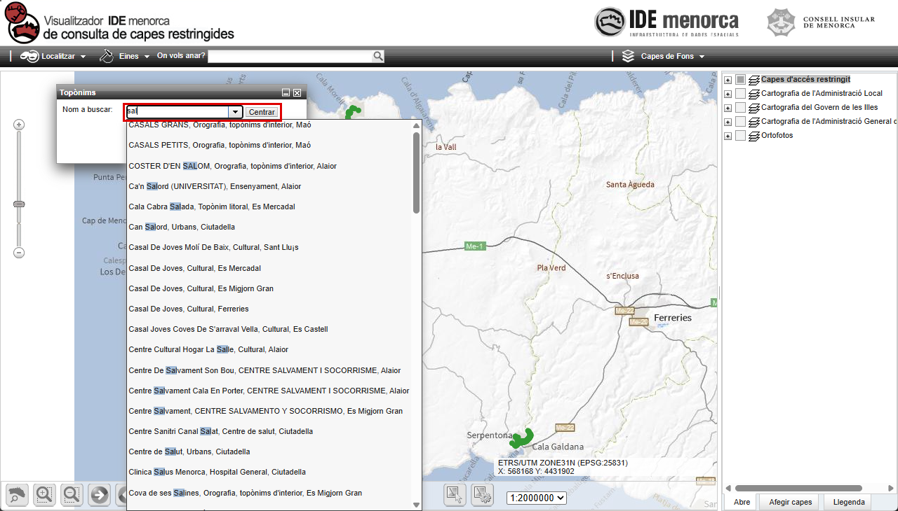
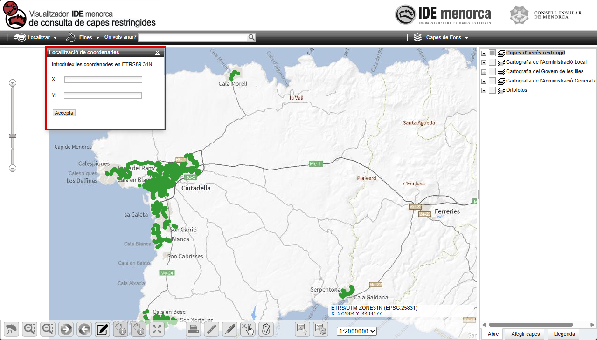

# 5.3. Eines bàsiques

## Objectiu

En acabar aquesta secció sabràs entrar al visor restringit, reconèixer-ne les
parts i trobar un lloc amb les eines del menú **Localitzar**.

## Entrar al visor

1. **Obre la pàgina d'entrada:** <https://ide.cime.es/sitmun/inicio.jsp>.

2. **Escriu l'usuari i la contrasenya** a **Accés Privat** i prem **Entrar**.

    <figure markdown>
      { .captura }
      <figcaption>L'usuari i la contrasenya del curs te'ls donarem a classe.</figcaption>
    </figure>

3. **Tria l'aplicació i el territori.** Si el teu usuari només en té un de
   cada, no cal triar: el visor hi entra directament.

    <figure markdown>
      { .captura }
      <figcaption>Amb l'usuari del curs no cal triar res.</figcaption>
    </figure>

## La vista inicial

<figure markdown>
  { .captura }
  <figcaption>Les parts del visor restringit.</figcaption>
</figure>

1. **A dalt a l'esquerra:** els menús **Localitzar** i **Eines**, i el quadre
   **On vols anar?**, que és un cercador general.
2. **A dalt a la dreta:** el menú **Capes de Fons**.
3. **A la dreta:** l'arbre de capes, amb les pestanyes **Abre**, **Afegir
   capes** i **Llegenda**.
4. **A baix:** la barra d'eines i l'escala.

## Localitzar

El menú **Localitzar** té cinc eines. Cadascuna s'obre en una finestra petita
damunt el mapa. Aquí en veurem quatre: la **Llista de Municipis** també hi és,
però no la veurem.

<figure markdown>
  { .captura }
  <figcaption>El menú Localitzar i la cerca d'infraestructures i equipaments.</figcaption>
</figure>

| Eina | Per trobar... | Com |
|---|---|---|
| **Infraestructures i equipaments** | Un equipament | Escriu el nom a **Nom a buscar** i prem **Cerca**. Marca'n un o més a la llista i prem **Centrar**: el mapa t'hi porta i els marca. **Tots** els marca tots |
| **Guia de carrers** | Una adreça | Municipi, nucli, carrer i portal. Cada nivell té el seu botó **Centrar** |
| **Topònims** | Un lloc pel seu nom | Escriu-ne un tros, tria'l de la llista i prem **Centrar**. A la llista hi surt el nom, el tipus i el municipi |
| **Localització de coordenades** | Un punt | Escriu la X i la Y en ETRS89 31N i prem **Accepta** |

!!! tip "Només t'hi porta"
    Llevat d'**Infraestructures i equipaments**, aquestes eines no deixen cap
    marca al mapa: només t'hi porten.

<figure markdown>
  { .captura }
  <figcaption>Guia de carrers</figcaption>
</figure>
<figure markdown>
  { .captura }
  <figcaption>Topònims</figcaption>
</figure>
<figure markdown>
  { .captura }
  <figcaption>Localització de coordenades</figcaption>
</figure>

!!! info "Un sol sistema de referència"
    Al visor restringit, les coordenades només es poden escriure en ETRS89 31N.
    Al visor genèric en pots triar tres
    ([4.6](../modul-4-visor-generic/06-localitzadors.md)).

## Exercici: troba-ho al visor restringit

- [ ] Entra al visor restringit amb l'usuari del curs.
- [ ] **Infraestructures i equipaments**: cerca **salut**, marca el **Centre de
  Salut Verge del Toro** i prem **Centrar**. A quin municipi és?
- [ ] **Guia de carrers**: troba l'adreça de la teva feina.
- [ ] **Topònims**: troba **Cala Cabra Salada**. De quin municipi és?
- [ ] **Localització de coordenades**: ves a X 570261, Y 4433650. Quin far hi
  trobes?
- [ ] **On vols anar?**: escriu-hi el nom d'un lloc que coneguis.
