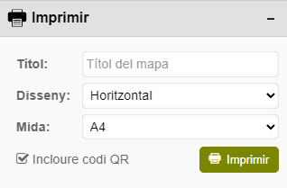
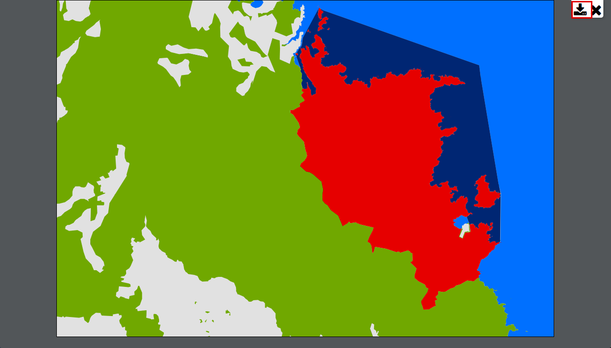

# 3.2. Imprimir

Genera un PDF del mapa que estàs veient en aquell moment.

<figure markdown>
  { .captura }
  <figcaption>El codi QR del PDF imprès porta al mapa que l'ha generat.</figcaption>
</figure>

## Opcions

| Opció | Què fa |
|---|---|
| **Títol** | Text que encapçalarà el document imprès |
| **Disseny** | Orientació del full: horitzontal o vertical |
| **Mida** | A3 o A4 |
| **Incloure codi QR** | Afegeix un codi QR que porta al mapa des del qual s'ha fet la impressió |

## Com es fa

1. Omple les opcions que vulguis.
2. Prem el botó **Imprimir**.
3. S'obre una previsualització dinàmica. Ajusta-hi l'àrea d'impressió i l'escala.
4. Prem el botó de descàrrega del PDF, al marge superior dret.

<figure markdown>
  { .captura }
  <figcaption>La previsualització permet ajustar l'enquadrament abans de generar el PDF.</figcaption>
</figure>

El PDF resultant inclou el mapa, l'escala i, si l'has demanat, el codi QR. Si tens capes
carregades, també hi apareix la seva llegenda.
