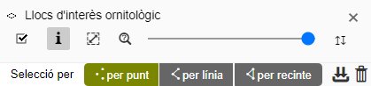
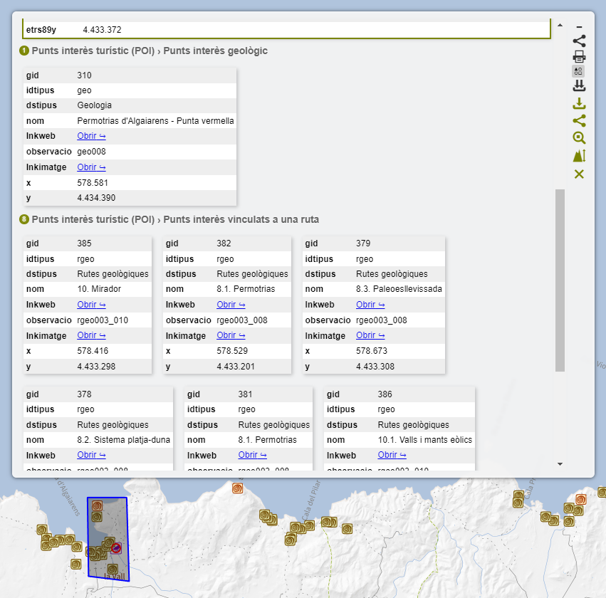
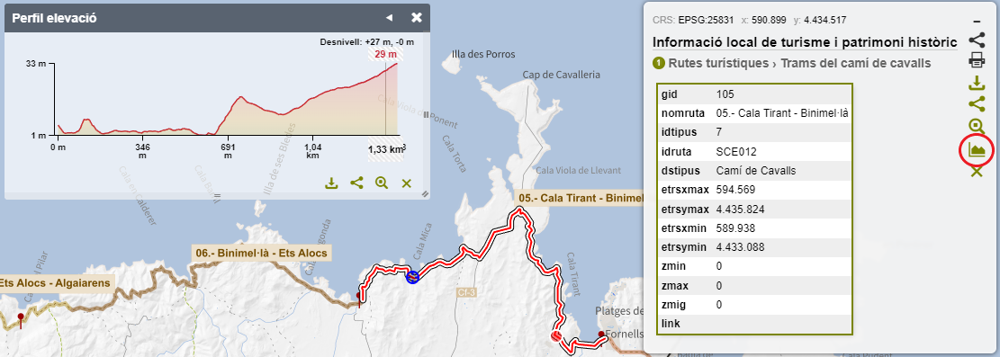

# 4. Selecció gràfica d'elements

Permet consultar la informació dels objectes geogràfics de les capes carregades fent una
selecció **espacial** sobre el mapa: per punt, per línia o per recinte.

!!! warning "Cal tenir capes carregades"
    La selecció només actua sobre capes que ja siguin al panell de
    [capes carregades](02-panell-capes.md#25-capes-carregades). Sense cap capa
    carregada, els botons **per línia** i **per recinte** apareixen apagats i no
    es poden fer servir. En carregar-ne una, s'activen.

!!! note "Capes que només tenen WMS"
    Amb una capa que només es publica per WMS, sense WFS —per exemple, una d'un
    altre organisme afegida amb
    [Afegir un servei WMS](08-fitxers-propis.md#85-afegir-un-servei-wms)—, els
    botons **per línia** i **per recinte** s'activen igualment, però no
    seleccionen res. Amb aquestes capes només funciona **per punt**.

<figure markdown>
  { .captura }
  <figcaption>La barra apareix un sol cop, al final de la llista de capes carregades.</figcaption>
</figure>

## 4.1. Tipus de selecció

| Tipus | Com es fa |
|---|---|
| **Per punt** | Un sol clic al mapa. Selecciona els objectes propers a aquell punt. És l'opció per defecte |
| **Per línia** | Dibuixa una línia; selecciona els objectes que hi intersequen. Es tanca amb doble clic |
| **Per recinte** | Dibuixa un polígon; selecciona els objectes que hi intersequen. Es tanca amb doble clic |

!!! tip "Consultar coordenades i elevació"
    La selecció per punt **sempre** dona el sistema de referència, les
    **coordenades** i l'**elevació** del punt consultat, hi hagi elements o no.
    Quan n'hi ha, la informació de les capes s'hi afegeix a sota.

Al costat dels tres botons n'hi ha dos més:

| Botó | Acció |
|---|---|
| Fletxa avall | Descarrega tots els objectes seleccionats, en diversos formats |
| Paperera | Elimina del mapa tots els objectes seleccionats |

## 4.2. El requadre de resultats

Després de qualsevol de les tres seleccions, **només un** dels objectes identificats es
dibuixa al mapa, però el requadre de resultats mostra la informació de **tots**.

<figure markdown>
  { .captura }
  <figcaption>Els resultats s'agrupen per capa; un cercle verd n'indica el nombre.</figcaption>
</figure>

Si fas clic a la taula d'atributs d'un objecte, aquell objecte es carrega al mapa i
desapareix el que s'hi estava veient abans.

Les seleccions noves **s'acumulen**: els objectes es van afegint al mapa fins que els
esborris amb algun dels botons de paperera (el negre o el vermell).

Quan els resultats provenen de diverses capes, es mostren agrupats per capa, amb un
cercle verd que indica quantes entitats s'han seleccionat de cadascuna.

## 4.3. Accions sobre tots els resultats

Els botons **negres** actuen sobre el conjunt d'objectes del requadre.

| Botó | Acció |
|---|---|
| Guió | **Tancar** el requadre |
| Compartir | Comparteix els paràmetres de la consulta: un enllaç que la reprodueix, o el codi `<iframe>` per incrustar-la. Funciona com l'eina [Compartir](03-eines/04-compartir.md) |
| Impressora | **Imprimir** la informació del requadre |
| Quadrícula | **Mostrar tots els resultats al mapa**. És un botó de dos estats |
| Fletxa avall | **Descarregar tots els resultats** |

Quan actives «Mostrar tots els resultats al mapa», es carreguen totes les entitats
alhora, es desactiven els botons verds i n'apareixen dos de nous:

| Botó | Acció |
|---|---|
| Lupa | **Centrar el mapa a tots els resultats**, a la major escala on hi càpiguen |
| Paperera | **Eliminar tots els resultats** del mapa i tancar el requadre |

La descàrrega admet KML, GML, GeoJSON, WKT, GPX, Shapefile i GeoPackage, i permet
incorporar dades d'elevació procedents del Model Digital del Terreny (MDT). El GPX no hi
surt si tot el que descarregues són polígons.

## 4.4. Accions sobre una entitat

Els botons **verds** apareixen quan al mapa es mostra un únic objecte dels resultants,
que és l'estat per defecte.

| Botó | Acció |
|---|---|
| Fletxa avall | **Descarregar l'entitat** ressaltada, amb elevacions del MDT opcionals |
| Compartir | **Compartir l'entitat** (geometria i atributs): enllaç que la centra, o codi `<iframe>` |
| Lupa | **Zoom a l'entitat**, a la major escala on càpiga |
| Creu | **Eliminar l'entitat** del mapa. Si en queden d'altres seleccionades, el requadre no es tanca |
| Muntanya amb marca | **Veure elevació**: per a entitats puntuals, afegeix una fila amb l'elevació del punt |
| Corba | **Veure perfil d'elevació**: per a entitats lineals, en mostra el perfil segons el MDT |

<figure markdown>
  { .captura }
  <figcaption>Perfil d'elevació d'una entitat lineal, calculat amb el Model Digital del Terreny.</figcaption>
</figure>
