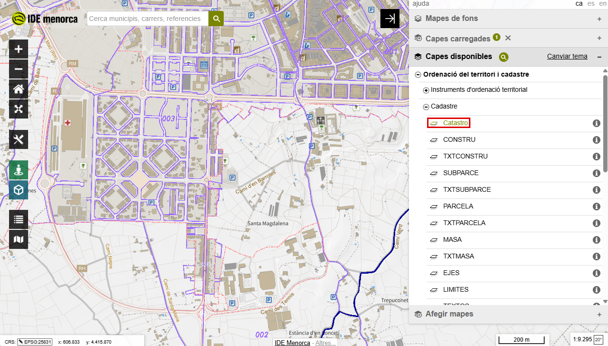
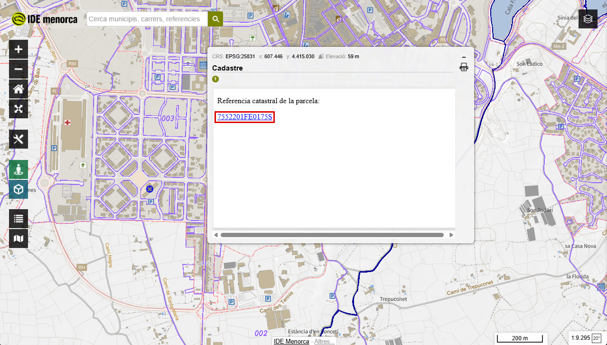

# 7. El cadastre

La cartografia cadastral no és de l'IDE Menorca: la serveix la **Direcció General
del Cadastre**. El visor la carrega com una capa més, però la consulta d'una
parcel·la no es comporta com la de la resta de capes: en comptes d'una taula
d'atributs, en retorna la **referència cadastral** en forma d'enllaç a la Seu
Electrònica del Cadastre.

## 7.1. Carregar la cartografia cadastral

Les capes del cadastre són a **Capes disponibles**, dins **Ordenació del
territori i cadastre → Cadastre**.

<figure markdown>
  { .captura }
  <figcaption>La capa Catastro dibuixa la cartografia cadastral sencera.</figcaption>
</figure>

La capa **`Catastro`** dibuixa la cartografia cadastral sencera: és la que es
carrega habitualment. El grup en conté unes quantes més, amb el nom que els dona
el servei del Cadastre:

`CONSTRU`, `TXTCONSTRU`, `SUBPARCE`, `TXTSUBPARCE`, `PARCELA`, `TXTPARCELA`,
`MASA`, `TXTMASA`, `EJES`, `LIMITES`.

!!! warning "A verificar: què dibuixa cadascuna"
    Els noms suggereixen que són les peces soltes de la cartografia —parcel·les,
    construccions, subparcel·les, masses, eixos i límits— i que les `TXT` en són
    les etiquetes de text, però **no s'ha comprovat al visor**. Tampoc no s'ha
    comprovat si la llista s'acaba a `LIMITES`: a la captura el desplegable
    continua més avall.

    Cal carregar-les una per una i descriure-les, o decidir que al manual només
    hi ha de sortir `Catastro` i la resta queden com a noms del servei.

## 7.2. Trobar una parcel·la per la seva referència

El quadre de cerca de la capçalera, el mateix que troba municipis, carrers i
equipaments, accepta també **referències cadastrals**. En escriure'n una, el
visor s'hi situa.

## 7.3. Consultar una parcel·la

Amb la capa carregada, un clic sobre una parcel·la obre el requadre de resultats
de la [selecció gràfica](04-seleccio-grafica.md). A dalt hi surten, com sempre,
el sistema de referència, les coordenades i l'elevació del punt; a sota, en
comptes d'una taula d'atributs, hi ha la **referència cadastral de la parcel·la**
com a enllaç.

<figure markdown>
  { .captura }
  <figcaption>La referència cadastral és, alhora, l'enllaç que obre la fitxa oficial.</figcaption>
</figure>

L'enllaç obre la **Seu Electrònica del Cadastre** en una pestanya nova, amb les
dades d'aquella parcel·la. El visor es queda obert a la pestanya d'abans.

!!! note "Només s'hi pot imprimir"
    Aquest requadre no porta els botons de descarregar ni de compartir que tenen
    les capes pròpies: només el d'imprimir.

!!! warning "A verificar: les altres capes del grup"
    Només s'ha provat la consulta sobre `Catastro`. No se sap si les altres
    capes del grup retornen el mateix enllaç, una taula d'atributs o res.

## 7.4. Què certifica cada cosa

El visor serveix per **situar** la parcel·la i veure-la en context. El document
amb validesa oficial surt de la **Seu Electrònica del Cadastre**, no del visor.
