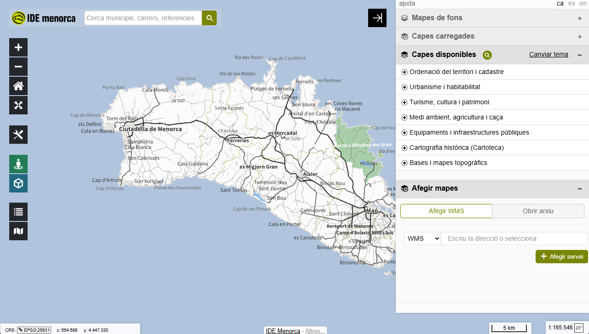
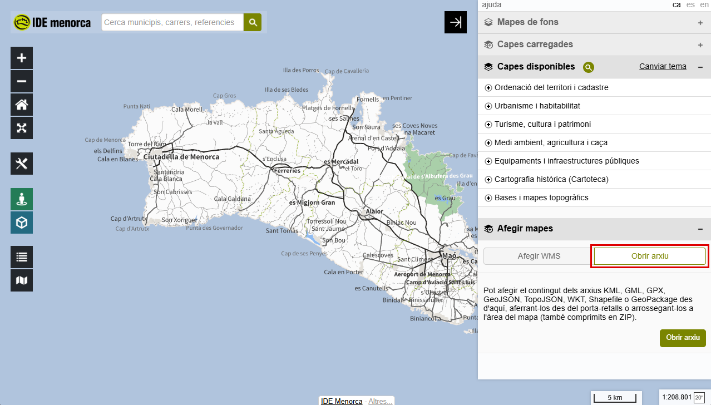
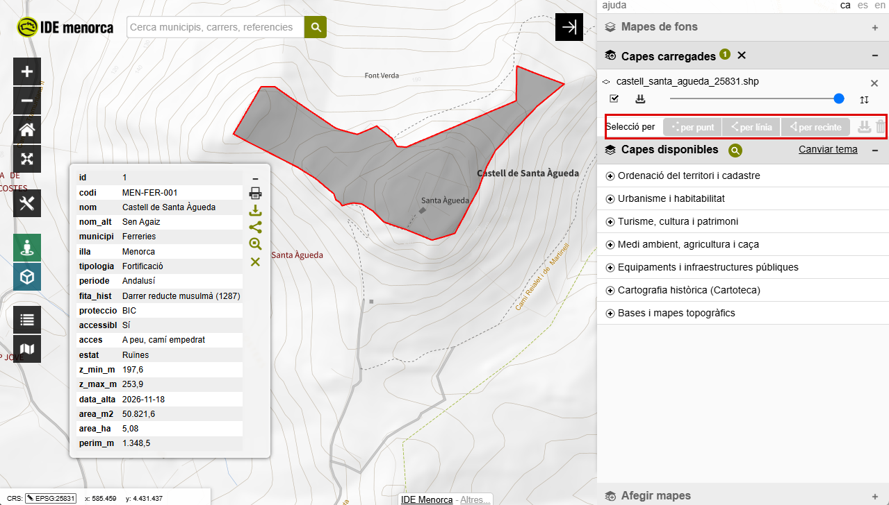

# 8. Afegir mapes i arxius

A més de les capes del catàleg, el visor pot carregar serveis de mapes d'altres
organismes i fitxers de cartografia del teu ordinador.

## 8.1. On es carreguen

La secció **Afegir mapes** és al final del panell de capes, sota **Capes
disponibles**. Té dues pestanyes:

| Pestanya | Per a què serveix |
|---|---|
| **Afegir WMS** | Connectar un servei de mapes extern a partir de la seva adreça |
| **Obrir arxiu** | Carregar un fitxer de l'ordinador |

<figure markdown>
  { .captura }
  <figcaption>Afegir mapes, al final del panell de capes, serveix tant per a serveis com per a fitxers.</figcaption>
</figure>

La pestanya **Afegir WMS** es descriu a la [8.5](#85-afegir-un-servei-wms).

## 8.2. Formats admesos i maneres de carregar

Des de la pestanya **Obrir arxiu**, el visor accepta **KML**, **GML**, **GPX**,
**GeoJSON**, **TopoJSON**, **WKT**, **Shapefile** i **GeoPackage**, també
comprimits en **ZIP**.

<figure markdown>
  { .captura }
  <figcaption>La pestanya Obrir arxiu diu quins formats accepta i de quines maneres.</figcaption>
</figure>

Hi ha tres maneres de carregar un fitxer, i totes tres van a parar al mateix lloc:

1. Triar-lo amb el botó **Obrir arxiu**.
2. Aferrar-lo des del porta-retalls.
3. Arrossegar-lo damunt l'àrea del mapa.

El sistema de referència del fitxer no importa: el visor el reprojecta.

Tres coses a tenir en compte segons el format:

- Un **Shapefile** són com a mínim quatre fitxers —`.shp`, `.shx`, `.dbf` i
  `.prj`— i s'han de carregar junts: dins un ZIP o seleccionant-los tots quatre
  alhora.
- Els **GPX** no van a **Capes carregades**: es carreguen a l'eina **GPS i
  rutes**.
- Només el **KML** porta els seus propis colors i símbols, i el visor els
  manté.

## 8.3. Com es comporta un fitxer carregat

El fitxer apareix a **Capes carregades** amb el seu nom, i s'hi queda encara
que recarreguis la pàgina.

!!! info "El fitxer es queda al navegador"
    No es puja a cap servidor: el visor el llegeix i el guarda al teu
    navegador. Per això hi continua quan recarregues la pàgina.

<figure markdown>
  { .captura }
  <figcaption>La fila d'un fitxer propi no porta les mateixes icones que la d'una capa del catàleg.</figcaption>
</figure>

La seva fila no porta les mateixes icones que les de
[2.5. Capes carregades](02-panell-capes.md#25-capes-carregades):

| Icona | Nom | Què fa |
|---|---|---|
| Fletxa avall sobre una safata | **Descarregar** | Torna a treure el fitxer en el format que triis |
| Casella | **Visibilitat** | Activa o desactiva la visualització |
| Barra lliscant | **Control de transparència** | Igual que a qualsevol capa |
| Fletxes verticals | **Canviar l'ordre** | Prem i arrossega amunt o avall |

A la dreta del nom, la **creu** treu el fitxer del mapa.

No hi són, en canvi, la **informació de la capa**, el **zoom a l'extensió de la
capa** ni les **consultes**.

La fila **Selecció per** del final del panell surt **apagada**. Tot i així, un
clic damunt un element del fitxer n'obre el requadre amb la taula d'atributs.

## 8.4. Tornar a descarregar el fitxer

La icona de descàrrega de la fila del fitxer el torna a treure en **KML**,
**GML**, **GeoJSON**, **WKT**, **Shapefile** o **GeoPackage**. És una manera de
convertir de format sense sortir del visor.

L'eina **Descarregar** del panell d'eines
([3.3. Descarregar](03-eines/03-descarregar.md)) **no** baixa els fitxers
propis: només treballa amb les capes del catàleg. Amb un fitxer teu carregat i
cap capa del catàleg, avisa que no hi ha capes carregades.

## 8.5. Afegir un servei WMS

La pestanya **Afegir WMS** carrega al visor un servei de mapes d'un altre
organisme, encara que no sigui al catàleg de l'IDE Menorca. És la que surt
oberta a la captura de la [8.1](#81-on-es-carreguen).

1. Escriu l'adreça (URL) completa del servei al camp **Escriu la direcció o
   selecciona**.
2. Prem **Afegir servei**.
3. El servei s'afegeix a **Capes disponibles**. D'allà en carregues les capes
   com les de qualsevol altre servei
   ([2.3. Cercar i afegir capes](02-panell-capes.md#23-cercar-i-afegir-capes)).

!!! info "El servei ha d'admetre el sistema de referència del visor"
    Si les capes d'un servei no admeten el sistema de referència que tens
    posat, el visor les marca amb una icona d'avís i no les deixa carregar
    fins que no el canviïs per un que el servei admeti
    ([1.6](01-interficie.md#16-sistema-de-coordenades-i-coordenades-del-cursor)).

!!! tip "On trobar adreces de serveis"
    El directori de serveis de la [Plataforma IDEE](https://plataforma.idee.es/)
    recull els serveis web de moltes administracions, amb la seva adreça.
